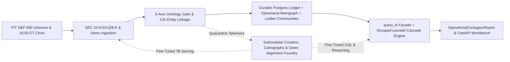

# YarnBall

**Point-in-Time Financial GraphRAG & Supply-Chain Contagion Intelligence Platform**

YarnBall reconstructs corporate supply-chain, subsidiary, and risk networks from statutory SEC filings (`Form 10-K`, `10-Q`, `8-K`, `Exhibit 21`) and market event streams under strict bitemporal U.S. equity session cutoffs (`16:00 ET` regular close / `13:00 ET` early close). When an operational shock occurs, YarnBall propagates capacity shortfalls through a deterministic Grouped-Leontief cascade engine with inventory buffer absorption and cyclic feedback damping, emitting provenance-graded **Domain 1** operational contagion reports anchored to verbatim filing chunks.



---

## Documentation & Dual-Lens Technical Report Series

YarnBall is documented as a **5-Chapter Dual-Lens Technical Report** ([ADR-00040](docs/decisions/ADR-00040-ch0-system-atlas-and-docs-integrity-----.md)). Each chapter pairs a domain and quantitative technical report (**Part A**: *What & Why*) with an AST-verified software anatomy, call-graph, and schema reference (**Part B**: *Where & How*):

| Chapter | Artifact | Scope | Governing ADR |
| :---: | :--- | :--- | :---: |
| **Ch. 0** | [**System Atlas & Architecture Overview**](docs/technical-report/00-system-atlas.md) | Why naive RAG fails in finance, Domain 1 vs. Domain 2 wall, Topic-Level UML, Pre-ADR/ADR atlas, 13-package AST graph, FastAPI/Docker/SQL catalog | [ADR-00040](docs/decisions/ADR-00040-ch0-system-atlas-and-docs-integrity-----.md) |
| **Ch. 1** | `docs/technical-report/01-pit-universe-and-ingestion.md` *(planned)* | Survivorship-free S&P 500 PiT universe, stock-split registry, `16:00 ET` market clock, 8-K sanitization, `800`/`120` chunking & Pass-2 gleaning | [ADR-00041](docs/decisions/ADR-00041-ch1-pit-universe-and-statutory-ingestion.md) |
| **Ch. 2** | `docs/technical-report/02-ontology-linkage-and-ledger.md` *(planned)* | 20-class / 26-predicate 5-axis ontology, clause hedge/negation gates, CIK Union-Find linkage, `1024`-d SCD2 `pgvector`, Postgres ledger vs. RAM Memgraph & Leiden communities | [ADR-00042](docs/decisions/ADR-00042-ch2-ontology-entity-linkage-and-ledger--.md) |
| **Ch. 3** | `docs/technical-report/03-retrieval-contagion-and-reporting.md` *(planned)* | `query_bi` facade, Cypher AST guardrails, hybrid RRF seeding, Grouped-Leontief cascade & TTS timing math, `OperationalContagionReport` & Workbench UI | [ADR-00043](docs/decisions/ADR-00043-ch3-retrieval-contagion-and-reporting---.md) |
| **Ch. 4** | `docs/technical-report/04-curation-and-model-foundry.md` *(planned)* | MinHash/SemDeDup/Facility Location coresets, Dataset Cartography, manifold sampling, inflection-lag DPO, LoRA-to-GGUF fusion & multi-judge torture evaluation | [ADR-00044](docs/decisions/ADR-00044-ch4-curation-cartography-model-foundry--.md) |

- **Architecture Decision Registry**: [`docs/decisions/index.md`](docs/decisions/index.md) (`ADR-00001` through `ADR-00044`)
- **Documentation Portal & Static AST API Reference**: [`docs/index.md`](docs/index.md) and [`docs/reference/index.md`](docs/reference/index.md)

---

## Quickstart

### 1. Local Environment & Verification

```bash
python -m venv .venv
.venv/bin/pip install -e ".[dev,retrieval,explorer,communities,docs]"

# Static typing & test suites (offline-safe without live Postgres/Memgraph)
.venv/bin/mypy
.venv/bin/pytest --ignore=tests/knowledge_graph/test_embedding_store.py -v
.venv/bin/pytest tests/docs/ -v
```

### 2. Offline Contagion Dry Run & Local Workbench

```bash
# Execute deterministic offline Form 8-K disruption & cascade dry run
.venv/bin/python -m tools.dry_run_sec_8k_contagion --use-mock

# Launch local read-only FastAPI KG & Form 8-K Audit Workbench (http://127.0.0.1:8050)
.venv/bin/python -m tools.serve_explorer --port 8050
```

### 3. Full Deployable Stack (PostgreSQL + Ephemeral Memgraph + Kafka + Retrieval API)

```bash
cp .env.example .env
docker compose up --build -d

# Check deep readiness across Postgres, schema metadata, Memgraph hydration, embedder & Ollama
curl -s http://localhost:8000/ready | python -m json.tool
```

### 4. Local Documentation Site (MkDocs Material + `mkdocstrings`)

```bash
.venv/bin/mkdocs serve
# Strict static build verification:
.venv/bin/mkdocs build --strict
```

---

## Architectural & Data Governance Invariants

1. **Domain 1 Scope Wall ([ADR-00010](docs/decisions/ADR-00010-directional-basket-peer-cluster-mapping-.md), [ADR-00011](docs/decisions/ADR-00011-operational-contagion-report-schema-----.md))**: Runtime APIs and reports quantify physical/contractual supply-chain contagion (`shock_onset_day`, `unbuffered_downtime_days`, `capacity_contraction_pct`, `provenance_tier`) and never emit portfolio weights, price targets, or trading recommendations.
2. **Historical vs. Live Data Partitioning**: Multi-year historical backfills and SFT datasets (`2018–2025+`) ground strictly on SEC EDGAR (`edgartools`), `yfinance` daily OHLCV, point-in-time S&P 500 registries (`universe/`), local FNSPID Parquet archives, and cached transcripts. `Finnhub` is reserved exclusively for forward live streaming.
3. **Fail-Fast & Epistemic Honesty ([ADR-00036](docs/decisions/ADR-00036-fail-fast-infra-and-deployable-topology-.md), [ADR-00037](docs/decisions/ADR-00037-pit-community-layer-and-impact-ranking--.md))**: Storage and embedder outages raise typed errors (`503`) unless explicit test mock env vars are enabled, and `ReportCoverage` explicitly surfaces edge truncation and default-parameter impact share.
