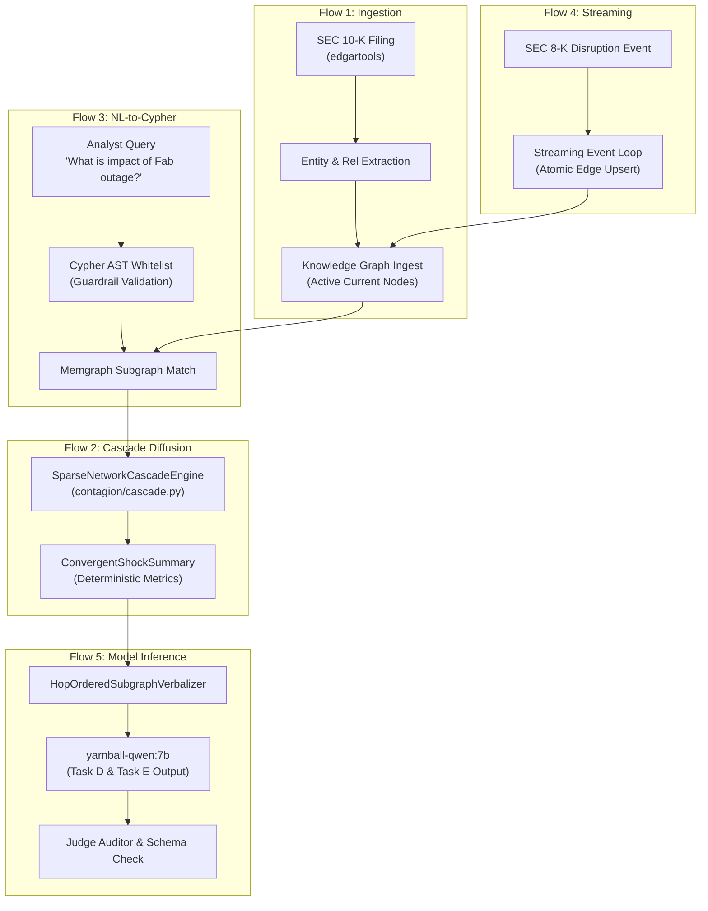

# ADR-00008: SIT Harness Audit & Unified Contract

<!--
STRICT FILENAME CONVENTION:
- Format: ADR-[5_DIGIT_ID]-[40_CHARACTER_SLUG].md
- Total Filename Length: Exactly 53 characters (including '.md')
- Slug Specification: Exactly 40 characters using lowercase alphanumeric and hyphens.
- Padding Rule: If the natural slug is under 40 characters, pad with trailing hyphens ('-').
Filename: ADR-00008-sit-harness-audit-and-unified-contract--.md (53 chars)
-->

- **ADR ID**: ADR-00008
- **Filename**: `ADR-00008-sit-harness-audit-and-unified-contract--.md`
- **Date**: 2026-11-11 04:35 UTC
- **Status**: PROPOSED
- **Target Subsystem**: `evaluation` / `integration`
- **Linked Commits**: None (Design Proposed for Review)

---

## 1. Context & Problem Statement

Between ADR-00001 and ADR-00005, the platform implemented five individual System Integration Test (SIT) flows:
- **SIT Flow 1** ([ADR-00005](ADR-00005-sit-flow-1-pit-sec-filing-to-kg-ingest--.md)): Point-in-Time (PiT) SEC filing ingestion to Knowledge Graph.
- **SIT Flow 2** ([ADR-00001](ADR-00001-sit-flow-2-event-shock-contagion-harness.md)): Event shock vector & contagion propagation.
- **SIT Flow 3** ([ADR-00002](ADR-00002-sit-flow-3-nl-to-cypher-rag-e2e-harness-.md)): Natural Language to Cypher GraphRAG end-to-end harness.
- **SIT Flow 4** ([ADR-00003](ADR-00003-sit-flow-4-streaming-event-graph-update-.md)): Real-time streaming event loop and dead-letter quarantine.
- **SIT Flow 5** ([ADR-00004](ADR-00004-sit-flow-5-model-foundry-alignment-smoke.md)): Model Foundry alignment smoke test (SFT, DPO, SafeTensors merge).

While each flow passes unit verification independently, two architectural gaps exist:
1. **Contagion Engine Divergence**: SIT Flow 2 originally exercised the legacy linear BFS function `traverse_multi_hop_contagion()` in `retrieval/shock_propagation.py`. In Phase 7 ([ADR-00006](ADR-00006-phase-7-sparse-network-cascade-engine---.md)), the platform upgraded to `SparseNetworkCascadeEngine` in `contagion/cascade.py`. Flow 2 must be formally upgraded to assert the convergent grouped-Leontief engine.
2. **Lack of a Unified E2E Contract**: There is currently no single macro-integration test that chains all 5 flows sequentially in one execution: ingesting raw filings $\to$ streaming an event $\to$ compiling Cypher $\to$ computing shock diffusion $\to$ evaluating the aligned 7B model.

---

## 2. Decision Drivers & Constraints

1. **Strict End-to-End Compatibility**:
   - The output of Flow $N$ must serve as the direct input to Flow $N+1$ without manual translation, mock shims, or out-of-band schema conversions.
2. **Single-Command Verification**:
   - The entire platform integration must execute via a single command:
     `pytest tests/integration/test_unified_sit_contract.py -v`
     completing in $< 15$ seconds under mock driver mode.
3. **Zero Magic Numbers**:
   - Thresholds, schemas, and assertions must be cross-referenced with ADR-00001 through ADR-00007.

---

## 3. Considered Alternatives & Rejection Rationale

- **Alternative A: Retain Disconnected Flow Tests**:
  - Keep the 5 test files isolated in `tests/integration/pipelines/`.
  - *Rejection Rationale*: Fails to test cross-flow contract breaking changes (e.g. Flow 1 changing entity node labels breaks Flow 3 Cypher compilation).
- **Alternative B: Live External Database Orchestration (Docker Compose Mandatory)**:
  - Require live Memgraph, Neo4j, and PostgreSQL containers running during CI.
  - *Rejection Rationale*: Slows test runs and introduces environmental flakiness. The unified harness must support both fully mocked offline isolation and live container execution via environment flag `YARNBALL_LIVE_INTEGRATION=1`.

---

## 4. Proposed Architecture: The Unified SIT Flow

### Concrete Deliverables

1. **Flow 2 Modernization**:
   - Refactor `tests/integration/pipelines/test_event_shock_propagation_flow.py` to assert `SparseNetworkCascadeEngine` and `ConvergentShockSummary` metrics directly.
2. **Unified Contract Test**:
   - Create `tests/integration/test_unified_sit_contract.py` implementing `test_full_platform_lifecycle_e2e()`.

---

## 5. Invariants & Guardrails

1. **State Preservation Invariant**:
   - Ingesting an 8-K event must update edge statuses to `TERMINATED_HISTORICAL` or add new `DISRUPTED_CURRENT` edges without mutating point-in-time historical filings.
2. **Zero In-Pipeline Hallucination**:
   - The final Task D and Task E prompts must strictly contain the exact numerical output emitted by `ConvergentShockSummary`.

---

## 6. Consequences & Downstream Impact

- **Positive / Guarantees**:
  - Provides mathematical and operational certainty that the entire YarnBall platform works as a single machine.
  - Upgrades Flow 2 to modern Phase 7 cascade standards.
- **Negative / Trade-offs**:
  - Requires maintaining an end-to-end mock state that tracks filings through to model prompt generation.

