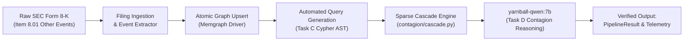

# ADR-00009: SEC 8-K Computational Reading & Contagion Dry Run

<!--
STRICT FILENAME CONVENTION:
- Format: ADR-[5_DIGIT_ID]-[40_CHARACTER_SLUG].md
- Total Filename Length: Exactly 53 characters (including '.md')
- Slug Specification: Exactly 40 characters using lowercase alphanumeric and hyphens.
- Padding Rule: If the natural slug is under 40 characters, pad with trailing hyphens ('-').
Filename: ADR-00009-sec-8k-computational-reading-dry-run----.md (53 chars)
-->

- **ADR ID**: ADR-00009
- **Filename**: `ADR-00009-sec-8k-computational-reading-dry-run----.md`
- **Date**: 2026-11-11 04:35 UTC
- **Status**: PROPOSED
- **Target Subsystem**: `retrieval` / `contagion` / `evaluation`
- **Linked Commits**: None (Design Proposed for Review)

---

## 1. Context & Problem Statement

YarnBall's core capability is the **computational reading of unstructured corporate regulatory disclosures** (SEC Form 8-K, Item 1.01, 1.02, 1.03, or 8.01) to trace supply-chain contagion and operational disruption across interconnected networks of companies.

While isolated unit tests prove functional correctness across individual modules, we lack a cohesive, push-button **end-to-end dry-run tool** that:
1. Ingests a raw SEC Form 8-K text payload.
2. Extracts the material disruption event (loss ratio, duration, affected components).
3. Atomically merges the event into the live knowledge graph.
4. Traverses active supply-chain paths and executes `SparseNetworkCascadeEngine` to calculate multi-tier capacity loss, inventory buffer delays, and unbuffered downtime.
5. Emits the platform's native [`PipelineResult`](../../retrieval/pipeline.py#L62) containing hop-ordered subgraph topology, deterministic shock summaries, and the aligned model's Chain-of-Thought contagion assessment.

Downstream trading decisions, directional basket construction, and portfolio hedging belong to a separate, downstream decision domain. This ADR focuses strictly on proving the upstream intelligence pipeline works reliably on authentic regulatory text.

---

## 2. Decision Drivers & Constraints

1. **End-to-End Processing Throughput (< 30 Seconds)**:
   - The end-to-end Python pipeline must complete ingestion, graph mutation, cascade diffusion, and model verbalization within **30 seconds** of receiving the 8-K payload.
   - Microsecond HFT latency is explicitly non-goal; depth of extraction, mathematical grounding, and operational assessment fidelity are the primary criteria.
2. **Authentic SEC 8-K Regulatory Grounding**:
   - The dry run must parse authentic corporate disclosure schemas conforming to `.agents/rules/data_sources.md` (using local SEC filing fixtures such as `tests/fixtures/filings/aapl_8k_disruption.json` or real Form 8-K filings via `edgartools`).
3. **Native Platform Schema Grounding (`PipelineResult`)**:
   - The dry-run output must strictly utilize existing, verified platform contracts:
     - [`PipelineResult`](../../retrieval/pipeline.py#L62) from the retrieval orchestrator.
     - [`ConvergentShockSummary`](../../contagion/cascade.py#L211) from the cascade engine.
   - Avoid premature, ungrounded external trading signal schemas.
4. **Strict Offline Isolation**:
   - Zero live broker APIs, external HTTP endpoints, or remote sockets (`socket.socket.connect` blocked).

---

## 3. Considered Alternatives & Rejection Rationale

- **Alternative A: Synthetic Mock Event Generation**:
  - Invent fictional tickers and hypothetical shock payloads.
  - *Rejection Rationale*: Fails to test authentic SEC legal language, item numbering, and realistic company ticker mapping.
- **Alternative B: Coupling to Downstream Trading / Portfolio Schemas**:
  - Forcing the dry-run tool to emit speculative trade signals (long/short baskets, option strikes).
  - *Rejection Rationale*: Violates domain boundaries. Downstream strategy and portfolio construction constitute a distinct domain that consumes YarnBall's output. YarnBall's core responsibility is objective, factual computational reading and operational contagion assessment.

---

## 4. Proposed Architecture: Dry-Run Pipeline



### Native Output Contract (`PipelineResult`)

The dry-run tool executes `GraphRAGPipelineOrchestrator.run()` and emits a structured report conforming to [`PipelineResult`](../../retrieval/pipeline.py#L62):

```python
PipelineResult(
    query="Assess operational supply-chain contagion resulting from Cirrus Logic 8-K fab halt.",
    as_of_date="2024-10-28",
    cypher_query="MATCH (s:Company {ticker: 'CRUS'})-[r:SUPPLIES_TO]->(t:Company) ...",
    is_valid_query=True,
    retrieved_subgraph=[
        {"source": "CRUS", "target": "AAPL", "share": 0.20, "buffer_days": 45.0, "nature": "audio_codecs"},
        {"source": "CRUS", "target": "HPQ", "share": 0.10, "buffer_days": 90.0, "nature": "audio_codecs"}
    ],
    convergent_shock_summary=ConvergentShockSummary(
        target_entity="AAPL",
        peak_shock_pct=20.0,
        impairment_score=0.20,
        onset_day=45.0,
        downtime_days=15.0,
        lost_capacity_days=3.0,
        verdict="CONTAINED_MINIMAL_CONTAGION"
    ),
    cascade_summaries={
        "AAPL": ConvergentShockSummary(...),
        "HPQ": ConvergentShockSummary(target_entity="HPQ", peak_shock_pct=0.0, downtime_days=0.0, verdict="TOLERATED_BUFFERED")
    },
    verbalized_subgraph="### Deterministic Cascade Shock Metrics ...",
    contagion_verdict="Apple Inc. (AAPL) experiences CONTAINED_MINIMAL_CONTAGION resulting from a 20.0% peak capacity contraction ...",
    contagion_think_trace="Analyzing Cirrus Logic (CRUS) audio codec fab halt of 60 days ...",
    latency_breakdown_ms={
        "task_c_cypher_ms": 12.4,
        "guardrail_validation_ms": 1.1,
        "graph_execution_ms": 4.2,
        "cascade_engine_ms": 2.8,
        "task_d_contagion_ms": 145.0
    },
    total_latency_ms=165.5
)
```

### Concrete Deliverables

1. **Tool Implementation**: Author `tools/dry_run_sec_8k_contagion.py`.
   - Accepts an SEC Form 8-K JSON payload or raw text path.
   - Merges the event into the graph.
   - Executes the full orchestrator flow and prints a clean, structured inspection summary.
2. **Automated Integration Test**: Author `tests/integration/test_dry_run_8k_contagion.py`.
   - Runs `tools/dry_run_sec_8k_contagion.py` under offline isolation.
   - Asserts end-to-end execution $< 30\text{s}$, exact numerical metric preservation, and valid CoT `<think>` traces.

---

## 5. Invariants & Guardrails

1. **Deterministic Metric Preservation**:
   - The textual explanation emitted by `yarnball-qwen:7b` in `contagion_verdict` must cite the exact numerical percentages, downtime days, and onset days computed by `SparseNetworkCascadeEngine`.
2. **Buffer Absorption Invariant**:
   - Downstream nodes whose inventory buffer covers the shock duration ($B \ge h_u D_u$) must be classified as `TOLERATED_BUFFERED` or `NEUTRAL_UNAFFECTED` with $0.0$ unbuffered downtime days.
3. **Domain Boundary Invariant**:
   - The dry-run harness operates strictly within the computational reading and contagion domain. It does not emit speculative trading signals, broker orders, or portfolio allocations.

---

## 6. Consequences & Downstream Impact

- **Positive / Guarantees**:
  - Provides a single, reproducible push-button dry run proving the core computational reading test works on authentic SEC 8-K data.
  - Generates verified, factual Operational Contagion Reports ready for downstream strategy and backtesting modules.
  - Closes the feedback loop between raw unstructured legal disclosures and deterministic network math.
- **Negative / Trade-offs**:
  - Requires maintaining high-fidelity SEC 8-K fixtures in the test suite.
