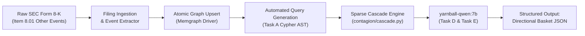

# ADR-00009: SEC 8-K to Directional Basket Dry Run

<!--
STRICT FILENAME CONVENTION:
- Format: ADR-[5_DIGIT_ID]-[40_CHARACTER_SLUG].md
- Total Filename Length: Exactly 53 characters (including '.md')
- Slug Specification: Exactly 40 characters using lowercase alphanumeric and hyphens.
- Padding Rule: If the natural slug is under 40 characters, pad with trailing hyphens ('-').
Filename: ADR-00009-sec-8k-to-directional-basket-dry-run----.md (53 chars)
-->

- **ADR ID**: ADR-00009
- **Filename**: `ADR-00009-sec-8k-to-directional-basket-dry-run----.md`
- **Date**: 2026-11-10 23:35
- **Status**: PROPOSED
- **Target Subsystem**: `retrieval` / `contagion` / `evaluation`
- **Linked Commits**: None (Design Proposed for Review)

---

## 1. Context & Problem Statement

YarnBall's core trading thesis is to capture directional stock movements that unfold across groups of equities over **1 to 4 hours** following a material corporate disclosure (SEC Form 8-K, Item 1.01, 1.02, 1.03, or 8.01). 

While unit tests prove isolated function logic, we lack an operational **end-to-end dry-run script** that:
1. Ingests a raw SEC Form 8-K text payload.
2. Updates the live knowledge graph with the shock event.
3. Automatically triggers the `GraphRAGPipelineOrchestrator`.
4. Computes multi-tier capacity loss via `SparseNetworkCascadeEngine`.
5. Synthesizes an immediate, structured **Directional Basket Trade Signal** via `yarnball-qwen:7b`.

Without a concrete dry-run tool, testing the pipeline requires manual orchestration across multiple scripts.

---

## 2. Decision Drivers & Constraints

1. **Realistic Market Execution Horizon (1 to 4 Hours)**:
   - The end-to-end Python pipeline must complete execution within **30 seconds** of receiving the 8-K payload.
   - Microsecond HFT latency is explicitly non-goal; depth of extraction, mathematical grounding, and directional signal accuracy are the primary criteria.
2. **Authentic SEC 8-K Regulatory Grounding**:
   - The dry run must parse authentic corporate disclosure schemas, conforming to `.agents/rules/data_sources.md` (using local SEC filing fixtures such as `tests/fixtures/filings/aapl_8k_disruption.json` or real Form 8-K filings via `edgartools`).
3. **Structured Directional Basket Schema**:
   - The output cannot be a generic conversational chat response. It must emit a strict, machine-readable JSON structure specifying the exact directional trade:
     - `SHORT_BASKET`: Unbuffered, high-exposure downstream customers facing production halts.
     - `LONG_BASKET`: Unimpacted competitors / substitute suppliers gaining market share.
     - `NEUTRAL_QUARANTINE`: Companies with adequate buffer cover ($h_u D_u \le B$) to prevent false positive shorting.

---

## 3. Considered Alternatives & Rejection Rationale

- **Alternative A: Synthetic Mock Event Generation**:
  - Invent fictional tickers and hypothetical shock payloads.
  - *Rejection Rationale*: Fails to test authentic SEC legal language, item numbering, and realistic company ticker mapping.
- **Alternative B: Live Broker API Integration (e.g., Alpaca / Interactive Brokers)**:
  - Wire automated order submission directly to a live trading sandbox.
  - *Rejection Rationale*: Premature. Automated order execution introduces API dependencies and risk before the signal generation pipeline has been thoroughly vetted.

---

## 4. Proposed Architecture: Dry-Run Pipeline



### Proposed Output Schema (`DirectionalBasketSignal`)

```json
{
  "event_id": "SEC_8K_20241028_AAPL_DISRUPT",
  "disrupted_entity": "CRUS",
  "event_summary": "Cirrus Logic audio codec fab outage halts 100% of capacity for 60 days.",
  "execution_horizon": "INTRA_DAY_1_TO_4_HOURS",
  "short_basket": [
    {
      "ticker": "AAPL",
      "exposure_pct": 20.0,
      "unbuffered_downtime_days": 15.0,
      "rationale": "High direct component exposure exceeds 45-day inventory buffer."
    }
  ],
  "long_basket": [
    {
      "ticker": "NXPI",
      "rationale": "Direct substitute supplier in audio/mixed-signal processing; captures displaced allocation."
    }
  ],
  "quarantine_neutral": [
    {
      "ticker": "HPQ",
      "rationale": "Holds 90-day inventory buffer; operational halt fully absorbed."
    }
  ]
}
```

### Concrete Deliverables

1. **Tool Implementation**: Author `tools/dry_run_8k_directional_basket.py`.
2. **Automated Integration Test**: Author `tests/integration/test_dry_run_8k_basket.py` verifying $< 30\text{s}$ execution and valid JSON emission.

---

## 5. Invariants & Guardrails

1. **Buffer Immunity Invariant**:
   - Any company whose Time-to-Survive (TTS) buffer exceeds shock duration ($B \ge h_u D_u$) must be quarantined in `quarantine_neutral` and NEVER placed in the `short_basket`.
2. **Deterministic Metric Injection**:
   - The `rationale` emitted by the model must cite the exact numerical shock percentages and downtime days computed by `SparseNetworkCascadeEngine`.

---

## 6. Consequences & Downstream Impact

- **Positive / Guarantees**:
  - Provides a single push-button dry-run harness proving the platform operates on authentic unstructured data to produce actionable trade signals.
  - Establishes the exact JSON contract needed for downstream order routing.
- **Negative / Trade-offs**:
  - Requires maintaining authentic SEC 8-K test fixtures.
