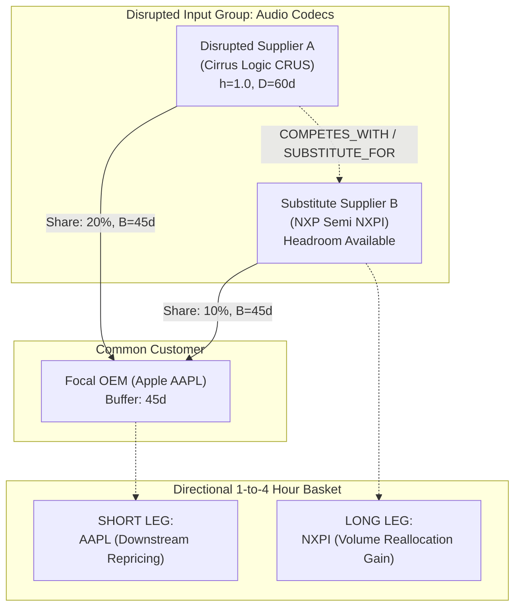

# ADR-00010: Directional Basket & Peer Cluster Mapping

<!--
STRICT FILENAME CONVENTION:
- Format: ADR-[5_DIGIT_ID]-[40_CHARACTER_SLUG].md
- Total Filename Length: Exactly 53 characters (including '.md')
- Slug Specification: Exactly 40 characters using lowercase alphanumeric and hyphens.
- Padding Rule: If the natural slug is under 40 characters, pad with trailing hyphens ('-').
Filename: ADR-00010-directional-basket-peer-cluster-mapping-.md (53 chars)
-->

- **ADR ID**: ADR-00010
- **Filename**: `ADR-00010-directional-basket-peer-cluster-mapping-.md`
- **Date**: 2026-11-11 04:35 UTC
- **Status**: REJECTED
- **Target Subsystem**: `ontology` / `retrieval` / `contagion`
- **Linked Commits**: None (Proposal Rejected)

---

## 1. Context & Problem Statement

> [!CAUTION]
> **FORMAL REJECTION NOTICE (2026-11-12)**:
> This ADR is formally **REJECTED**. It attempted to position YarnBall as an intraday pairs-trading generator and market-maker tool (introducing 1-to-4 hour directional trading baskets, long/short legs, and options overlays).
>
> Per the architectural domain boundary established in [ADR-00011](ADR-00011-operational-contagion-report-schema-----.md) and verified in [ADR-00009](ADR-00009-sec-8k-computational-reading-dry-run----.md):
> 1. **Domain 1 (Operational & Physical Contagion - YarnBall Core)**: The platform's sole mandate is the computational reading of regulatory filings (SEC Form 8-K), graph traversal, and deterministic network cascade modeling ($h_v, B_v, D_v, L_v$).
> 2. **Domain 2 (Market Strategy & Portfolio Decision - Downstream Consumer)**: Evaluating asset prices, liquidity, pairs trading, directional long/short baskets, and execution windows belongs strictly to external downstream consumers. YarnBall does not trade, make markets, or emit order recommendations.
>
> The historical proposal text below is retained for archival governance purposes only.

To trade directional basket moves over a **1 to 4 hour** horizon following a disruption event, a trader cannot merely short the downstream victims (`SUPPLIES_TO`). A pure short position carries uncompensated market beta risk—if the broader S&P 500 rallies 2% during that 4-hour window, the short trade can be stopped out even if the underlying company analysis was completely correct.

To achieve beta-neutral or market-hedged directional returns, the trading desk requires **pair trades and balanced baskets**:
1. **Short Leg**: The unbuffered downstream victim experiencing severe capacity contraction.
2. **Long Leg**: The peer rival or substitute supplier that produces the identical input group and will capture the displaced procurement volume.

Currently, YarnBall's knowledge graph primarily indexes vertical supply chains (`SUPPLIES_TO`, `CUSTOMER_OF`, `SUBSIDIARY_OF`). It lacks first-class horizontal competitor and substitute relationships (`COMPETES_WITH`, `SUBSTITUTE_FOR`), making it difficult to generate balanced directional baskets algorithmically.

---

## 2. Decision Drivers & Constraints

1. **Horizontal Peer & Substitute Ontology**:
   - The knowledge graph schema must support horizontal peer relationships partitioned by specific GICS sub-industries and product input groups.
2. **Displaced Market Share Allocation Formula**:
   - When Supplier $A$ suffers capacity contraction $h_A$, the displaced volume flows to competing substitute suppliers $k \in \text{Peers}(A)$ proportional to their available capacity headroom:
     $$\Delta \text{Share}(k) = \frac{\text{Capacity}(k)}{\sum_{j \in \text{Peers}(A)} \text{Capacity}(j)} \times (h_A \cdot \text{Share}(A \to C))$$
3. **Graph Retrieval & Verbalization Protocol**:
   - During GraphRAG traversal, the Cypher query must expand both vertically (downstream victims) and horizontally (substitute beneficiaries) in a single query.

---

## 3. Considered Alternatives & Rejection Rationale

- **Alternative A: Broad Industry ETF Hedging (e.g., Short Apple, Long XLK/SMH)**:
  - Hedge single-stock shorts using sector ETFs.
  - *Rejection Rationale*: Sector ETFs are noisy and diluted. If Apple drops because of a specific Cirrus Logic audio chip shortage, shorting Apple while longing the broad tech ETF (which is 20% Apple) produces negative tracking error. High-conviction single-stock substitute pairs (e.g., Long NXP Semiconductors, Short Cirrus Logic) offer significantly higher alpha.
- **Alternative B: Pure Qualitative LLM Guessing of Competitors**:
  - Ask the LLM in the prompt: *"Who are the competitors of Company X?"*
  - *Rejection Rationale*: LLMs frequently hallucinate competitors across unrelated sub-sectors or miss regulatory distinctions. Competitor and substitute mappings must be formally verified in the knowledge graph ontology.

---

## 4. Proposed Architecture: Horizontal Cluster Extension

### Concrete Schema Extensions (`ontology/schema.py`)

1. **Relation Types**:
   - `COMPETES_WITH`: Horizontal peer relationship within identical GICS sub-industry.
   - `SUBSTITUTE_FOR`: Product-level interchangeability edge within a specific `input_group`.
2. **Edge Properties**:
   - `switching_cost_tier`: `LOW`, `MODERATE`, `PROHIBITIVE`.
   - `headroom_capacity_pct`: Estimated surge headroom available to absorb displaced volume.
3. **Pipeline Verbalizer Update**:
   - Update `HopOrderedSubgraphVerbalizer` to render `[BENEFICIARY_SUBSTITUTES]` alongside `[VICTIM_CUSTOMERS]`.

---

## 5. Invariants & Guardrails

1. **Zero Prohibitive Switching Invariant**:
   - If an edge carries `switching_cost_tier: PROHIBITIVE` (e.g. custom ASIC with 18-month requalification cycle), that peer must NOT be proposed as an immediate intra-day long candidate.
2. **Input Group Match Invariant**:
   - A substitute supplier can only be designated as a beneficiary if their `SUBSTITUTE_FOR` relationship matches the exact `input_group` of the disrupted component.

---

## 6. Consequences & Downstream Impact

- **Positive / Guarantees**:
  - Transforms YarnBall from a single-directional alert system into a true **market-neutral directional pairs trading generator**.
  - Protects traders from broader market beta shocks during the 1-to-4 hour execution window.
- **Negative / Trade-offs**:
  - Increases graph construction complexity by requiring horizontal peer relationships to be extracted and validated alongside supply chains.

