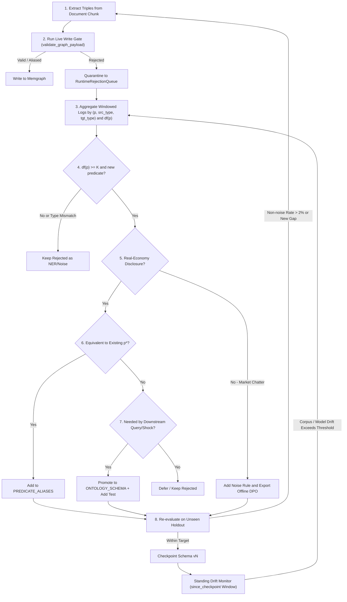

# ADR-00031: Iterative Predicate Sufficiency & Quarantine Convergence Protocol

- **ADR ID**: ADR-00031
- **Filename**: `ADR-00031-iterative-predicate-convergence-protocol.md`
- **Date**: 2026-11-14 23:05 UTC
- **Status**: ACCEPTED
- **Target Subsystem**: `ontology` / `sft_pipeline` / `knowledge_graph` / `retrieval`
- **Linked Commits**: [`7f5a754`](../../sft_pipeline/rejection_queue.py), [`7f5a754`](../../ontology/convergence.py), [`7f5a754`](../../ontology/validation.py)

---

## 1. Context & Problem Statement

[`ADR-00023`](ADR-00023-unified-live-ontology-gate-and-schema---.md) closed the open-world predicate bypass and converged Memgraph writers onto a single canonical TBox ([`ontology/schema.py`](../../ontology/schema.py)) backed by strict write-time gating (`validate_graph_payload`) and quarantine logging (`RuntimeRejectionQueue`).

However, static inspection alone cannot prove that a closed predicate vocabulary is **empirically sufficient** across diverse SEC 10-K/8-K filings, financial news streams, and swapped local Qwen models:

1. Over-narrow ontologies silently starve downstream contagion/Cypher queries if recurring financial relationships get dropped at the gate without review.
2. Uncurated schema expansion in response to isolated model phrasings fragments graph edge types and hurts Text-to-CQL accuracy.
3. Because `ADR-00024` (clause-scoped negation/hedging) and `ADR-00025` (entity placeholder stoplist and dynamic CIK rollup) also sit inside the pre-write quality gate, empirical predicate convergence must run *after* those noise filters stabilize so quarantine metrics reflect genuine predicate gaps rather than upstream boilerplate noise.

---

## 2. Decision Drivers & Constraints

1. **Evidence-Driven Over Guesswork**: Ontology growth and alias additions must be driven by observed quarantine telemetry (`data/rejection_queue/`) over representative financial corpora rather than manual speculation.
2. **Model-Swap Resilience**: Upgrading to newer local Qwen weights behind [`YarnBallModelClient`](../../sft_pipeline/serving/model_client.py) requires a deterministic calibration loop that absorbs benign phrasing shifts via `PREDICATE_ALIASES` before requiring full SFT retraining.
3. **Zero Schema Bloat**: Synonyms and inverted verbs map deterministically onto existing canonical predicates (`ONTOLOGY_SCHEMA`); new predicates are added only when downstream analytical competency questions (supply-chain, ownership, credit/governance, risk exposure) require them.
4. **Sequence Dependency**: Execution of this protocol depends on `ADR-00023` (strict gate & quarantine), plus completion of `ADR-00024` and `ADR-00025` so hedged/placeholder noise does not distort predicate rejection frequencies.

---

## 3. Considered Alternatives & Rejection Rationale

- **Alternative A: Freeze `ONTOLOGY_SCHEMA` Permanently After `ADR-00023`**:
  - *Rationale for Rejection*: Risks blind spots on newly observed financial contract structures or upgraded model vocabularies without an empirical feedback channel.
- **Alternative B: Allow Dynamic Runtime Addition of Arbitrary Predicates**:
  - *Rationale for Rejection*: Reintroduces the open-world drift eliminated by `ADR-00023` and breaks [`retrieval/guardrails/schema_guardrail.py`](../../retrieval/guardrails/schema_guardrail.py) WHITELIST invariants.

---

## 4. Decision Outcome

Establish a bounded, multi-pass **Iterative Predicate Convergence Loop** executed over representative 10-K, 8-K, and news calibration batches once Wave 1 (`ADR-00023`–`ADR-00025`) is active.

### 4.1 Ground Truth Anchors (Design-Time Decision Basis)

Because ontologies are task-bounded engineering contracts rather than natural laws, triage decisions during calibration MUST be grounded against three concrete anchors:

1. **Regulatory Disclosure Fidelity**: Does the captured source text express an auditable real-economy operational, ownership, credit, governance, or risk mechanism (SEC Reg S-K / ASC 280 narrative scope; explicitly excluding trading/market-making chatter rejected in [`ADR-00010`](ADR-00010-directional-basket-peer-cluster-mapping-.md))? Optionally consult FIBO definitions strictly to disambiguate legal/corporate-control terminology.
2. **Non-Redundancy Against `ONTOLOGY_SCHEMA`**: Does an existing canonical predicate (forward or swapped) already support the identical downstream graph traversal semantics?
3. **Downstream Competency Utility**: Does omitting the predicate cause [`TextToCQL`](../../retrieval/text_to_cql.py), shock contagion traversal ([`retrieval/shock_propagation.py`](../../retrieval/shock_propagation.py)), or materiality tiering ([`ontology/compiler.py`](../../ontology/compiler.py)) to miss a required analytical answer?

### 4.2 End-to-End Convergence Algorithm

Starting from the converged baseline `ONTOLOGY_SCHEMA` and `PREDICATE_ALIASES` in [`ontology/schema.py`](../../ontology/schema.py):

1. **Extract Candidate Triples**: Run [`YarnBallModelClient`](../../sft_pipeline/serving/model_client.py) on document chunk $D$ and parse completions via `parse_extraction_payload` into candidate triples $(s, \tau_s, p, t, \tau_t)$ (or `(none)`).
2. **Enforce Live Write Gate (`validate_graph_payload`)**:
   - Drop generic placeholder nodes/edges (`GENERIC_PLACEHOLDER_*`).
   - Rewrite known aliases ($p \in \text{PREDICATE\_ALIASES}$, flipping $s \leftrightarrow t$ when `swap=True`).
   - If canonical $p \in \text{ONTOLOGY\_SCHEMA}$ and $(\tau_s, \tau_t)$ passes SHACL domain/range checks (directly or auto-oriented), **write to Memgraph** and stop for this triple.
   - Otherwise, **quarantine** $(s, \tau_s, p, t, \tau_t, \text{source\_id}, \text{snippet})$ into [`RuntimeRejectionQueue`](../../sft_pipeline/rejection_queue.py) (`ONTOLOGY_PRUNING`).
3. **Aggregate Quarantine Signatures**: Across the calibration batch, group `ONTOLOGY_PRUNING` failures by unique signature $(p, \tau_s, \tau_t)$ sorted by distinct document frequency $df(p)$, displaying sample snippets via a grouped summary report (`python -m sft_pipeline.rejection_queue`).
4. **Filter Support & Typing Errors**:
   - Discard one-off signatures below support threshold ($df(p) < K$, default $K = 3$ distinct documents).
   - If $p \in \text{ONTOLOGY\_SCHEMA}$ and failed strictly on entity-type mismatch (e.g., `Company -> CEO_OF -> Company`), leave rejected as a model/NER error without widening domain/range axioms.
5. **Reject Off-Domain Noise (Bucket 3)**: Inspect sample source snippets; if $p$ describes price moves, peer comparisons, or journalist attribution (`CORRELATES_WITH`, `OUTPERFORMS`, `TRADED_IN`), add $p$ to `NON_SCHEMA_NOISE_PREDICATES`, export rejected samples via `export-dpo` (`chosen="(none)"`) for [`ADR-00012`](ADR-00012-qwen-model-upgrade-and-fine-tuning-plan-.md), and stop.
6. **Alias Equivalent Verbs (Bucket 1)**: If $p$ encodes the exact same traversal meaning as an existing $p^* \in \text{ONTOLOGY\_SCHEMA}$ (forward or swapped), insert `PREDICATE_ALIASES[p] = (p*, swap)` in [`ontology/schema.py`](../../ontology/schema.py) and stop.
7. **Promote New Schema Entry (Bucket 2)**: Only if Steps 5–6 fail AND Competency Anchor #3 confirms downstream analytical need, add $p$ to `RelationPredicate` and `(valid_src_types, valid_tgt_types, is_symmetric)` in `ONTOLOGY_SCHEMA` (prompts and [`schema_guardrail.py`](../../retrieval/guardrails/schema_guardrail.py) inherit automatically) plus unit tests.
8. **Checkpoint Release `vN` & Monitor Drift**: Re-run Steps 1–3 on an unseen holdout split. Once non-noise `ONTOLOGY_PRUNING` rejections fall below target ($\le 2\%$ of candidate triples per batch) with zero recurring gaps, tag **schema release `vN`** and enter standing quarantine monitoring—re-entering Step 3 whenever real-world filing terminology, new risk mechanisms, or local Qwen model weights (`ADR-00012`) introduce fresh drift.

### 4.3 Computational Cost & Time Complexity Guarantees

Ontology learning NEVER runs inline with inference or triggers GPU work on live traffic:

- **Online Production Gate (`validate_graph_payload`)**: Strictly $O(|V| + |E|)$ CPU-only hash lookups (`GENERIC_NOUN_STOPLIST`, `PREDICATE_ALIASES`, `ONTOLOGY_SCHEMA`), chunk-local DFS for ownership cycles, and $O(1)$ amortized JSONL append on rejection. Overhead is sub-millisecond per chunk with **$0\text{ B}$ extra GPU VRAM**.
- **Offline Quarantine Aggregation**: Windowed single-pass aggregation scans only daily `rejections_YYYYMMDD.jsonl` files newer than the previous checkpoint cursor (`since_checkpoint`), giving **$O(R_{\text{window}})$ CPU time** and **$O(U)$ memory** ($U$ unique predicate signatures), independent of total historical archive size.
- **Adaptation Budget**: `PREDICATE_ALIASES` (Bucket 1) and `ONTOLOGY_SCHEMA` (Bucket 2) updates require **$0\text{ GPU cost}$** and zero retraining. Contrastive DPO refinement over Bucket 3 noise (`export-dpo`) runs strictly as an opt-in offline batch job ([`ADR-00012`](ADR-00012-qwen-model-upgrade-and-fine-tuning-plan-.md)) outside live serving.

### 4.4 Scholarly & Literature Foundations

This protocol adapts established knowledge-graph ontology engineering and OpenIE canonicalization work to a local closed-world financial pipeline:

- **Iterative Competency-Question Design**: Grüninger & Fox (1995) and Noy & McGuinness (2001, *"Ontology Development 101"*) — defines incremental ontology bootstrapping validated against concrete downstream competency questions.
- **Open Knowledge Base Relation Canonicalization**: Vashishth et al. (WWW 2018, *"CESI: Canonicalizing Open Knowledge Bases using Embeddings and Side Information"*) — groups unaligned open-extraction predicates using type signatures and lexical/contextual cues.
- **LLM Extract–Define–Canonicalize (EDC)**: Zhang & Soh (EMNLP 2024, *"Extract, Define, Canonicalize: An LLM-based Framework for Knowledge Graph Construction"*) — decouples extraction from schema contextualization and post-hoc canonicalization onto either a fixed or induced non-redundant schema.

---

## 5. Invariants & Guardrails

1. **Downward-Propagating Single Registry**: All promotions in Bucket 2 MUST be applied solely in [`ontology/schema.py`](../../ontology/schema.py) so prompts, Tier-4 repair, and Cypher AST guardrails stay synchronized automatically.
2. **No Unaliased Ad-Hoc Writes During Calibration**: Calibration runs MUST inspect rejections from Memgraph write-time quarantine rather than disabling `strict=True`.
3. **Holdout & Checkpoint Windowing**: Calibration checkpoints MUST verify holdout accuracy on an unseen split and advance a `since_checkpoint` date cursor so offline scans remain bounded ($O(R_{\text{window}})$) rather than re-reading unbounded history.
4. **Zero Online Learning / Zero Extra GPU Budget**: Production ingestion MUST execute zero online clustering, embedding, or fine-tuning inside the write-time gate.
5. **Zero Absolute Paths Invariant**: All references remain strictly repository-relative (`../../<path>`).

---

## 6. Consequences & Downstream Impact

- **Positive / Guarantees**:
  - Replaces guesswork with measurable, repeatable convergence criteria grounded in production-format data.
  - Creates a clean upgrade playbook whenever `yarnball-qwen:7b` is swapped to a newer local Qwen architecture.
  - Feeds verified contrastive DPO negatives directly from quarantine into the model foundry ([`ADR-00012`](ADR-00012-qwen-model-upgrade-and-fine-tuning-plan-.md)).
- **Negative / Trade-offs**:
  - Requires periodic human-in-the-loop review of quarantine summaries during calibration passes (or when onboarding new base model weights).
