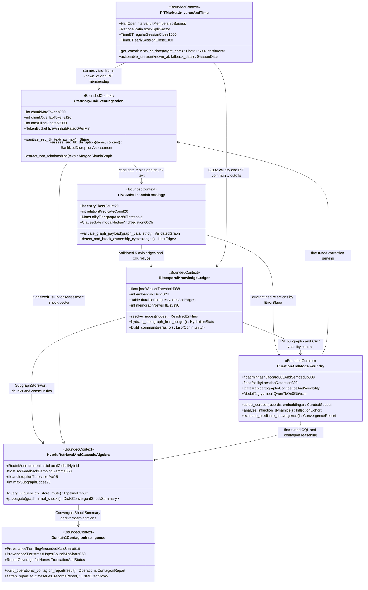
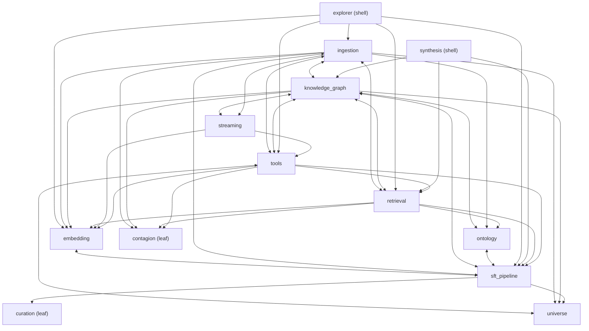

# Chapter 0: Architecture of a Point-in-Time Financial GraphRAG Engine

> **Series Navigation**: **Part 0 (System Atlas)** | [Part 1 (PiT Universe & Ingestion)](01-pit-universe-and-ingestion.md) | [Part 2 (Ontology, Linkage & Ledger)](02-ontology-linkage-and-ledger.md) | [Part 3 (Retrieval, Contagion & Reporting)](03-retrieval-contagion-and-reporting.md) | [Part 4 (Curation & Model Foundry)](04-curation-and-model-foundry.md)

YarnBall is a point-in-time Financial GraphRAG and production-network contagion platform built over U.S. Securities and Exchange Commission (SEC) filings, historical S&P 500 equity universes, and real-time corporate event streams. Given a physical or contractual disruption at a supplier, foundry, logistics hub, or counterparty, YarnBall reconstructs the supply-chain topology strictly as known at a specific market session cutoff, propagates capacity shortfalls through a buffered Grouped-Leontief cascade engine, and produces provenance-graded operational risk reports backed by verbatim statutory text chunks.

This chapter serves two roles. **Part A** presents the quantitative finance, econometric, and systems design principles governing the platform as a standalone technical report. **Part B** provides the software anatomy, AST-verified inter-package dependency graph, service entry-point catalog, and relational/graph/Parquet storage contracts across all 13 runtime and pipeline packages.

---

## Part A: Domain & Architectural Technical Report

### A.1 Why Naive RAG Fails in Institutional Finance

Standard Retrieval-Augmented Generation (RAG) and off-the-shelf property-graph pipelines assume a static text corpus, symmetric semantic similarity, and linear multi-hop relevance. Applied to corporate filings and equity event studies, those assumptions fail along seven distinct axes:

1. **Intraday and overnight look-ahead leakage.** 
   Public companies routinely submit Form 8-K, Form 10-Q, and Form 10-K filings to SEC EDGAR after the `16:00 ET` regular cash-equity close (`13:00 ET` on scheduled NYSE/NASDAQ early-close sessions). A naive date filter such as `filing_date <= query_date` admits a `16:12 ET` disclosure into a same-day close snapshot, crediting backtests with overnight price gaps that were untradable during regular market hours ([ADR-00033](../decisions/ADR-00033-bitemporal-pit-contract-for-read-paths--.md)).

2. **Survivorship and corporate-action distortion.** 
   Evaluating historical supply-chain shocks only over *today's* S&P 500 constituents omits bankrupt, receivership, and acquired issuers (`SIVB`, `FRC`, `SBNY`, `CELG`, `RTN`, `XLNX`, `TWTR`) while projecting recent index additions backward into earlier years. Similarly, unindexed forward stock splits (`NVDA` 10-for-1, `GOOGL`/`GOOG` 20-for-1) and reverse splits (`GE` 1-for-8) either introduce mechanical price discontinuities or inject announcement/ex-date drift that confounds abnormal-return attribution ([ADR-00039](../decisions/ADR-00039-sp500-pit-stock-split-corporate-actions-.md)).

3. **Counterfactual risk-factor and boilerplate hallucination.** 
   SEC Form 10-K `Item 1A` Risk Factors and Form 8-K Private Securities Litigation Reform Act (PSLRA) Safe Harbor disclaimers enumerate hypothetical disasters (*"fire, earthquake, cyberattack, or loss of a supplier may adversely affect..."*) and negated clauses (*"did not experience material disruption"*). Unconstrained LLM triple extractors convert those modal hedges into active disruption edges ([ADR-00014](../decisions/ADR-00014-sec-8k-boilerplate-sanitization-gating--.md), [ADR-00024](../decisions/ADR-00024-clause-scoped-negation-and-hedge-filter-.md)).

4. **Subsidiary fragmentation and ticker lexical collisions.** 
   Multinational issuers contract through operating subsidiaries listed in Form 10-K `Exhibit 21` (`Mellanox Technologies` under `NVIDIA`, `DISH DBS` under `DISH Network`), while valid stock tickers collide with everyday English words (`ALL`, `NOW`, `ON`, `IT`, `KEY`, `FAST`, `LOW`, `SO`, `A`). Without CIK-anchored record linkage and dictionary-ticker guards, entity resolution either fragments corporate parents or merges unrelated sentences onto equity nodes ([ADR-00025](../decisions/ADR-00025-entity-stoplist-and-dynamic-cik-rollup--.md), [ADR-00028](../decisions/ADR-00028-cross-source-entity-linking-and-kg-sync-.md)).

5. **Linear diffusion mismodeling of physical production networks.** 
   PageRank-style random walks average incoming edge weights. Real manufacturing bills of materials behave differently: interchangeable dual-source suppliers within the same input group $k$ substitute additively up to capacity, whereas distinct component groups (for example, lithography optics *and* high-bandwidth memory) act as complementary Leontief bottlenecks gated by inventory safety stock (`buffer_days`) ([ADR-00006](../decisions/ADR-00006-phase-7-sparse-network-cascade-engine---.md)).

6. **Unbounded in-memory graph bloat.** 
   Storing raw filing prose and years of ephemeral `:News` event nodes inside an in-memory Cypher engine (Memgraph) exhausts host RAM and couples analytical survival to container restarts ([ADR-00036](../decisions/ADR-00036-fail-fast-infra-and-deployable-topology-.md)).

7. **Silent infrastructure degradation and ungraded priors.** 
   Returning HTTP `200` with empty subgraphs when a vector or graph store is unreachable, or presenting conservative fallback procurement shares (`share = 1.0`, `buffer_days = 0.0`) identically to filing-extracted numbers, misleads downstream analysts about epistemic certainty ([ADR-00020](../decisions/ADR-00020-fail-fast-embedder-and-zero-vector-guard.md), [ADR-00026](../decisions/ADR-00026-cascade-parameter-extraction-provenance-.md), [ADR-00037](../decisions/ADR-00037-pit-community-layer-and-impact-ranking--.md)).

---

### A.2 The Domain 1 vs. Domain 2 Architectural Wall

A foundational design rule in YarnBall is the strict separation between **operational supply-chain intelligence (Domain 1)** and **portfolio construction or trade execution (Domain 2)**.

**Table 0.1:** *Domain 1 (Operational Contagion Intelligence) vs. Domain 2 (Portfolio & Trading Execution) Architectural Wall.*

| Dimension | Domain 1: Operational Contagion (In Scope) | Domain 2: Portfolio & Trading (Out of Scope) |
| :--- | :--- | :--- |
| **Core Question** | *Which downstream customers face unbuffered* *capacity contraction, when does safety stock* *exhaust, and which filings prove the link?* | *Should a fund buy, short, or size an options* *spread on ticker $X$, and at what price target?* |
| **State Variables** | Procurement share $a_{uv} \in [0, 1]$, buffer $B_{uv}$, shock $h_v \in [0, 1]$, onset $t_v$, downtime $d_v$, and feedback spectral radius $\rho(W_{\text{eff}})$ | Position weights $w_i$, expected alpha $\mathbb{E}[r_i]$, return covariance $\Sigma$, Sharpe ratio, option Greeks, and order-book execution liquidity |
| **Primary Output** | [`OperationalContagionReport`](../../retrieval/reporting.py) and 1NF [`ContagionTimeSeriesEventRecord`](../../retrieval/reporting.py) structured event time-series rows | Trade blotters, long/short equity baskets, hedging legs, and structured option overlays |
| **Governing ADRs** | Accepted: [ADR-00011](../decisions/ADR-00011-operational-contagion-report-schema-----.md), [ADR-00013](../decisions/ADR-00013-contagion-event-time-series-join-schema-.md), [ADR-00034](../decisions/ADR-00034-single-bi-read-facade-and-pipeline-merge.md), [ADR-00037](../decisions/ADR-00037-pit-community-layer-and-impact-ranking--.md) | Formally rejected for runtime: [ADR-00010](../decisions/ADR-00010-directional-basket-peer-cluster-mapping-.md) |

Conflating physical disruption with equity direction inside a single LLM prompt invites severe errors: a customer with 90 days of inventory cover (`TOLERATED_BUFFERED`) may experience zero production halt despite sensational headlines, while a physical bottleneck may already be priced in at the next market open ([ADR-00038](../decisions/ADR-00038-event-study-backtest-and-signal-decay---.md)). YarnBall therefore restricts all runtime APIs, graph schemas, and workbench views strictly to **Domain 1** physical, contractual, and topological facts, emitting normalized 1NF event telemetry ([ADR-00013](../decisions/ADR-00013-contagion-event-time-series-join-schema-.md)) that external quantitative research harnesses can join against market return series offline.

---

### A.3 End-to-End Quantitative & Systems Synthesis

Before inspecting file-level imports in Part B, the conceptual structure of YarnBall is best understood at the **domain-topic level**. The UML diagram below models the seven bounded domain contexts, their internal mathematical state and invariants, and the typed artifacts flowing between them.

**Figure 0.1:** *Topic-level conceptual architecture across YarnBall's seven bounded domain contexts and typed artifact flows.*

Across these seven contexts, four quantitative planes govern execution from raw regulatory filings to audited analytical output, each handled as a separate chapter:

#### Chapter 1: Bitemporal Grounding & Statutory Ingestion
Every equity universe lookup and document timestamp is anchored before graph extraction begins. Let $\mathcal{U}(t)$ denote the point-in-time set of active S&P 500 constituents on calendar date $t$. Membership for issuer $i$ is evaluated over half-open intervals $[d_i^{\text{add}}, d_i^{\text{rem}})$ in [`universe/sp500.py`](../../universe/sp500.py):

$$i \in \mathcal{U}(t) \iff \left(d_i^{\text{add}} \le t\right) \;\land\; \left(d_i^{\text{rem}} = \varnothing \,\lor\, t < d_i^{\text{rem}}\right) \tag{0.1}$$

where $d_i^{\text{add}}$ is issuer $i$'s index addition date and $d_i^{\text{rem}}$ is its removal date ($d_i^{\text{rem}} = \varnothing$ while active).

To prevent after-hours disclosures from leaking into regular-session close snapshots, [`actionable_session`](../../retrieval/temporal.py) maps each document's UTC acceptance timestamp $t_{\text{known}}$ onto the NYSE/NASDAQ regular session close $t_{\text{close}}(d) \in \{\text{16:00 ET}, \text{13:00 ET}\}$: disclosures arriving after $t_{\text{close}}(d)$ or on exchange holidays roll forward strictly to `next_us_equity_trading_day(d)`. Filings are segmented along statutory item boundaries (`Item 1`, `Item 1A`, `Item 7`, `Item 1.01`, `Exhibit 21`) into `800`-token chunks with `120`-token sliding overlap and immutable document headers ([`ingestion/segmentation/chunker.py`](../../ingestion/segmentation/chunker.py)), ranked by relational salience without dropping tail chunks, and extracted with conditional Pass-2 gleaning ([`ingestion/sec/parser.py`](../../ingestion/sec/parser.py)).

#### Chapter 2: 5-Axis Ontology, Record Linkage & Durable-Before-Ephemeral Ledger
Candidate triples pass through [`validate_graph_payload`](../../ontology/validation.py) and [`Tier4OntologyGate`](../../ontology/guardrails.py), which enforce 20 `EntityClass` types and 26 `RelationPredicate` domain/range axioms, suppress triples hedged by modal speculation (`MODAL_HEDGE_REGEX`) or local clause negation (`NEGATION_REGEX`) inside `chunk.text`, roll up `Exhibit 21` subsidiaries to parent CIKs, and break cyclic ownership chains (`SUBSIDIARY_OF` / `PARENT_OF`) by pruning the lowest-confidence cycle edge. [`EntityResolver`](../../knowledge_graph/entity_resolver.py) merges duplicate mentions via CIK-conflict-guarded Union-Find over ticker, initialism, bounded Levenshtein ($\le 2$), and Jaro-Winkler ($\ge 0.88$) similarity.

Validated assertions commit **first** to the durable PostgreSQL ledger (`kg_nodes`, `kg_edges`, `document_chunks`, SCD Type 2 `node_embeddings` at `EMBEDDING_DIM = 1024`) and **second** to the prose-stripped in-memory Memgraph projection, where transient `:News` nodes expire after `MEMGRAPH_EVENT_TTL_DAYS = 90` ([`knowledge_graph/ledger.py`](../../knowledge_graph/ledger.py)). Structural edges active at `as_of` are partitioned into internally connected clusters via seeded hierarchical Leiden (with connected-component Louvain fallback) in [`knowledge_graph/communities.py`](../../knowledge_graph/communities.py).

#### Chapter 3: Unified BI Read Facade & Grouped-Leontief Contagion Algebra
All analytical reads enter through [`query_bi`](../../retrieval/facade.py) with a mandatory non-optional [`PiTContext`](../../retrieval/temporal.py). A deterministic zero-LLM router ([`classify_query_route`](../../retrieval/routing.py)) dispatches queries to `local` ego-cascade traversal, `global` community map-reduce, or `hybrid` execution across interchangeable live (`MemgraphSubgraphStore`) and offline (`InMemorySubgraphStore`) backends.

On `local` and `hybrid` shock paths, [`SparseNetworkCascadeEngine`](../../contagion/cascade.py) computes convergent capacity impairment $h_v^{(r)} \in [0, 1]$ at node $v$ across topological propagation rounds $r = 1, \dots, R$ ($R = 5$) using Grouped-Leontief aggregation with inventory buffer gating and Tarjan SCC feedback damping ($a_{uv}^{\text{eff}} = \gamma a_{uv}$ with $\gamma = 0.50$ on cyclic feedback edges, and $a_{uv}^{\text{eff}} = a_{uv}$ otherwise):

$$h_v^{(r)} = \max\!\left(h_v^{(0)},\; \max_{k \in \mathcal{K}(v)} \min\!\left(1,\; \sum_{u \in \text{In}_k(v)} \mathbf{1}\!\left[B_{uv} = 0 \,\lor\, h_u^{(r-1)} d_u > B_{uv}\right] a_{uv}^{\text{eff}}\, h_u^{(r-1)}\right)\right) \tag{0.2}$$

where $h_v^{(0)} \in [0, 1]$ is node $v$'s initial exogenous shock, $\mathcal{K}(v)$ is the set of complementary input groups required by $v$, $\text{In}_k(v)$ is the set of upstream suppliers $u$ feeding input group $k$, $\mathbf{1}[\cdot] \in \{0, 1\}$ is the indicator function ($1$ when the bracketed condition holds, $0$ otherwise), $a_{uv} \in [0, 1]$ and $B_{uv} \ge 0$ are the procurement share and inventory buffer (days) on edge $(u \to v)$, and $d_u \ge 0$ is upstream node $u$'s disruption duration (days). Subgraph verbalization retains the top `MAX_SUBGRAPH_EDGES = 25` edges ordered by downstream cascade impact while recording `dropped_impact_share`, and [`OperationalContagionReport`](../../retrieval/reporting.py) grades epistemic reliability by the share of total downstream impact driven by fallback edge parameters (`FILING_GROUNDED` $\le 0.10$, `MIXED_PROVENANCE` $\in (0.10, 0.50)$, `STRESS_UPPER_BOUND` $\ge 0.50$).

#### Chapter 4: Submodular Curation, Cartography & Model Alignment Foundry
Runtime structured extraction, Text-to-Cypher translation, contagion `<think>` reasoning, and community summarization are served on a single 8 GB GPU budget (`yarnball-qwen:7b` on GPU via [`YarnBallModelClient`](../../sft_pipeline/serving/model_client.py), paired with CPU-pinned `qwen3-embedding:0.6b` in [`embedding/embedder.py`](../../embedding/embedder.py)). Training corpora are curated through MinHash LSH (`0.85`), SemDeDup (`0.88`), and greedy Facility Location core-set maximization:

$$F(S) = \sum_{i \in V} \max_{j \in S}\, \text{sim}_+(i, j) \tag{0.3}$$

where $V$ is the full candidate corpus, $S \subseteq V$ is the selected core-set subset, and $\text{sim}_+(i, j) = \max(0, \cos(e_i, e_j))$ is the non-negative cosine similarity between corpus item embeddings $e_i$ and $e_j$. This geometric selection pairs with rare-predicate manifold floors (`400`–`500`), Dataset Cartography ambiguity selection ($\hat{\sigma}_i \ge 0.15$), Step-50/100 inflection-lag Direct Preference Optimization (`seq_prob < 0.70`), and closed-loop quarantine telemetry from [`RuntimeRejectionQueue`](../../sft_pipeline/rejection_queue.py) ([ADR-00031](../decisions/ADR-00031-iterative-predicate-convergence-protocol.md)).

---

### A.4 Pre-ADR Foundations & Thematic ADR Provenance Atlas

Architectural Decision Records ([`docs/decisions/index.md`](../decisions/index.md)) were introduced mid-way through YarnBall's development, beginning at System Integration Testing (SIT) harness verification ([ADR-00001](../decisions/ADR-00001-sit-flow-2-event-shock-contagion-harness.md)). Treating the ADR log as the sole history of the codebase would obscure half of its quantitative design. The table below maps every capability domain across both its **Pre-ADR Foundational Implementation** (documented directly from live source modules in Chapters 1–4) and its **Post-`ADR-00001` Evolution**.

**Table 0.2:** *Pre-ADR Foundational Modules and Post-ADR-00001 Governance Atlas Across Capability Domains.*

| Capability Domain | Pre-ADR Foundational Modules | Post-ADR-00001 Accepted ADRs | Proposed / Rejected ADRs | Report Chapter |
| :--- | :--- | :--- | :--- | :---: |
| **PiT Equity Universe &** **Market Econometrics** | [`universe/sp500.py`](../../universe/sp500.py) [`universe/builder.py`](../../universe/builder.py) [`ingestion/market/parser.py`](../../ingestion/market/parser.py) | [ADR-00005](../decisions/ADR-00005-sit-flow-1-pit-sec-filing-to-kg-ingest--.md) [ADR-00033](../decisions/ADR-00033-bitemporal-pit-contract-for-read-paths--.md) | *Proposed*: [ADR-00038](../decisions/ADR-00038-event-study-backtest-and-signal-decay---.md) [ADR-00039](../decisions/ADR-00039-sp500-pit-stock-split-corporate-actions-.md) | Ch. 1 (`01`) |
| **Statutory, News, Transcript** **& Stream Ingestion** | [`ingestion/sec/client.py`](../../ingestion/sec/client.py) [`ingestion/news/harvester.py`](../../ingestion/news/harvester.py) [`ingestion/transcripts/harvester.py`](../../ingestion/transcripts/harvester.py) [`streaming/consumer.py`](../../streaming/consumer.py) | [ADR-00003](../decisions/ADR-00003-sit-flow-4-streaming-event-graph-update-.md) [ADR-00014](../decisions/ADR-00014-sec-8k-boilerplate-sanitization-gating--.md) [ADR-00027](../decisions/ADR-00027-canonical-staged-8k-envelope-and-catalog.md) [ADR-00035](../decisions/ADR-00035-text-unit-chunk-layer-and-evidence-links.md) | None | Ch. 1 (`01`) |
| **5-Axis Ontology, Modality** **Gates & Convergence** | [`ontology/schema.py`](../../ontology/schema.py) [`ontology/reification.py`](../../ontology/reification.py) [`ontology/compiler.py`](../../ontology/compiler.py) [`ontology/alignment.py`](../../ontology/alignment.py) | [ADR-00023](../decisions/ADR-00023-unified-live-ontology-gate-and-schema---.md) [ADR-00024](../decisions/ADR-00024-clause-scoped-negation-and-hedge-filter-.md) [ADR-00025](../decisions/ADR-00025-entity-stoplist-and-dynamic-cik-rollup--.md) [ADR-00029](../decisions/ADR-00029-structured-llm-extraction-and-quarantine.md) [ADR-00031](../decisions/ADR-00031-iterative-predicate-convergence-protocol.md) | None | Ch. 2 (`02`) |
| **Entity Linkage, Embeddings,** **Ledger & Communities** | [`knowledge_graph/entity_resolver.py`](../../knowledge_graph/entity_resolver.py) [`knowledge_graph/snapshot_manager.py`](../../knowledge_graph/snapshot_manager.py) [`tools/init_db.py`](../../tools/init_db.py) | [ADR-00020](../decisions/ADR-00020-fail-fast-embedder-and-zero-vector-guard.md) [ADR-00021](../decisions/ADR-00021-contextual-node-embeddings-and-pgvector-.md) [ADR-00022](../decisions/ADR-00022-unified-sec-news-dense-vector-coverage--.md) [ADR-00028](../decisions/ADR-00028-cross-source-entity-linking-and-kg-sync-.md) [ADR-00036](../decisions/ADR-00036-fail-fast-infra-and-deployable-topology-.md) [ADR-00037](../decisions/ADR-00037-pit-community-layer-and-impact-ranking--.md) | None | Ch. 2 (`02`) |
| **Network Contagion, BI** **Retrieval & Reporting** | [`retrieval/guardrails/schema_guardrail.py`](../../retrieval/guardrails/schema_guardrail.py) [`retrieval/text_to_cql.py`](../../retrieval/text_to_cql.py) [`synthesis/synthesizer.py`](../../synthesis/synthesizer.py) | [ADR-00001](../decisions/ADR-00001-sit-flow-2-event-shock-contagion-harness.md) [ADR-00002](../decisions/ADR-00002-sit-flow-3-nl-to-cypher-rag-e2e-harness-.md) [ADR-00006](../decisions/ADR-00006-phase-7-sparse-network-cascade-engine---.md)– [ADR-00009](../decisions/ADR-00009-sec-8k-computational-reading-dry-run----.md) [ADR-00011](../decisions/ADR-00011-operational-contagion-report-schema-----.md) [ADR-00013](../decisions/ADR-00013-contagion-event-time-series-join-schema-.md) [ADR-00015](../decisions/ADR-00015-dynamic-in-memory-offline-subgraph-store.md)– [ADR-00019](../decisions/ADR-00019-pit-kg-explorer-and-cohort-browser-views.md) [ADR-00026](../decisions/ADR-00026-cascade-parameter-extraction-provenance-.md) [ADR-00034](../decisions/ADR-00034-single-bi-read-facade-and-pipeline-merge.md) | *Rejected*: [ADR-00010](../decisions/ADR-00010-directional-basket-peer-cluster-mapping-.md) | Ch. 3 (`03`) |
| **Submodular Curation,** **Cartography & Foundry** | [`curation/cold_start/coreset.py`](../../curation/cold_start/coreset.py) [`curation/active_learning/cartographer.py`](../../curation/active_learning/cartographer.py) [`sft_pipeline/sampler.py`](../../sft_pipeline/sampler.py) [`sft_pipeline/builder.py`](../../sft_pipeline/builder.py) [`sft_pipeline/dpo_builder.py`](../../sft_pipeline/dpo_builder.py) | [ADR-00004](../decisions/ADR-00004-sit-flow-5-model-foundry-alignment-smoke.md) [ADR-00030](../decisions/ADR-00030-purge-non-ft-qwen-runtime-dependencies--.md) | *Proposed*: [ADR-00012](../decisions/ADR-00012-qwen-model-upgrade-and-fine-tuning-plan-.md) | Ch. 4 (`04`) |
| **Static Typing, Architecture** **& Docs Gates** | `tests/` unit harnesses | [ADR-00032](../decisions/ADR-00032-full-corpus-static-typing-and-adr-gates-.md) [ADR-00040](../decisions/ADR-00040-ch0-system-atlas-and-docs-integrity-----.md)– [ADR-00044](../decisions/ADR-00044-ch4-curation-cartography-model-foundry--.md) | None | Ch. 0 (`00`) |

**Notable Supersede & Retirement Chains**:
- **Frontend Consolidation ([ADR-00016](../decisions/ADR-00016-decommission-legacy-chainlit-ui-frontend.md) $\rightarrow$ [ADR-00017](../decisions/ADR-00017-local-fastapi-kg-contagion-workbench-app.md)–[ADR-00019](../decisions/ADR-00019-pit-kg-explorer-and-cohort-browser-views.md))**: retired the legacy Chainlit conversational wrapper (`interactive/`) in favor of the deterministic read-only FastAPI Workbench (`explorer/`).
- **Read-Path Consolidation ([ADR-00001](../decisions/ADR-00001-sit-flow-2-event-shock-contagion-harness.md) $\rightarrow$ [ADR-00034](../decisions/ADR-00034-single-bi-read-facade-and-pipeline-merge.md))**: retired standalone `retrieval/shock_propagation.py` and `HybridRetriever.expand_subgraph`, routing all live and offline reads through `retrieval/facade.py:query_bi` and `SubgraphStorePort`.
- **Embedder Evolution ([ADR-00020](../decisions/ADR-00020-fail-fast-embedder-and-zero-vector-guard.md)–[ADR-00022](../decisions/ADR-00022-unified-sec-news-dense-vector-coverage--.md) $\rightarrow$ [ADR-00035](../decisions/ADR-00035-text-unit-chunk-layer-and-evidence-links.md))**: upgraded dense embeddings to `qwen3-embedding:0.6b` (`EMBEDDING_DIM = 1024`, CPU-pinned during live serving) while preserving fail-fast startup checks and `embedding_schema_metadata` dimension locks.

---

### A.5 System-Wide Theory-to-Code Crosswalk Table

Every `<package>.<module>:<symbol>` identifier in the table below is AST-verified by [`tests/docs/test_docs_integrity.py`](../../tests/docs/test_docs_integrity.py).

**Table 0.3:** *System-Wide Theory-to-Code Crosswalk (AST-Verified Anchors and Verification Suites).*

| Concept / Mathematical Invariant | Code Anchor (`module:symbol`) | Provenance | Verification Suite |
| :--- | :--- | :--- | :--- |
| PiT S&P 500 half-open membership $[d^{\text{add}}, d^{\text{rem}})$ | `universe.sp500:SP500UniverseManager.get_constituents_at_date` | Pre-ADR + [ADR-00005](../decisions/ADR-00005-sit-flow-1-pit-sec-filing-to-kg-ingest--.md) | [`test_filing_to_graph_flow.py`](../../tests/integration/pipelines/test_filing_to_graph_flow.py) |
| Dictionary-word ticker collision stoplist | `universe.sp500:DICTIONARY_TICKERS` | Pre-ADR + [ADR-00025](../decisions/ADR-00025-entity-stoplist-and-dynamic-cik-rollup--.md) | [`test_entity_stoplist_and_dynamic_rollup.py`](../../tests/ontology/test_entity_stoplist_and_dynamic_rollup.py) |
| Mandatory Point-in-Time read context | `retrieval.temporal:PiTContext` | [ADR-00033](../decisions/ADR-00033-bitemporal-pit-contract-for-read-paths--.md) | [`test_pit_invariants.py`](../../tests/retrieval/test_pit_invariants.py) |
| NYSE `16:00 ET` / `13:00 ET` actionable session mapping | `retrieval.temporal:actionable_session` | [ADR-00033](../decisions/ADR-00033-bitemporal-pit-contract-for-read-paths--.md) | [`test_pit_invariants.py`](../../tests/retrieval/test_pit_invariants.py) |
| Section-bounded `800`/`120` token chunker | `ingestion.segmentation.chunker:FinancialSectionSegmenter` | [ADR-00035](../decisions/ADR-00035-text-unit-chunk-layer-and-evidence-links.md) | [`test_adr00035_chunk_evidence.py`](../../tests/ingestion/test_adr00035_chunk_evidence.py) |
| Form 8-K sanitization & 4-tier disruption gate | `ingestion.sec.disruption_gating:assess_sec_8k_disruption` | [ADR-00014](../decisions/ADR-00014-sec-8k-boilerplate-sanitization-gating--.md) | [`test_sec_8k_disruption_gating.py`](../../tests/ingestion/test_sec_8k_disruption_gating.py) |
| Salience-ordered chunk extraction & Pass-2 gleaning | `ingestion.sec.parser:extract_sec_relationships` | [ADR-00035](../decisions/ADR-00035-text-unit-chunk-layer-and-evidence-links.md) | [`test_adr00035_chunk_evidence.py`](../../tests/ingestion/test_adr00035_chunk_evidence.py) |
| 20-class / 26-predicate TBox ontology | `ontology.schema:RelationPredicate` | Pre-ADR + [ADR-00023](../decisions/ADR-00023-unified-live-ontology-gate-and-schema---.md) | [`test_live_ontology_gate.py`](../../tests/ontology/test_live_ontology_gate.py) |
| 5-Axis GAAP ASC 280 reified triple | `ontology.reification:AnnotatedTriple` | Pre-ADR Foundation | [`test_ontology.py`](../../tests/ontology/test_ontology.py) |
| Clause-scoped hedge/negation & CIK rollup gate | `ontology.guardrails:Tier4OntologyGate` | [ADR-00024](../decisions/ADR-00024-clause-scoped-negation-and-hedge-filter-.md), [ADR-00025](../decisions/ADR-00025-entity-stoplist-and-dynamic-cik-rollup--.md) | [`test_clause_negation_and_hedge_filter.py`](../../tests/ontology/test_clause_negation_and_hedge_filter.py) |
| Inline SHACL orientation & ownership DAG cycle breaker | `ontology.validation:validate_graph_payload` | Pre-ADR + [ADR-00023](../decisions/ADR-00023-unified-live-ontology-gate-and-schema---.md) | [`test_live_ontology_gate.py`](../../tests/ontology/test_live_ontology_gate.py) |
| CIK-guarded Union-Find record linkage | `knowledge_graph.entity_resolver:EntityResolver` | Pre-ADR + [ADR-00028](../decisions/ADR-00028-cross-source-entity-linking-and-kg-sync-.md) | [`test_cross_source_linking_adr00028.py`](../../tests/knowledge_graph/test_cross_source_linking_adr00028.py) |
| Asymmetric `1024`-dim embedder (`qwen3-embedding:0.6b`) | `embedding.embedder:embed_query` | [ADR-00020](../decisions/ADR-00020-fail-fast-embedder-and-zero-vector-guard.md), [ADR-00035](../decisions/ADR-00035-text-unit-chunk-layer-and-evidence-links.md) | [`test_embedder_adr00020.py`](../../tests/embedding/test_embedder_adr00020.py) |
| Durable Postgres ledger $\rightarrow$ RAM Memgraph hydrator (`TTL=90d`) | `knowledge_graph.ledger:hydrate_memgraph_from_ledger` | [ADR-00036](../decisions/ADR-00036-fail-fast-infra-and-deployable-topology-.md) | [`test_adr00036_infra_invariants.py`](../../tests/knowledge_graph/test_adr00036_infra_invariants.py) |
| PiT structural Leiden / connected Louvain communities | `knowledge_graph.communities:build_communities` | [ADR-00037](../decisions/ADR-00037-pit-community-layer-and-impact-ranking--.md) | [`test_adr00037_communities_ranking_coverage.py`](../../tests/retrieval/test_adr00037_communities_ranking_coverage.py) |
| Grouped-Leontief cascade & TTS timing engine | `contagion.cascade:SparseNetworkCascadeEngine.propagate` | [ADR-00006](../decisions/ADR-00006-phase-7-sparse-network-cascade-engine---.md), [ADR-00007](../decisions/ADR-00007-cascade-engine-adversarial-verification-.md) | [`test_cascade_pathologies.py`](../../tests/contagion/test_cascade_pathologies.py) |
| 3-tier cascade edge parameter provenance | `contagion.parameters:resolve_edge_cascade_parameters` | [ADR-00026](../decisions/ADR-00026-cascade-parameter-extraction-provenance-.md) | [`test_cascade_parameter_provenance_adr00026.py`](../../tests/contagion/test_cascade_parameter_provenance_adr00026.py) |
| Single BI read facade & `SubgraphStorePort` | `retrieval.facade:query_bi` | [ADR-00034](../decisions/ADR-00034-single-bi-read-facade-and-pipeline-merge.md) | [`test_adr00034_facade_invariants.py`](../../tests/retrieval/test_adr00034_facade_invariants.py) |
| Deterministic zero-LLM `local`/`global`/`hybrid` router | `retrieval.routing:classify_query_route` | [ADR-00037](../decisions/ADR-00037-pit-community-layer-and-impact-ranking--.md) | [`test_adr00037_communities_ranking_coverage.py`](../../tests/retrieval/test_adr00037_communities_ranking_coverage.py) |
| Impact-ranked subgraph cap (`MAX_SUBGRAPH_EDGES = 25`) | `retrieval.pipeline:MAX_SUBGRAPH_EDGES` | [ADR-00037](../decisions/ADR-00037-pit-community-layer-and-impact-ranking--.md) | [`test_adr00037_communities_ranking_coverage.py`](../../tests/retrieval/test_adr00037_communities_ranking_coverage.py) |
| Provenance-graded Domain-1 contagion report (`0.10` / `0.50`) | `retrieval.reporting:OperationalContagionReport` | [ADR-00011](../decisions/ADR-00011-operational-contagion-report-schema-----.md), [ADR-00037](../decisions/ADR-00037-pit-community-layer-and-impact-ranking--.md) | [`test_operational_contagion_reporting.py`](../../tests/retrieval/test_operational_contagion_reporting.py) |
| Submodular Facility Location core-set selector | `curation.cold_start.coreset:FacilityLocationCoresetSelector` | Pre-ADR Foundation | [`test_cold_start.py`](../../tests/curation/test_cold_start.py) |
| Dataset Cartography $(\hat{\mu}_i, \hat{\sigma}_i)$ & forgetfulness | `curation.active_learning.cartographer:DatasetCartographer` | Pre-ADR Foundation | [`test_cartographer.py`](../../tests/curation/test_cartographer.py) |
| Economic manifold rare-predicate & hard-negative sampler | `sft_pipeline.sampler:ManifoldTargetedSampler` | Pre-ADR Foundation | [`test_pipeline.py`](../../tests/sft_pipeline/test_pipeline.py) |
| Inflection-lag Step-50/100 DPO preference builder | `sft_pipeline.dpo_builder:InflectionSliceDPOBuilder` | Pre-ADR Foundation | [`test_model_foundry_smoke_flow.py`](../../tests/integration/pipelines/test_model_foundry_smoke_flow.py) |
| Unified fine-tuned model client & quarantine queue | `sft_pipeline.serving.model_client:YarnBallModelClient` | [ADR-00029](../decisions/ADR-00029-structured-llm-extraction-and-quarantine.md), [ADR-00030](../decisions/ADR-00030-purge-non-ft-qwen-runtime-dependencies--.md) | [`test_extraction_quarantine.py`](../../tests/knowledge_graph/test_extraction_quarantine.py) |

---

## Part B: Software Anatomy, Package Graph, Entry Points & Schemas

### B.1 13-Package Inventory: Functional Orthogonality vs. AST Import Coupling

At the domain-capability level, YarnBall is partitioned into **13 functionally orthogonal runtime and pipeline packages** (plus `tests/`). Each package owns a single conceptual responsibility without duplicating another package's algorithms.

At the physical Python import level, however, the repository is **not** a strict directed acyclic graph (DAG). Inspecting all module AST imports reveals **52 directed cross-package import edges** categorized into:
- **2 Zero-Dependency Algorithmic Leaves (`0` internal outbound imports)**: [`contagion/`](../../contagion/__init__.py) and [`curation/`](../../curation/__init__.py) depend solely on the Python standard library, `numpy`, and `pydantic`.
- **2 Pure Consumer Shells (`0` internal inbound imports)**: [`explorer/`](../../explorer/__init__.py) and [`synthesis/`](../../synthesis/__init__.py) sit cleanly at the top of the call hierarchy; no internal package imports them.
- **12 Bidirectional Package Couplings among the middle 9 packages**: almost entirely induced by **four shared-kernel modules** housed inside pipeline packages rather than a standalone `core/` package:
  1. [`sft_pipeline/serving/model_client.py`](../../sft_pipeline/serving/model_client.py) and [`sft_pipeline/rejection_queue.py`](../../sft_pipeline/rejection_queue.py) live inside `sft_pipeline/`, causing `embedding`, `ontology`, `ingestion`, `knowledge_graph`, `retrieval`, `synthesis`, and `explorer` to import `sft_pipeline` while `sft_pipeline` imports them back during dataset construction.
  2. [`retrieval/temporal.py`](../../retrieval/temporal.py) (`PiTContext`, `actionable_session`) lives inside `retrieval/`, so write-side ingestion and ledger modules (`ingestion`, `knowledge_graph`) import `retrieval`.
  3. [`tools/init_db.py`](../../tools/init_db.py) and [`tools/utils.py`](../../tools/utils.py) live inside CLI `tools/`, so `universe`, `ingestion`, `knowledge_graph`, and `streaming` import DSN/queue helpers from `tools`.
  4. [`knowledge_graph/graph_store.py`](../../knowledge_graph/graph_store.py) lazy-imports [`ingestion/segmentation/chunker.py`](../../ingestion/segmentation/chunker.py) and [`ingestion/sec/parser.py`](../../ingestion/sec/parser.py) while `ingestion` writes into `knowledge_graph`.

**Table 0.4:** *13-Package Inventory Comparing Functional Orthogonality Against Physical AST Import Coupling.*

| Package | `.py` Files | Architectural Role | Outbound Internal Imports | Inbound Internal Importers | Deep-Dive Chapter |
| :--- | :---: | :--- | :--- | :--- | :---: |
| `contagion` | 3 | Grouped-Leontief cascade algebra, Tarjan SCC damping, TTS timing & edge parameter provenance | *(none: pure leaf)* | `ingestion`, `knowledge_graph`, `retrieval`, `tools` | Ch. 3 |
| `curation` | 10 | MinHash LSH, SemDeDup, Facility Location coresets & Dataset Cartography | *(none: pure leaf)* | `sft_pipeline` | Ch. 4 |
| `embedding` | 2 | Asymmetric `qwen3-embedding` (`1024`-d + MRL projection), norm guards, Ollama CPU/GPU control & pluggable `RerankerPort` | `sft_pipeline` | `explorer`, `ingestion`, `knowledge_graph`, `retrieval`, `sft_pipeline`, `streaming`, `tools` | Ch. 2 |
| `explorer` | 2 | Read-only FastAPI Workbench backend & static SPA (`index.html`, `app.js`, `styles.css`) | `embedding`, `ingestion`, `retrieval`, `sft_pipeline`, `tools` | *(none: pure shell)* | Ch. 3 |
| `ingestion` | 22 | SEC EDGAR (`10-K`/`10-Q`/`8-K`/`Ex.21` + `canon.py`), `800`-tok chunker, 8-K gate, market CAR, news & transcripts | `contagion`, `embedding`, `knowledge_graph`, `ontology`, `retrieval`, `sft_pipeline`, `streaming`, `tools`, `universe` | `explorer`, `knowledge_graph`, `retrieval`, `sft_pipeline`, `tools` | Ch. 1 |
| `knowledge_graph` | 14 | Durable Postgres ledger, RAM Memgraph driver/hydrator, Union-Find resolver, chunks, SCD2 vectors, Leiden communities & form-ablation scorecard | `contagion`, `embedding`, `ingestion`, `ontology`, `retrieval`, `sft_pipeline`, `streaming`, `tools`, `universe` | `ingestion`, `ontology`, `retrieval`, `sft_pipeline`, `streaming`, `synthesis`, `tools` | Ch. 2 |
| `ontology` | 8 | 20-class / 26-predicate TBox, 5-axis reification, clause hedge/negation compiler, `Tier4OntologyGate` & convergence | `knowledge_graph`, `sft_pipeline` | `ingestion`, `knowledge_graph`, `retrieval`, `sft_pipeline` | Ch. 2 |
| `retrieval` | 13 | Single `query_bi` facade, `PiTContext`, `SubgraphStorePort`, `HybridSeeder`, RRF, Cypher AST guardrails & reporting | `contagion`, `embedding`, `ingestion`, `knowledge_graph`, `ontology`, `sft_pipeline` | `explorer`, `ingestion`, `knowledge_graph`, `synthesis`, `tools` | Ch. 3 |
| `sft_pipeline` | 21 | Manifold sampler, SFT/DPO builders, LoRA-to-GGUF fusion, `YarnBallModelClient`, `RuntimeRejectionQueue` & `evaluation/` | `curation`, `embedding`, `ingestion`, `knowledge_graph`, `ontology`, `universe` | `embedding`, `explorer`, `ingestion`, `knowledge_graph`, `ontology`, `retrieval`, `synthesis`, `tools` | Ch. 4 |
| `streaming` | 4 | Kafka producer, manual-commit consumer, raw/vector persistence & `<topic>.dlt` quarantine | `embedding`, `knowledge_graph`, `tools` | `ingestion`, `knowledge_graph` | Ch. 1 |
| `synthesis` | 4 | Citation-grounded narrative synthesizer, `FinancialAnalysisEngine` & `EvaluationHarness` | `knowledge_graph`, `retrieval`, `sft_pipeline` | *(none: pure shell)* | Ch. 3 |
| `tools` | 11 | Operational CLIs: `init_db`, `hydrate_memgraph`, `build_kg_snapshot`, `reextract_sp500_chunks`, `eval_kg_form_ablation`, `scheduler`, dry runs & `serve_explorer` | `contagion`, `embedding`, `ingestion`, `knowledge_graph`, `retrieval`, `sft_pipeline`, `universe` | `explorer`, `ingestion`, `knowledge_graph`, `streaming`, `universe` | Ch. 0–4 |
| `universe` | 3 | Point-in-time S&P 500 constituent manager (`2018–2025+`), turnover builder & `DICTIONARY_TICKERS` | `tools` | `ingestion`, `knowledge_graph`, `sft_pipeline`, `tools` | Ch. 1 |

#### AST-Verified Inter-Package Dependency Graph (`<-->` = bidirectional import pair; `-->` = one-way import)

Every edge in the Mermaid graph below is mechanically checked against the live Python AST in [`tests/docs/test_docs_integrity.py`](../../tests/docs/test_docs_integrity.py):

**Figure 0.2:** *AST-verified inter-package dependency graph showing pure consumer shells, zero-dependency leaves, 12 bidirectional couplings, and 28 one-way imports.*

---

### B.2 Master Entry-Point & Service Catalog

#### 1. HTTP Microservices (FastAPI)

**Table 0.5:** *FastAPI HTTP Microservice Endpoints, Request Contracts, and Fail-Fast Semantics.*

| Service & Module | Method & Route | Request / Query Contract | Purpose & Failure Semantics |
| :--- | :--- | :--- | :--- |
| **BI Retrieval API** ([`retrieval/service.py`](../../retrieval/service.py)) | `GET /health` | None | Lightweight container liveness probe (`200 {"status": "alive"}`). |
| **BI Retrieval API** ([`retrieval/service.py`](../../retrieval/service.py)) | `GET /ready` | None | Deep readiness check over Postgres, `embedding_schema_metadata`, Memgraph hydration, embedder, and Ollama models (`200` or `503`). |
| **BI Retrieval API** ([`retrieval/service.py`](../../retrieval/service.py)) | `POST /search` | `SearchRequest` (`query`, mandatory `as_of`, `mode`, `hops`, `route`) | Executes `query_bi`; returns `422` on invalid hops/vectors and `503` if stores or model are degraded. |
| **BI Retrieval API** ([`retrieval/service.py`](../../retrieval/service.py)) | `POST /report` | `ReportRequest` (`SearchRequest` + `event_id`, `disrupted_entity_ticker`, `shock_duration_days`, `shock_magnitude_pct`) | Executes `query_bi` + `SparseNetworkCascadeEngine` and returns validated `OperationalContagionReport` (`503` on degraded state). |
| **Local Workbench API** ([`explorer/workbench_api.py`](../../explorer/workbench_api.py)) | `GET /` (+ `/static`) | None | Serves the interactive Workbench SPA (`explorer/static/index.html`) or HTML readiness index. |
| **Local Workbench API** ([`explorer/workbench_api.py`](../../explorer/workbench_api.py)) | `GET /api/catalog` | None | Lists allowlisted Parquet snapshots, staged 8-K filings, cohort exports, and live Ollama/embedder health. |
| **Local Workbench API** ([`explorer/workbench_api.py`](../../explorer/workbench_api.py)) | `GET /api/subgraph` | `as_of_date` (mandatory), `ticker`, `max_hops`, `direction`, `pit_mode`, `snapshot_id` | Point-in-time ego-network query via `query_subgraph_ego` (`422` on invalid date). |
| **Local Workbench API** ([`explorer/workbench_api.py`](../../explorer/workbench_api.py)) | `POST /api/evaluate-8k` | `Evaluate8KRequest` (`filing_path` or `inline_filing`, `target_ticker`, `snapshot_id`, `use_mock`) | Runs `assess_sec_8k_disruption` + `run_sec_8k_dry_run` + `validate_verbatim_citations` + 1NF flattening. |
| **Local Workbench API** ([`explorer/workbench_api.py`](../../explorer/workbench_api.py)) | `POST /api/cohort` | `CohortFilterRequest` (`cohort_path`, `verdicts`, `categories`, `sec_items`, `min_contraction_pct`) | Filters and aggregates 1NF `ContagionTimeSeriesEventRecord` JSONL exports. |

#### 2. Docker Compose Topology ([`docker-compose.yml`](../../docker-compose.yml))

**Table 0.6:** *Docker Compose Service Topology, Container Roles, and Port Bindings.*

| Service Name | Image / Dockerfile | Exposed Port | Lifecycle & Role |
| :--- | :--- | :---: | :--- |
| `postgres` | `pgvector/pgvector:pg16` | `5432` | Durable relational, `pgvector` HNSW, `tsvector` GIN, and `pg_trgm` source of truth (`pgdata` volume). |
| `memgraph` | `memgraph/memgraph-mage:latest` | `7687` | Pure in-memory OpenCypher projection (no persistent volume; rebuilt from Postgres on startup). |
| `memgraph_lab` | `memgraph/lab:latest` | `3000` | Visual Cypher inspection UI attached to `memgraph:7687`. |
| `kafka` | `confluentinc/cp-kafka:latest` | `9092` | Single-node KRaft broker/controller transporting live ingestion events and `<topic>.dlt` dead letters. |
| `db_init` | Root `Dockerfile` (`python -m tools.init_db`) | None | One-shot startup sidecar initializing all 15 PostgreSQL tables, extensions, and `embedding_schema_metadata`. |
| `memgraph_hydrator` | Root `Dockerfile` (`python -m tools.hydrate_memgraph`) | None | One-shot startup sidecar replaying `kg_nodes` and `kg_edges` into Memgraph RAM after `db_init`. |
| `finnhub_scheduler` | Root `Dockerfile` (`python -m tools.scheduler`) | None | APScheduler daemon polling live Finnhub feeds (`60 req/min` `TokenBucket`) into Kafka. |
| `stream_consumer` | Root `Dockerfile` (`python -m streaming.consumer`) | None | Kafka consumer persisting deduplicated raw payloads and dense news embeddings into PostgreSQL. |
| `memgraph_consumer` | Root `Dockerfile` (`python -m knowledge_graph.memgraph_consumer`) | None | Kafka consumer committing extracted assertions to Postgres `kg_nodes`/`kg_edges` before Memgraph RAM. |
| `retriever` | [`retrieval/Dockerfile`](../../retrieval/Dockerfile) (`uvicorn retrieval.service:app`) | `8000` | Lightweight CPU container (no PyTorch wheel bloat) serving `/health`, `/ready`, `/search`, and `/report`. |

#### 3. Primary CLI Entry Points

**Table 0.7:** *Primary Operational CLI Entry Points Across Ingestion, Storage, Retrieval, and Workbench Flows.*

| Command | Module | Purpose |
| :--- | :--- | :--- |
| `python -m tools.init_db` | [`tools/init_db.py`](../../tools/init_db.py) | Initialize PostgreSQL extensions (`vector`, `pg_trgm`) and all 15 durable schema tables. |
| `python -m tools.hydrate_memgraph` | [`tools/hydrate_memgraph.py`](../../tools/hydrate_memgraph.py) | Deterministic boot/manual hydration of in-memory Memgraph from PostgreSQL `kg_nodes` and `kg_edges`. |
| `python -m tools.build_kg_snapshot` | [`tools/build_kg_snapshot.py`](../../tools/build_kg_snapshot.py) | Resolve entities, partition PiT Leiden communities, and export offline Parquet snapshots (`nodes`, `edges`, `chunks`, `communities`). |
| `python -m tools.reextract_sp500_chunks` | [`tools/reextract_sp500_chunks.py`](../../tools/reextract_sp500_chunks.py) | Resumable checkpointed 800-token SEC section chunking and Pass-2 gleaning across S&P 500 filings. |
| `python -m tools.dry_run_sec_8k_contagion` | [`tools/dry_run_sec_8k_contagion.py`](../../tools/dry_run_sec_8k_contagion.py) | Offline-isolated Form 8-K sanitization, cascade propagation, report rendering, and 1NF JSONL export. |
| `python -m tools.serve_explorer` | [`tools/serve_explorer.py`](../../tools/serve_explorer.py) | Launch the local read-only FastAPI Workbench UI (`explorer.workbench_api:create_workbench_app`). |
| `python -m universe.sp500` | [`universe/sp500.py`](../../universe/sp500.py) | Query PiT S&P 500 membership/GICS distribution by date or sync `sp500_historical_constituents` to Postgres. |
| `python -m universe.builder` | [`universe/builder.py`](../../universe/builder.py) | Rebuild `data/sp500_constituents_historical.json` from cached Wikipedia and SEC exchange master files. |

---

### B.3 Master Storage & Artifact Schema Map

#### 1. PostgreSQL Durable Tables ([`tools/init_db.py`](../../tools/init_db.py))

**Table 0.8:** *PostgreSQL Durable Schema Map (15 Tables, Primary Keys, Indexes, and Architectural Roles).*

| Table Name | Primary Key | Key Columns & Indexes | Architectural Role |
| :--- | :--- | :--- | :--- |
| `kg_nodes` | `node_id` | `label`, `ticker`, `cik`, `properties` (`JSONB`); B-tree on `label`, `ticker`, `cik` | Durable entity assertion ledger (source of truth for Memgraph hydration, [ADR-00036](../decisions/ADR-00036-fail-fast-infra-and-deployable-topology-.md)). |
| `kg_edges` | `(source_id, target_id, rel_type, input_group)` | `valid_from`, `valid_to`, `known_at`, `share`, `buffer_days`, `param_provenance`, `evidence_chunk_ids` (`JSONB`), `status` | Durable bitemporal edge ledger with cascade parameters and chunk provenance ([ADR-00033](../decisions/ADR-00033-bitemporal-pit-contract-for-read-paths--.md)–[ADR-00036](../decisions/ADR-00036-fail-fast-infra-and-deployable-topology-.md)). |
| `document_chunks` | `chunk_id` | `doc_id`, `source_type`, `cik`, `section`, `text`, `tsv` (`TSVECTOR` GIN), `embedding` (`vector(1024)` HNSW), `valid_from`, `known_at` | Verbatim 800-token statutory and news passages supporting hybrid RRF and citations ([ADR-00035](../decisions/ADR-00035-text-unit-chunk-layer-and-evidence-links.md)). |
| `chunk_entity_links` | `(chunk_id, node_id)` | FK `chunk_id -> document_chunks` (`ON DELETE CASCADE`), `valid_from` | Many-to-many join linking canonical graph entities to supporting evidence chunks. |
| `node_embeddings` | `(node_id, valid_from)` | `valid_to`, `entity_type`, `embedding` (`vector(1024)`), `is_unanchored`; partial HNSW `WHERE valid_to IS NULL` | SCD Type 2 versioned contextual node vectors preventing look-ahead entity seeding ([ADR-00021](../decisions/ADR-00021-contextual-node-embeddings-and-pgvector-.md), [ADR-00033](../decisions/ADR-00033-bitemporal-pit-contract-for-read-paths--.md)). |
| `node_embedding_sources` | `(node_id, source_hash)` | `entity_type`, `source_published_at`, `first_seen_at` | Durable passage-to-entity lineage surviving Memgraph `:News` TTL eviction ([ADR-00034](../decisions/ADR-00034-single-bi-read-facade-and-pipeline-merge.md)). |
| `embedding_schema_metadata` | `id` (`DEFAULT 1`) | `embedder_model`, `embedding_dim` (`1024`), `updated_at` | Singleton startup lock halting boot on vector dimension or model drift ([ADR-00022](../decisions/ADR-00022-unified-sec-news-dense-vector-coverage--.md)). |
| `community_reports` | `(universe_id, as_of, level, community_id)` | `member_ids` (`TEXT[]`), `summary`, `key_edges` (`JSONB`), `evidence_chunk_ids` (`TEXT[]`), `embedding` (`vector(1024)` HNSW) | Precomputed PiT Leiden cluster summaries for `global` and `hybrid` BI routing ([ADR-00037](../decisions/ADR-00037-pit-community-layer-and-impact-ranking--.md)). |
| `graph_snapshots` | `snapshot_id` | `tag`, `time_window_start`, `time_window_end`, `node_count`, `edge_count`, `snapshot_dir`, `metadata` | Registry of immutable exported offline Parquet graph snapshots. |
| `sec_companies` | `cik` (`VARCHAR(10)`) | `ticker`, `company_name`, `normalized_name` (`pg_trgm` GIN), `sic`, `is_sp500` | Master SEC registrant directory backing Tier 1–3 entity linking. |
| `sec_subsidiaries` | `id` (`SERIAL`) | `parent_cik` (FK `-> sec_companies`), `subsidiary_name`, `normalized_name` (`pg_trgm` GIN), `jurisdiction`, `source_filing_acc` | Form 10-K `Exhibit 21` operating subsidiaries backing Tier 4 entity linking & CIK rollup. |
| `sec_filings_queue` | `accession_number` | `cik`, `ticker`, `form_type`, `filing_date`, `report_date`, `items_present` (`JSONB`), `status`, `extracted_nodes`, `extracted_edges` | Ingestion state tracker for SEC EDGAR filings. |
| `sp500_historical_constituents` | `id` (`SERIAL`) | `ticker`, `cik`, `gics_sector`, `date_added`, `date_removed`, `is_current`, `listing_exchange` | Survivorship-free S&P 500 point-in-time index membership table *(paired with `sp500_stock_splits` in proposed [ADR-00039](../decisions/ADR-00039-sp500-pit-stock-split-corporate-actions-.md))*. |
| `financial_news_queue` | `id` (`SERIAL`) | `source_hash` (`UNIQUE`), `raw_text`, `published_at`, `ticker_symbols` (`JSONB`), `embedding` (`vector(1024)`), `status` | Deduplicated raw news staging queue and dense passage search index. |
| `domain_status` | `domain` | `consecutive_failures`, `status` (`allowed` / blacklisted), `updated_at` | Self-learning publisher HTTP failure circuit breaker. |

#### 2. Ephemeral Memgraph Projection & Offline Parquet Snapshots

- **In-Memory Memgraph Projection ([`knowledge_graph/ledger.py`](../../knowledge_graph/ledger.py))**:
  - Stores structural nodes (`:Company`, `:Person`, `:Product`, `:Technology`, `:Sector`, `:Metric`, `:Location`, `:Risk`, `:RegulatoryBody`) and typed relationships (`[:SUPPLIES_TO]`, `[:SOLE_SOURCE_DEPENDENT_ON]`, etc.) with `FORBIDDEN_MEMGRAPH_PROSE_KEYS` (`raw_text`, `full_text`, `chunk_text`, `evidence_text`, `body_text`) stripped prior to Bolt `MERGE`.
  - Evicts transient `:News` nodes older than `MEMGRAPH_EVENT_TTL_DAYS` (`90` days) while full event history remains intact in PostgreSQL.
- **Offline Parquet Snapshot Bundle (`data/snapshots/<snapshot_id>/`, [`knowledge_graph/snapshot_manager.py`](../../knowledge_graph/snapshot_manager.py) & [`knowledge_graph/communities.py`](../../knowledge_graph/communities.py))**:
  - `nodes.parquet`: canonical resolved entities (`id`, `label`, `ticker`, `listing_exchange`, `properties_json`).
  - `edges.parquet`: canonical bitemporal edges (`source_id`, `target_id`, `rel_type`, `input_group`, `valid_from`, `valid_to`, `share`, `buffer_days`, `param_provenance`, `evidence_chunk_ids`).
  - `chunks.parquet`: offline mirror of `document_chunks` for DB-free Workbench and dry-run citation verification.
  - `communities.parquet`: offline mirror of `community_reports` for DB-free `global` and `hybrid` thematic queries.
