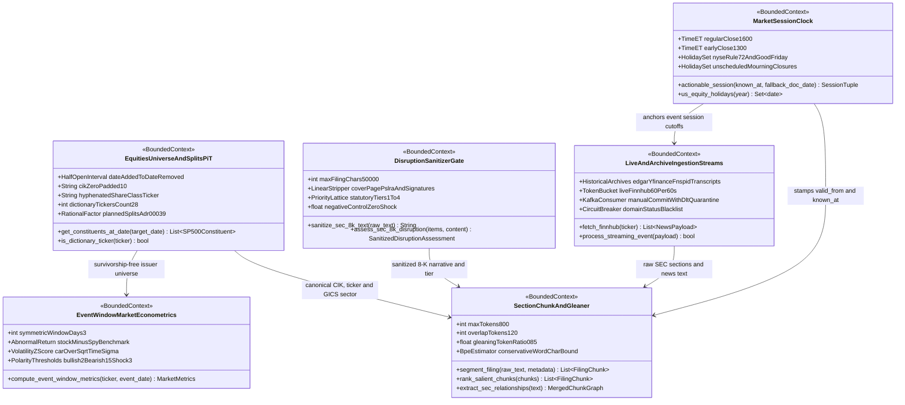
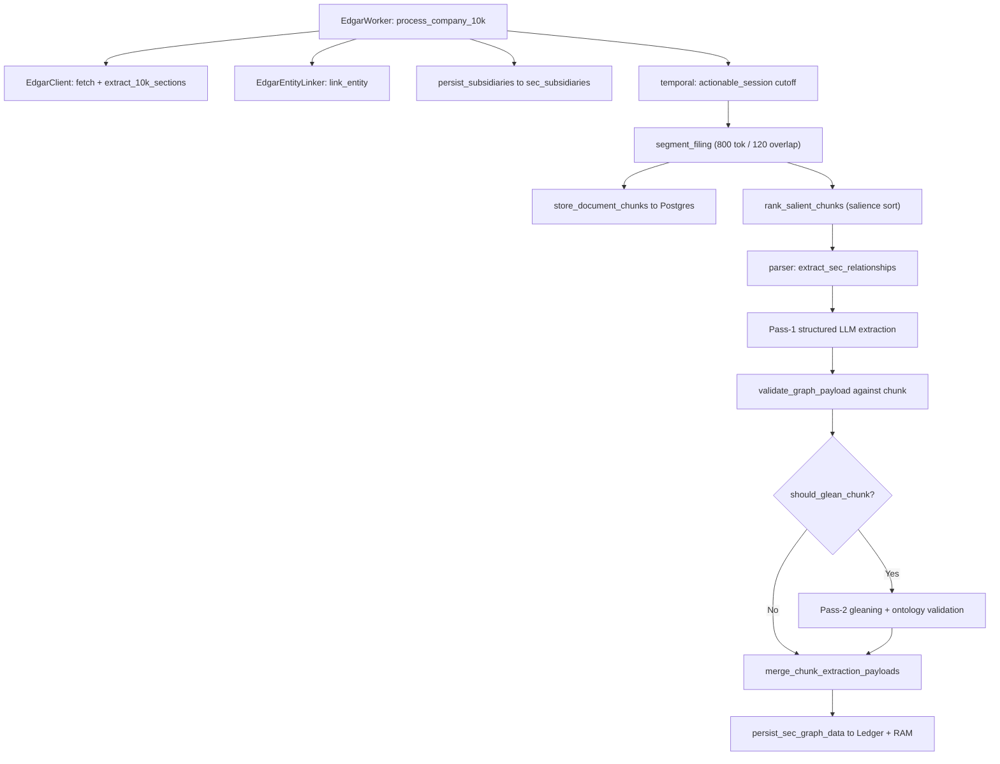
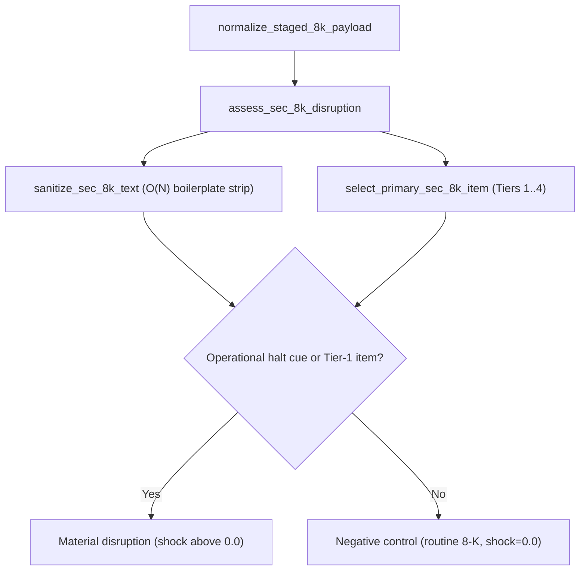
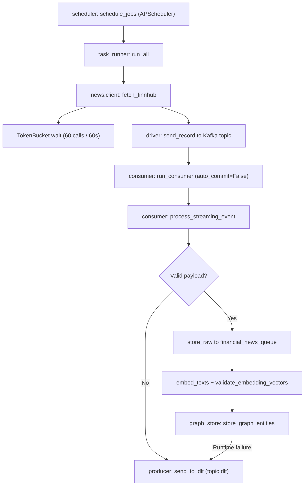

# Chapter 1:<br>Point-in-Time Equity Universes, Market Time & Statutory Ingestion

> **Series Navigation**: [Part 0 (System Atlas)](00-system-atlas.md) | **Part 1 (PiT Universe & Ingestion)** | [Part 2 (Ontology, Linkage & Ledger)](02-ontology-linkage-and-ledger.md) | [Part 3 (Retrieval, Contagion & Reporting)](03-retrieval-contagion-and-reporting.md) | [Part 4 (Curation & Model Foundry)](04-curation-and-model-foundry.md)

Quantitative supply-chain intelligence stands or falls at the data-grounding boundary. Before a single edge enters the Knowledge Graph or a single token reaches a language model, an institutional pipeline must answer three empirical questions without look-ahead bias: *Which issuers actually belonged to the equity benchmark on date $t$? At which cash-equity trading session did a statutory disclosure become actionable? And does a filing describe an executed operational disruption or routine legal boilerplate?*

This chapter documents YarnBall's upstream universe, temporal, econometric, and ingestion subsystems (`universe/`, `ingestion/`, `streaming/`, and the market-session clock in [`retrieval/temporal.py`](../../retrieval/temporal.py)), governed by [ADR-00041](../decisions/ADR-00041-ch1-pit-universe-and-statutory-ingestion.md). **Part A** formalizes the financial, market-microstructure, and statistical mechanisms as a standalone domain report. **Part B** provides the complete module inventory, three AST-verified execution call graphs, CLI interfaces, and relational/Parquet schemas.

---

## Part A: Domain & Theoretical Technical Report

### A.1 Topic-Level Conceptual Architecture

At the domain level, Chapter 1 transforms raw regulatory filings, equity price series, and live news wires into bitemporally stamped document chunks, extracted candidate subgraphs, sanitized Form 8-K shock vectors, and market abnormal-return telemetry.



**Figure 1.1:** *Chapter 1 topic-level domain architecture covering PiT equity universes, market time, statutory gating, segmentation, econometrics, and streaming.*

---

### A.2 Survivorship Bias, Corporate Split Actions & Point-in-Time Equity Universes

Backtesting a financial model on a static snapshot of current S&P 500 members introduces two compounding statistical biases:
1. **Ex-post conditioning (upward bias)**: recent index entrants (`PLTR`, `CRWD`, `SMCI`, `KKR`) entered the S&P 500 *because* of prior multi-year growth; including them in 2019 cohorts conditions on future success.
2. **Terminal event censoring (downward risk omission)**: firms removed due to receivership (`SIVB`, `FRC`, `SBNY`), distress/market-cap contraction (`DISH`, `LUMN`, `VNO`), or acquisition (`ATVI`, `XLNX`, `CELG`, `RTN`, `TWTR`) vanish from modern constituent tables, censoring the exact tail-risk events a contagion system exists to detect.

[`SP500UniverseManager`](../../universe/sp500.py) (a pre-ADR foundation later integration-tested under [ADR-00005](../decisions/ADR-00005-sit-flow-1-pit-sec-filing-to-kg-ingest--.md)) defines the point-in-time S&P 500 constituent universe $\mathcal{U}(t)$ on calendar date $t$ by modeling each constituent record $i$ as a half-open membership interval $[d_i^{\text{add}}, d_i^{\text{rem}})$, where $d_i^{\text{add}}$ defaults to the modern 500-stock S&P index inception (`1957-03-04`) when unrecorded and $d_i^{\text{rem}} = \varnothing$ denotes active membership:

$$i \in \mathcal{U}(t) \iff \left(d_i^{\text{add}} \le t\right) \;\land\; \left(d_i^{\text{rem}} = \varnothing \,\lor\, t < d_i^{\text{rem}}\right) \tag{1.1}$$

meaning issuer $i$ belongs to the active point-in-time universe $\mathcal{U}(t)$ if and only if its addition date $d_i^{\text{add}}$ is on or before $t$ and it has not yet been removed ($d_i^{\text{rem}} = \varnothing$ or $t < d_i^{\text{rem}}$).

#### Identifier Hygiene & Dictionary-Ticker Collision Defense
Cross-source equity datasets routinely disagree on share-class punctuation and entity identifiers. [`SP500Constituent`](../../universe/sp500.py) enforces four normalization invariants at construction:
- **10-digit SEC Central Index Key (CIK)**: zero-padded (`0000320193` for Apple Inc.), serving as the immutable legal registrant key across ticker changes (`FB` $\rightarrow$ `META`).
- **Dual-class share punctuation**: canonicalizes dot notation (`BRK.B`, `BF.B`) to hyphenated notation (`BRK-B`, `BF-B`) via `canonical_ticker` for compatibility across EDGAR and `yfinance`.
- **Listing venue canonicalization**: `normalize_exchange` maps raw exchange strings (`ISLAND`, `BATS`, `ARCA`) onto `{NASDAQ, NYSE, AMEX, CBOE, OTC, UNKNOWN}`, enriched offline from SEC master files and `HISTORICAL_DELISTED_EXCHANGES` in [`universe/builder.py`](../../universe/builder.py).
- **Lexical collision defense (`DICTIONARY_TICKERS`)**: 28 valid uppercase tickers (`A`, `ALL`, `ARE`, `BE`, `BEST`, `BIG`, `CAN`, `CAT`, `FAST`, `FOR`, `GAP`, `HAS`, `IT`, `KEY`, `LOW`, `MAN`, `NET`, `NEW`, `NOW`, `ON`, `ONE`, `OUT`, `SEE`, `SO`, `STAY`, `TRUE`, `TWO`, `WELL`) plus all single-character tickers trigger `is_dictionary_ticker(t) = True`, blocking downstream unanchored uppercase string matches from merging common English prose words onto S&P 500 nodes.

#### Planned Extension: Point-in-Time Stock-Split & Reverse-Split Registry (`PROPOSED` [ADR-00039](../decisions/ADR-00039-sp500-pit-stock-split-corporate-actions-.md))
While `yfinance` applies backward split adjustments by default, inferring splits from SEC EDGAR on-the-fly during backtests is prohibitively slow, omits delisted constituents, and masks behavioral drift around split announcements (`declared_date`) and execution dates (`ex_date`). Proposed [ADR-00039](../decisions/ADR-00039-sp500-pit-stock-split-corporate-actions-.md) specifies an offline-built `sp500_stock_splits` registry keyed on `(cik, ticker, ex_date)` (preserving distinct records for dual-class S&P 500 issuers such as `GOOGL` and `GOOG` under CIK `0001652044`) with exact rational share ratios $F(i, t_1, t_2) = \prod_{t_1 < d_{\text{ex}}(s) \le t_2} (N_s / D_s) \in \mathbb{Q}_{>0}$ for both forward splits ($N_s > D_s$) and reverse splits ($N_s < D_s$, such as `GE` `1:8` on `2021-08-02`).

---

### A.3 Market Microstructure Time, Exchange Calendars & Bitemporal Grounding

In financial event studies and point-in-time retrieval, every assertion carries **two distinct temporal coordinates** ([ADR-00033](../decisions/ADR-00033-bitemporal-pit-contract-for-read-paths--.md)):
1. **Valid time $[t_{\text{valid\_from}}, t_{\text{valid\_to}})$**: the economic interval during which the relationship held in the real world.
2. **Transaction / knowledge time $t_{\text{known}}$ (`known_at`)**: the exact UTC timestamp when the public market first observed the disclosure (for example, the SEC EDGAR `acceptance_datetime` header).

#### U.S. Cash-Equity Regular-Session Calendar
Under regular-hours execution (no after-hours trading), a filing accepted by EDGAR at `16:05 ET` on Tuesday cannot be acted upon until Wednesday's regular session. [`retrieval/temporal.py`](../../retrieval/temporal.py) implements a self-contained NYSE/NASDAQ/Cboe calendar (`US_EASTERN = ZoneInfo("America/New_York")`):
- **Regular and half-day closes**: `REGULAR_CLOSE_ET = 16:00:00` on standard sessions; `EARLY_CLOSE_ET = 13:00:00` on scheduled half-days (`us_equity_early_closes`: the Friday after Thanksgiving, July 3 when open Mon–Fri, and December 24 when open Mon–Fri).
- **Exchange holidays (`us_equity_holidays`)**: New Year's Day (applying **NYSE Rule 7.2**: Saturday Jan 1 does *not* close the preceding Friday Dec 31), MLK Jr. Day, Presidents' Day, Good Friday (computed via the Meeus-Jones-Butcher Gregorian Easter algorithm `_easter_sunday(y) - 2 days`), Memorial Day, Juneteenth (effective `year >= 2022`), Independence Day, Labor Day, Thanksgiving, Christmas, plus historical unscheduled National Days of Mourning (`2018-12-05` and `2025-01-09`).

Given raw acceptance timestamp $t_{\text{known}}$ (including 14-digit EDGAR header strings `YYYYMMDDHHMMSS` interpreted in `America/New_York`) and fallback document date $d_{\text{doc}}$, the actionable-session operator $\tau_{\text{act}}$ in `actionable_session(known_at, fallback_doc_date)` is:

$$\tau_{\text{act}}(t_{\text{known}}, d_{\text{doc}}) = \begin{cases} d_{\text{ET}}, & \text{if } t_{\text{known}} \ne \varnothing \;\land\; \text{open}(d_{\text{ET}}) \;\land\; \text{time}_{\text{ET}}(t_{\text{known}}) \le t_{\text{close}}(d_{\text{ET}}) \\[4pt] \text{next\_open}(d_{\text{ET}}), & \text{if } t_{\text{known}} \ne \varnothing \;\land\; \big(\neg\text{open}(d_{\text{ET}}) \,\lor\, \text{time}_{\text{ET}}(t_{\text{known}}) > t_{\text{close}}(d_{\text{ET}})\big) \\[4pt] \text{next\_open}(d_{\text{doc}}), & \text{if } t_{\text{known}} = \varnothing \;\land\; d_{\text{doc}} \ne \varnothing \quad (\text{conservative end-of-day imputation}) \end{cases} \tag{1.2}$$

where $d_{\text{ET}}$ and $\text{time}_{\text{ET}}(t_{\text{known}})$ are the `America/New_York` calendar date and wall-clock time of $t_{\text{known}}$, $\text{open}(d)$ indicates whether U.S. equity markets are open on date $d$, $t_{\text{close}}(d) \in \{\text{16:00 ET}, \text{13:00 ET}\}$ is the scheduled close on date $d$, and $\text{next\_open}(d)$ returns the strictly next trading session via `next_us_equity_trading_day(d)`. When only a calendar `filing_date` $d_{\text{doc}}$ is available (`known_at_imputed = True`), `actionable_session` imputes $t_{\text{known}}$ to `23:59:59 ET` on $d_{\text{doc}}$ and advances `valid_from` to `next_us_equity_trading_day(d_doc)`, guaranteeing zero intraday look-ahead bias even on legacy date-only archives.

---

### A.4 Statutory Disclosure Structure, Form 8-K Sanitization & Disruption Gating

Raw SEC Form 8-K filings contain dense legal framing that triggers false positives in naive keyword or LLM pipelines: cover-page checkboxes, Private Securities Litigation Reform Act (PSLRA) Safe Harbor disclaimers listing hypothetical catastrophes, Exchange Act signature blocks, and `Item 9.01` exhibit tables.

[`ingestion/sec/disruption_gating.py`](../../ingestion/sec/disruption_gating.py) ([ADR-00014](../decisions/ADR-00014-sec-8k-boilerplate-sanitization-gating--.md), [ADR-00027](../decisions/ADR-00027-canonical-staged-8k-envelope-and-catalog.md)) executes a stateless, linear-time $O(N)$ preprocessing and gating pass capped at `DEFAULT_MAX_FILING_CHARS = 50_000`:

1. **Structural Boilerplate Sanitization (`sanitize_sec_8k_text`)**:
   - Splits explicitly fenced or post-signature attached `Exhibit 99.x` press releases before truncating each document segment's statutory signature clause (*"Pursuant to the requirements of the Securities Exchange Act of 1934"*) and bounding each segment independently to `50_000` characters (`ADR-00046`), ensuring attached operational press releases survive signature removal while trailing `EXHIBIT INDEX` tables are still discarded.
   - Splits inline headers and paragraphs, dropping blocks matching EDGAR cover-page markers (`commission file number`, `emerging growth company`), PSLRA Safe Harbor disclaimers (`forward-looking statements`, `actual results may differ materially`), and `Item 9.01` exhibit indices on both the primary filing and each attached exhibit.
2. **4-Tier Statutory Item Precedence (`select_primary_sec_8k_item`)**:
   Multi-item Form 8-K filings (for example, `["Item 1.05", "Item 9.01"]` or `["Item 2.02", "Item 7.01", "Item 9.01"]`) are resolved deterministically by statutory severity tier rather than array position:
   - **Tier 1 (Acute Operational / Solvency Shocks)**: `Item 1.05` (Material Cybersecurity Incidents) $\succ$ `Item 1.04` (Mine Safety / Shutdown) $\succ$ `Item 1.03` (Bankruptcy / Receivership) $\succ$ `Item 1.02` (Termination of Material Definitive Agreement) $\succ$ `Item 2.05` (Exit / Disposal Activities) $\succ$ `Item 2.06` (Material Impairments) $\succ$ `Item 2.04` (Triggering Events Accelerating Obligations).
   - **Tier 2 (Commercial Agreements & General Material Events)**: `Item 1.01` $\succ$ `Item 8.01`.
   - **Tier 3 (Financial Results, M&A & Reg FD)**: `Item 2.01` $\succ$ `Item 2.02` $\succ$ `Item 2.03` $\succ$ `Item 7.01`.
   - **Tier 4 (Governance, Bylaws, Directors & Exhibits)**: `Item 3.01`–`3.03`, `4.01`–`4.02`, `5.01`–`5.08`, `6.01`–`6.05`, `Item 9.01`.
3. **Zero-Shock Negative-Control Gating (`assess_sec_8k_disruption`)**:
   Routine governance filings (such as an `Item 5.02` CFO transition or `Item 2.02` earnings release with no operational halt cues in sanitized text) receive `is_material_operational_disruption = False`, `disruption_category = NONE_ROUTINE_GOVERNANCE_OR_FINANCIAL`, and strictly zero shock parameters (`recommended_shock_magnitude_pct = 0.0`, `recommended_shock_duration_days = 0.0`), short-circuiting downstream cascade propagation before false alarms can form.

---

### A.5 Section-Aware Segmentation, Salience Ordering & Targeted 1-Pass Gleaning

Long Form 10-K `Item 1` (Business) and `Item 1A` (Risk Factors) sections frequently span 15,000 to 40,000 tokens. Truncating sections to a fixed character budget silently discards tail supplier and customer disclosures, whereas naive fixed-length slicing strips issuer and period identity from interior chunks.

[`FinancialSectionSegmenter`](../../ingestion/segmentation/chunker.py) and [`extract_sec_relationships`](../../ingestion/sec/parser.py) ([ADR-00035](../decisions/ADR-00035-text-unit-chunk-layer-and-evidence-links.md)) enforce lossless, section-bounded extraction:

1. **Conservative Deterministic Token Bound**:
   To prevent prompt overflow on Qwen/BPE tokenizers without invoking a runtime tokenizer dependency inside pure chunking paths, `estimate_token_count(x)` bounds token allocation via:

   $$\hat{T}(x) = \left\lfloor \max\!\left(1.35\, W(x),\; \frac{C(x)}{3.7}\right) + 1 \right\rfloor \tag{1.3}$$

   where $\hat{T}(x)$ is the conservative token-count estimate for text $x$, $W(x)$ is whitespace word count, and $C(x)$ is character length.
2. **Section-Aware Windowing & Immutable Headers**:
   `FinancialSectionSegmenter` (`max_tokens = 800`, `overlap_tokens = 120`, `min_chunk_tokens = 40`) splits filings along 25 canonical `10-K`/`10-Q`/`8-K`/`20-F`/`Exhibit 21` regex boundaries defined in [`ingestion/sec/canon.py`](../../ingestion/sec/canon.py) ([ADR-00045](../decisions/ADR-00045-canonical-sec-edgar-filing-registry-----.md)) first, then packs paragraphs and sentences within each section while prepending an immutable header (`[DOCUMENT: SEC Form 10-K | CIK: ... | TICKER: ... | COMPANY: ... | PERIOD: ... | DATE: ... | SECTION: ...]`) and assigning deterministic `make_chunk_id(doc_id, section, ordinal)` keys persisted into PostgreSQL `document_chunks`.
3. **Non-Truncating Salience Ordering & Conditional Pass-2 Gleaning**:
   `rank_salient_chunks` orders chunks descending by relational supply-chain cue count (`score_chunk_salience`) while retaining **100% of chunks** ([ADR-00035](../decisions/ADR-00035-text-unit-chunk-layer-and-evidence-links.md) Invariant #4). After Pass-1 extraction on chunk $c$, `should_glean_chunk` triggers a single targeted Pass-2 gleaning prompt if and only if:

   $$\text{Glean}(c) \iff \text{HighSignal}(\text{sec}_c) \;\land\; \neg\text{runaway}_1 \;\land\; \Big(|E_1(c)| \ge 1 \;\lor\; T_{\text{gen},1}(c) \ge \lfloor 0.85\, T_{\max} \rfloor\Big) \tag{1.4}$$

   where $\text{HighSignal}(\text{sec}_c)$ (evaluated via `is_high_signal_section` in [`ingestion/sec/canon.py`](../../ingestion/sec/canon.py)) holds when chunk $c$'s statutory section $\text{sec}_c$ is `Item 1`, `Item 1A`, `Item 1C` (explicitly excluding `Item 1B`), Tier-1/Tier-2 Form 8-K operational items (`Item 1.01`–`1.05`, `Item 2.01`, `Item 2.04`–`2.06`, `Item 8.01`), reserved `20-F` `Item 3.D`/`Item 4`, or—when `gics_sector` is supplied per [ADR-00046](../decisions/ADR-00046-sec-core-sections-amendments-exhibit-991.md)—sector-scoped sections (`Item 2` for `Real Estate`, `Item 4` for `Materials`/`Energy`, `Item 7` MD&A for `Financials`); $\text{runaway}_1$ indicates Pass-1 hit runaway loop truncation; $|E_1(c)|$ is the Pass-1 extracted edge count; $T_{\text{gen},1}(c)$ is the Pass-1 generated token count; and $T_{\max} = 512$ is the Pass-1 output budget. Pass-2 failures are quarantined non-destructively (`ErrorStage.GLEANING_PARSE_FAILED`) without discarding Pass-1 triples.

---

### A.6 Event-Window Market Econometrics & Historical-vs-Live Source Partitioning

#### Event-Study Abnormal Returns & Volatility Polarity
To ground historical events and SFT volatility boundary cohorts in realized market reactions, [`MarketMetricsCalculator`](../../ingestion/market/parser.py) computes symmetric $[T - k, T + k]$ (`window_days` $k = 3$) event-window metrics from daily `yfinance` OHLCV histories against `SPY`:

$$R_{i,[t_{\text{pre}}, t_{\text{post}}]} = \frac{P_i(t_{\text{post}}) - P_i(t_{\text{pre}})}{\max(10^{-4},\, P_i(t_{\text{pre}}))}, \qquad \text{CAR}_{i} = R_{i,[t_{\text{pre}}, t_{\text{post}}]} - R_{m,[t_{\text{pre}}, t_{\text{post}}]} \tag{1.5}$$

where $P_i(t_{\text{pre}})$ and $P_i(t_{\text{post}})$ are issuer $i$'s adjusted closing prices at the start and end of the $[t_{\text{pre}}, t_{\text{post}}]$ event window, $R_{i,[t_{\text{pre}}, t_{\text{post}}]}$ and $R_{m,[t_{\text{pre}}, t_{\text{post}}]}$ are the cumulative returns of issuer $i$ and the `SPY` market benchmark, and $\text{CAR}_i$ is the resulting Cumulative Abnormal Return. Baseline daily return volatility $\hat{\sigma}_i = \sqrt{\max(10^{-8},\, s_r^2)}$ (defaulting to `0.02` if fewer than 2 daily returns exist) scales over $\Delta t = \max(1, \text{idx}_{\text{post}} - \text{idx}_{\text{pre}})$ trading sessions via square-root-of-time diffusion to yield the standardized volatility $z$-score and 5-axis polarity regime:

$$z_i = \frac{\text{CAR}_i}{\hat{\sigma}_i \sqrt{\Delta t}}, \qquad \text{Polarity}(z_i) = \begin{cases} \texttt{EXPANDING\_BULLISH}, & z_i \ge +2.0 \\ \texttt{DISRUPTIVE\_SHOCK}, & z_i \le -3.0 \\ \texttt{CONTRACTING\_BEARISH}, & -3.0 < z_i \le -1.5 \\ \texttt{NEUTRAL\_STABLE}, & -1.5 < z_i < +2.0 \end{cases} \tag{1.6}$$

#### Strict Historical-vs-Live Source Partitioning & Rate-Limited Streaming
YarnBall enforces an explicit architectural wall between multi-year historical archives (`2018–2025+`) and live forward streaming:
- **Historical & Dry-Run Grounding**: SEC EDGAR filings via `edgartools` ([`EdgarClient`](../../ingestion/sec/client.py)), daily OHLCV via `yfinance` ([`YahooFinanceClient`](../../ingestion/market/client.py)), local FNSPID Parquet news archives ([`HistoricalNewsIngestor`](../../ingestion/news/harvester.py)), and cached quarterly earnings call transcripts ([`EarningsTranscriptIngestor`](../../ingestion/transcripts/harvester.py)).
- **Live Forward Streaming Only**: [`fetch_finnhub`](../../ingestion/news/client.py) is strictly reserved for real-time forward ingestion (Finnhub's free tier lacks multi-year depth), throttled by a thread-safe continuous-refill [`TokenBucket`](../../ingestion/news/client.py) with capacity $B = 60$ (`capacity = 60`, `refill_seconds = 60`) and refill rate $r = 1.0\text{ token/s}$:

  $$b(t) = \min\!\big(B,\; b(t_0) + r\,(t - t_0)\big) \tag{1.7}$$

  where $b(t)$ is the token balance available at monotonic time $t$ and $t_0$ is the prior refill timestamp. Live payloads publish to Kafka via [`streaming/driver.py`](../../streaming/driver.py) and are consumed by [`streaming/consumer.py`](../../streaming/consumer.py) (`enable_auto_commit = False`), which validates required fields (`raw_payload`, `fetched_at`, `source_hash`), persists deduplicated rows into `financial_news_queue`, embeds text via `embed_texts` (failing fast on `EmbedderUnavailableError` / `InvalidEmbeddingError` per [ADR-00020](../decisions/ADR-00020-fail-fast-embedder-and-zero-vector-guard.md)), merges extracted entities, and routes malformed or failed payloads deterministically to `<KAFKA_TOPIC>.dlt` ([ADR-00003](../decisions/ADR-00003-sit-flow-4-streaming-event-graph-update-.md)).

---

### A.7 Chapter 1 Theory-to-Code Crosswalk Table

Every `<package>.<module>:<symbol>` anchor below is AST-verified by [`tests/docs/test_docs_integrity.py`](../../tests/docs/test_docs_integrity.py).

**Table 1.1:** *Chapter 1 Theory-to-Code Crosswalk (PiT Universe, Market Calendar, 8-K Gating, Chunking, and Market Econometrics).*

| Concept / Mathematical Invariant | Code Anchor (`module:symbol`) | Provenance | Verification Suite |
| :--- | :--- | :--- | :--- |
| PiT S&P 500 membership $[d^{\text{add}}, d^{\text{rem}})$ | `universe.sp500:SP500UniverseManager.get_constituents_at_date` | Pre-ADR + [ADR-00005](../decisions/ADR-00005-sit-flow-1-pit-sec-filing-to-kg-ingest--.md) | [`test_sp500_universe.py`](../../tests/universe/test_sp500_universe.py) |
| Dual-class hyphenated ticker & 10-digit CIK | `universe.sp500:SP500Constituent` | Pre-ADR Foundation | [`test_sp500_universe.py`](../../tests/universe/test_sp500_universe.py) |
| 28-word English dictionary ticker guard | `universe.sp500:is_dictionary_ticker` | Pre-ADR + [ADR-00025](../decisions/ADR-00025-entity-stoplist-and-dynamic-cik-rollup--.md) | [`test_sp500_universe.py`](../../tests/universe/test_sp500_universe.py) |
| Wikipedia + delisted turnover universe builder | `universe.builder:get_historical_turnover_records` | Pre-ADR Foundation | [`test_builder.py`](../../tests/universe/test_builder.py) |
| NYSE Rule 7.2 & mourning-closure holiday set | `retrieval.temporal:us_equity_holidays` | [ADR-00033](../decisions/ADR-00033-bitemporal-pit-contract-for-read-paths--.md) | [`test_pit_invariants.py`](../../tests/retrieval/test_pit_invariants.py) |
| `13:00 ET` scheduled early-close sessions | `retrieval.temporal:us_equity_early_closes` | [ADR-00033](../decisions/ADR-00033-bitemporal-pit-contract-for-read-paths--.md) | [`test_pit_invariants.py`](../../tests/retrieval/test_pit_invariants.py) |
| Actionable regular-session cutoff $\tau_{\text{act}}$ | `retrieval.temporal:actionable_session` | [ADR-00033](../decisions/ADR-00033-bitemporal-pit-contract-for-read-paths--.md) | [`test_pit_invariants.py`](../../tests/retrieval/test_pit_invariants.py) |
| Linear-time Form 8-K PSLRA & signature stripper | `ingestion.sec.disruption_gating:sanitize_sec_8k_text` | [ADR-00014](../decisions/ADR-00014-sec-8k-boilerplate-sanitization-gating--.md) | [`test_sec_8k_disruption_gating.py`](../../tests/ingestion/test_sec_8k_disruption_gating.py) |
| 4-tier Form 8-K statutory item precedence | `ingestion.sec.disruption_gating:select_primary_sec_8k_item` | [ADR-00014](../decisions/ADR-00014-sec-8k-boilerplate-sanitization-gating--.md) | [`test_sec_8k_disruption_gating.py`](../../tests/ingestion/test_sec_8k_disruption_gating.py) |
| Zero-shock negative-control disruption gate | `ingestion.sec.disruption_gating:assess_sec_8k_disruption` | [ADR-00014](../decisions/ADR-00014-sec-8k-boilerplate-sanitization-gating--.md) | [`test_sec_8k_disruption_gating.py`](../../tests/ingestion/test_sec_8k_disruption_gating.py) |
| Canonical staged Form 8-K envelope normalizer | `ingestion.sec.disruption_gating:normalize_staged_8k_payload` | [ADR-00027](../decisions/ADR-00027-canonical-staged-8k-envelope-and-catalog.md) | [`test_staged_8k_envelope_adr00027.py`](../../tests/ingestion/sec/test_staged_8k_envelope_adr00027.py) |
| Canonical SEC EDGAR 33-form, exhibit & section registry | `ingestion.sec.canon:SECFormType` | [ADR-00045](../decisions/ADR-00045-canonical-sec-edgar-filing-registry-----.md) | [`test_sec_canon_integrity.py`](../../tests/ingestion/sec/test_sec_canon_integrity.py) |
| Conservative BPE token bound $\hat{T}(x)$ | `ingestion.segmentation.chunker:estimate_token_count` | Pre-ADR + [ADR-00035](../decisions/ADR-00035-text-unit-chunk-layer-and-evidence-links.md) | [`test_section_segmenter.py`](../../tests/ingestion/test_section_segmenter.py) |
| `800`/`120` section-aware filing segmenter | `ingestion.segmentation.chunker:FinancialSectionSegmenter.segment_filing` | [ADR-00035](../decisions/ADR-00035-text-unit-chunk-layer-and-evidence-links.md) | [`test_adr00035_chunk_evidence.py`](../../tests/ingestion/test_adr00035_chunk_evidence.py) |
| Non-truncating relational salience ranker | `ingestion.sec.parser:rank_salient_chunks` | [ADR-00035](../decisions/ADR-00035-text-unit-chunk-layer-and-evidence-links.md) | [`test_adr00035_chunk_evidence.py`](../../tests/ingestion/test_adr00035_chunk_evidence.py) |
| Targeted 1-pass gleaning gate (`0.85 * max_new_tokens`) | `ingestion.sec.parser:should_glean_chunk` | [ADR-00035](../decisions/ADR-00035-text-unit-chunk-layer-and-evidence-links.md) | [`test_adr00035_chunk_evidence.py`](../../tests/ingestion/test_adr00035_chunk_evidence.py) |
| End-to-end 10-K / Exhibit 21 worker | `ingestion.sec.harvester:EdgarWorker.process_company_10k` | Pre-ADR + [ADR-00035](../decisions/ADR-00035-text-unit-chunk-layer-and-evidence-links.md) | [`test_edgar_worker.py`](../../tests/ingestion/sec/test_edgar_worker.py) |
| Event-window CAR & $\sqrt{\Delta t}$ volatility $z$-score | `ingestion.market.parser:MarketMetricsCalculator.compute_event_window_metrics` | Pre-ADR Foundation | [`test_market_context.py`](../../tests/ingestion/market/test_market_context.py) |
| `60 req/60s` live Finnhub token-bucket limiter | `ingestion.news.client:TokenBucket` | Pre-ADR Foundation | [`test_finnhub_client.py`](../../tests/ingestion/news/test_finnhub_client.py) |
| Publisher paywall/boilerplate filter & circuit breaker | `ingestion.news.parser:is_domain_blacklisted` | Pre-ADR Foundation | [`test_scraping_worker.py`](../../tests/ingestion/news/test_scraping_worker.py) |
| Kafka manual-commit event consumer & DLT router | `streaming.consumer:process_streaming_event` | Pre-ADR + [ADR-00003](../decisions/ADR-00003-sit-flow-4-streaming-event-graph-update-.md) | [`test_streaming_event_loop_flow.py`](../../tests/integration/pipelines/test_streaming_event_loop_flow.py) |

---

## Part B: Software Architecture, Call Graphs & Entry Points

### B.1 Subsystem Module Inventory

**Table 1.2:** *Chapter 1 Subsystem Module Inventory Across `universe/`, `ingestion/`, `streaming/`, and `retrieval/temporal.py`.*

| Module Path | Key Classes & Functions | Role in Chapter 1 Pipeline |
| :--- | :--- | :--- |
| [`universe/sp500.py`](../../universe/sp500.py) | `SP500Constituent`, `SP500UniverseManager`, `is_dictionary_ticker`, `normalize_exchange` | Point-in-time S&P 500 lookups, GICS sector stats, JSON cache & PostgreSQL sync. |
| [`universe/builder.py`](../../universe/builder.py) | `extract_wiki_constituents`, `get_historical_turnover_records`, `enrich_constituents_with_exchanges` | Rebuilds `data/sp500_constituents_historical.json` with 2018–2025 delisted turnover & exchanges. |
| [`retrieval/temporal.py`](../../retrieval/temporal.py) | `PiTContext`, `actionable_session`, `us_equity_holidays`, `us_equity_early_closes`, `session_close_utc` | Shared U.S. equity session calendar (`16:00 ET` / `13:00 ET`) stamping write-time `valid_from` & `known_at`. |
| [`ingestion/__init__.py`](../../ingestion/__init__.py) & [`ingestion/task_runner.py`](../../ingestion/task_runner.py) | `@ingest_task`, `run_all` | Task decorator registry and batch runner dispatching registered ingestion jobs. |
| [`ingestion/segmentation/chunker.py`](../../ingestion/segmentation/chunker.py) | `FilingMetadata`, `FilingChunk`, `FinancialSectionSegmenter`, `estimate_token_count` | Section-aware `800`-token / `120`-overlap segmentation with immutable metadata headers. |
| [`ingestion/sec/canon.py`](../../ingestion/sec/canon.py) | `SECFormType`, `SECForm8KItem`, `SEC_FORM_CANON`, `SEC_EXHIBIT_CANON`, `SEC_SECTION_CANON`, `is_termination_eligible_form`, `is_high_signal_section` | Zero-dependency single source of truth for all 33 SEC forms, 9 exhibits, 32 8-K items, 4-tier lattice & 25 section regexes ([ADR-00045](../decisions/ADR-00045-canonical-sec-edgar-filing-registry-----.md)). |
| [`ingestion/sec/client.py`](../../ingestion/sec/client.py) | `EdgarClient`, `download_filings_for_ticker` | `edgartools` transport wrapper fetching `10-K`/`10-K/A` (6 sections + `Exhibit 21`), part-qualified `10-Q`/`10-Q/A`, `8-K`/`8-K/A` + `Exhibit 99.x` & `acceptance_datetime` ([ADR-00046](../decisions/ADR-00046-sec-core-sections-amendments-exhibit-991.md)). |
| [`ingestion/sec/disruption_gating.py`](../../ingestion/sec/disruption_gating.py) | `SanitizedDisruptionAssessment`, `sanitize_sec_8k_text`, `select_primary_sec_8k_item`, `assess_sec_8k_disruption`, `normalize_staged_8k_payload` | Linear-time Form 8-K boilerplate sanitization, 4-tier item precedence, and negative-control shock gating. |
| [`ingestion/sec/parser.py`](../../ingestion/sec/parser.py) | `EdgarEntityLinker`, `rank_salient_chunks`, `should_glean_chunk`, `extract_sec_relationships` | 4-tier SEC entity linking, non-truncating salience sorting, Pass-1 extraction & Pass-2 gleaning. |
| [`ingestion/sec/harvester.py`](../../ingestion/sec/harvester.py) | `HistoricalSECHarvester`, `EdgarWorker`, `run_sec_ingestion` | Orchestrates SEC filing download, `document_chunks` persistence, `sec_subsidiaries` load & KG commit. |
| [`ingestion/market/client.py`](../../ingestion/market/client.py) | `YahooFinanceClient` | Historical daily OHLCV transport for equities and `SPY` benchmark via `yfinance`. |
| [`ingestion/market/parser.py`](../../ingestion/market/parser.py) | `MarketMetricsCalculator` | Computes event-window returns, market-adjusted CAR, $\sqrt{\Delta t}$ volatility $z$-score & polarity. |
| [`ingestion/market/harvester.py`](../../ingestion/market/harvester.py) | `MarketContextIntegrator` | Coordinates OHLCV pulls, metric computation, and Snappy Parquet staging (`sp500_market_context.parquet`). |
| [`ingestion/news/client.py`](../../ingestion/news/client.py) | `TokenBucket`, `fetch_finnhub`, `check_api` | Rate-limited (`60/60s`) live Finnhub news fetcher publishing normalized records to Kafka. |
| [`ingestion/news/parser.py`](../../ingestion/news/parser.py) | `compute_source_hash`, `is_paywall_or_stub`, `strip_publisher_boilerplates`, `is_domain_blacklisted` | SHA-256 deduplication, HTML/paywall cleaning, and PostgreSQL `domain_status` circuit-breaker logic. |
| [`ingestion/news/harvester.py`](../../ingestion/news/harvester.py) | `MultiSourceNewsHarvester`, `HistoricalNewsIngestor` | Offline FNSPID / Form 8-K historical news loader and multi-source queue ingestor. |
| [`ingestion/transcripts/client.py`](../../ingestion/transcripts/client.py), [`parser.py`](../../ingestion/transcripts/parser.py), [`harvester.py`](../../ingestion/transcripts/harvester.py) | `TranscriptSourceClient`, `EarningsTranscriptParser`, `EarningsTranscriptIngestor` | Local cached quarterly earnings transcript reader, speaker/Q&A turn splitter & Parquet stager. |
| [`streaming/producer.py`](../../streaming/producer.py), [`driver.py`](../../streaming/driver.py), [`consumer.py`](../../streaming/consumer.py) | `send_record`, `publish_message`, `send_to_dlt`, `process_streaming_event`, `run_consumer` | Kafka producer/consumer envelope with manual offset commits and `<topic>.dlt` dead-letter routing. |
| [`tools/scheduler.py`](../../tools/scheduler.py) & [`tools/reextract_sp500_chunks.py`](../../tools/reextract_sp500_chunks.py) | `schedule_jobs`, `run_sp500_chunk_reextraction` | APScheduler daemon for live feeds and checkpointed S&P 500 chunk re-extraction CLI. |

---

### B.2 AST-Verified Execution Call Graphs

#### Pipeline 1: SEC Form 10-K & Exhibit 21 Chunked Ingestion & Targeted Gleaning



**Figure 1.2:** *Execution call graph for SEC Form 10-K and Exhibit 21 chunked ingestion with conditional Pass-2 gleaning.*

#### Pipeline 2: SEC Form 8-K Boilerplate Sanitization & Disruption Gating



**Figure 1.3:** *Execution call graph for linear-time SEC Form 8-K boilerplate sanitization and 4-tier disruption gating.*

#### Pipeline 3: Live Scheduled Finnhub Fetch & Kafka DLT Streaming Loop



**Figure 1.4:** *Execution call graph for scheduled live Finnhub polling, token-bucket throttling, and manual-commit Kafka DLT streaming.*

---

### B.3 CLI Entry Points, Environment Variables & Persistence Contracts

#### CLI Invocations

```bash
# 1. Rebuild historical S&P 500 constituent cache and inspect point-in-time sector breakdown
.venv/bin/python -m universe.builder
.venv/bin/python -m universe.sp500 --date 2022-09-15 --stats

# 2. Download & ingest SEC filings into PostgreSQL document_chunks, kg_nodes/kg_edges & Memgraph
.venv/bin/python -m ingestion.sec.client --tickers AAPL,NVDA,TSM --forms 10-K,8-K
.venv/bin/python -m ingestion.sec.harvester --tickers AAPL,NVDA

# 3. Resumable checkpointed 800-token chunk re-extraction across S&P 500 filings
.venv/bin/python -m tools.reextract_sp500_chunks --checkpoint-file data/checkpoints/reextract.jsonl

# 4. Stage event-window CAR & volatility z-score Parquet archive
.venv/bin/python -m ingestion.market.harvester
```

#### Key Chapter 1 Configuration & Persistence Contracts

**Table 1.3:** *Chapter 1 Configuration Flags, Archive Formats, and Staged Payload Contracts.*

| Variable / Artifact | Default / Location | Contract Summary |
| :--- | :--- | :--- |
| `ENABLE_TARGETED_GLEANING` | `"1"` (`ingestion/sec/parser.py`) | Enables conditional Pass-2 gleaning on high-signal SEC sections when Pass-1 edges $\ge 1$ or generated tokens $\ge 435$ (`0.85 * 512`). |
| `FINNHUB_API_KEY` / `FINNHUB_TICKERS` | Env (`ingestion/news/client.py`) | Credentials and symbol allowlist for live streaming only (never historical backtests). |
| `KAFKA_TOPIC` / `KAFKA_DLT_TOPIC` | `<topic>` / `<topic>.dlt` | Primary live ingestion topic and dead-letter quarantine topic (`streaming/consumer.py`). |
| `data/sp500_constituents_historical.json` | JSON array of `SP500Constituent` | Offline cache backing `SP500UniverseManager` (`ticker`, `cik`, `gics_sector`, `date_added`, `date_removed`, `listing_exchange`). |
| `data/market_context/sp500_market_context.parquet` | Snappy Parquet (`MarketContextIntegrator`) | Columns: `ticker`, `event_date`, `window_days`, `window_truncated`, `event_return_pct`, `car_abnormal_return_pct`, `volatility_zscore`, `polarity_sentiment`. |
| Staged Form 8-K Envelope ([ADR-00027](../decisions/ADR-00027-canonical-staged-8k-envelope-and-catalog.md)) | JSON (`normalize_staged_8k_payload`) | Canonical keys: `doc_id`, `ticker`, `cik`, `company_name`, `filing_date`, `timestamp`, `items` (`List[str]`), `headline`, `content`, `metadata`. |
