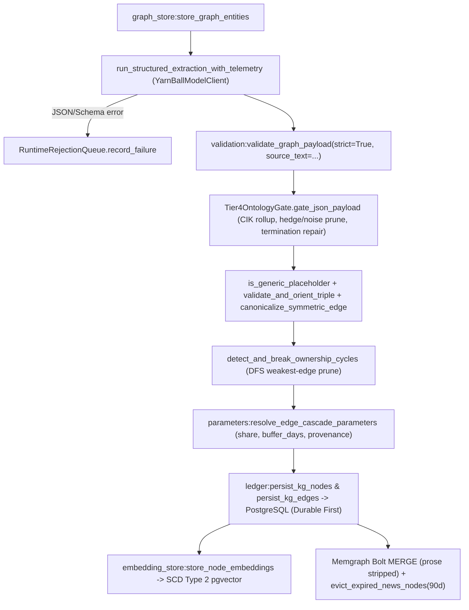
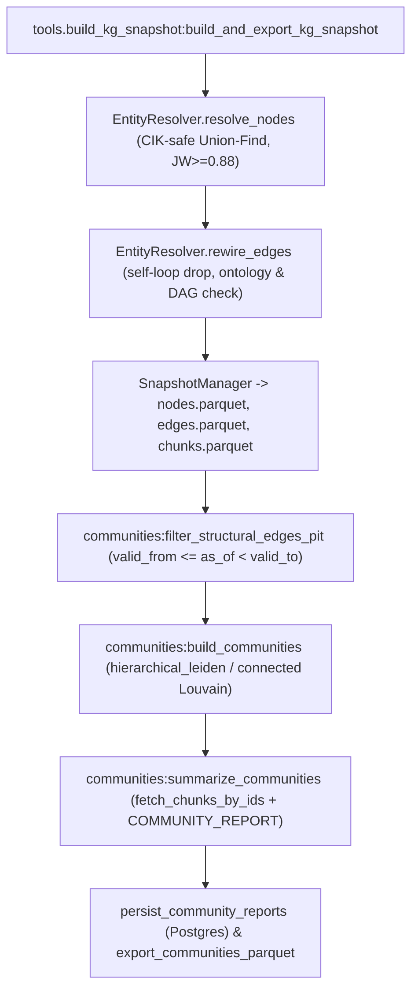

# Chapter 2: Formal Financial Ontology, Entity Linkage & Durable-vs-Ephemeral Graph Storage

> **Series Navigation**: [Part 0 (System Atlas)](00-system-atlas.md) | [Part 1 (PiT Universe & Ingestion)](01-pit-universe-and-ingestion.md) | **Part 2 (Ontology, Linkage & Ledger)** | [Part 3 (Retrieval, Contagion & Reporting)](03-retrieval-contagion-and-reporting.md) | [Part 4 (Curation & Model Foundry)](04-curation-and-model-foundry.md)

Extracting candidate triples from chunked SEC disclosures (Chapter 1) is only half of knowledge-graph construction. Left unchecked, generative language models emit inverted relations (`Company` $\rightarrow$ `CEO_OF` $\rightarrow$ `Person`), convert speculative risk factors (*"may evaluate alternative suppliers"*) into active procurement contracts, treat anonymized placeholders (*"Customer A"*) as real companies, fragment parent corporations across dozens of operating subsidiaries, and overload in-memory Cypher engines with raw filing prose and multi-year news nodes.

This chapter documents YarnBall's formal knowledge-representation, record-linkage, dense-embedding, bitemporal-ledger, and structural community-detection stack (`ontology/`, `embedding/`, `knowledge_graph/`, and snapshot/hydration tooling), governed by [ADR-00042](../decisions/ADR-00042-ch2-ontology-entity-linkage-and-ledger--.md). **Part A** develops the ontological axioms, string/probabilistic linkage metrics, vector geometry, and storage invariants. **Part B** provides the module inventory, three AST-verified write/hydration/snapshot call graphs, and the complete DDL contracts.

---

## Part A: Domain & Theoretical Technical Report

### A.1 Topic-Level Conceptual Architecture

At the conceptual level, Chapter 2 mediates every write between raw chunk extraction and analytical graph storage through seven cooperating domain mechanisms.

```mermaid
classDiagram
    direction TB

    class TBoxAnd5AxisOntology {
        <<BoundedContext>>
        +EntityClasses: 20 canonical concepts
        +Predicates: 26 domain/range typed relations
        +Axes: Identity, Predicate, Polarity, ASC280Materiality, Lifecycle
        +SymmetricOrder: R(min(a,b), max(a,b))
        +compile_to_cypher_dsl(triple) str
    }

    class ClauseAndStructuralGate {
        <<BoundedContext>>
        +ClauseScope: MODAL_HEDGE_REGEX & NEGATION_REGEX (60ch)
        +Stoplist: anonymized counterparties & generic roles
        +OwnershipDAG: DFS weakest-edge cycle pruning
        +DegreeBurst: check_degree_anomaly_quarantine (25)
        +Convergence: target_max_rate = 0.02 (min_support = 3)
        +validate_graph_payload(strict=True) ValidatedGraph
    }

    class UnionFindEntityResolver {
        <<BoundedContext>>
        +EdgarLinker: 4-tier pg_trgm + sec_subsidiaries
        +SafeUnion: CIK & ticker conflict prevention
        +SubsidiaryRollup: dynamic Exhibit 21 -> parent CIK
        +Similarity: Jaro-Winkler >= 0.88, Levenshtein <= 2
        +resolve_nodes(nodes) Tuple~Mapping, Nodes~
    }

    class BitemporalVectorIndex {
        <<BoundedContext>>
        +Model: qwen3-embedding:0.6b (EMBEDDING_DIM = 1024)
        +LiveServing: CPU-pinned (num_gpu = 0, preserves 8GB VRAM)
        +NormGuard: ||v||_2^2 >= 1e-8 (no zero/NaN vectors)
        +NodeVectors: SCD Type 2 PRIMARY KEY (node_id, valid_from)
        +ChunkIndex: pgvector HNSW + tsvector GIN
    }

    class DurableKGLedger {
        <<BoundedContext>>
        +Tables: kg_nodes & kg_edges (PostgreSQL source of truth)
        +EdgePK: (source_id, target_id, rel_type, input_group)
        +ProseStrip: FORBIDDEN_MEMGRAPH_PROSE_KEYS removed
        +Evidence: evidence_chunk_ids JSONB & param_provenance
    }

    class EphemeralMemgraphProjection {
        <<BoundedContext>>
        +Mode: pure in-memory RAM Bolt projection
        +BootHydration: hydrate_memgraph_from_ledger()
        +EventTTL: DEFAULT_MEMGRAPH_EVENT_TTL_DAYS = 90
        +evict_expired_news_nodes(ttl_days=90) int
    }

    class PiTLeidenCommunityPartition {
        <<BoundedContext>>
        +EdgeScope: active structural edges [valid_from, valid_to)
        +Primary: seeded hierarchical_leiden (graspologic)
        +Fallback: connected-component Louvain (Traag invariant)
        +Persistence: community_reports & communities.parquet
    }

    TBoxAnd5AxisOntology --> ClauseAndStructuralGate : domain/range & 5-axis schema
    ClauseAndStructuralGate --> UnionFindEntityResolver : schema-valid, unhedged triples
    UnionFindEntityResolver --> DurableKGLedger : canonical nodes, CIK rollups & rewired edges
    UnionFindEntityResolver --> BitemporalVectorIndex : contextualized entity & chunk texts
    DurableKGLedger --> EphemeralMemgraphProjection : deterministic boot & live Bolt MERGE
    DurableKGLedger --> PiTLeidenCommunityPartition : structural supply-chain topology at as_of
```

---

### A.2 5-Axis Reified Financial Ontology & TBox Axiomatization

Flat Resource Description Framework (RDF) triples `(Apple, SUPPLIES_TO, TSMC)` omit economic direction, statutory materiality, and contract validity. [`ontology/schema.py`](../../ontology/schema.py) and [`ontology/reification.py`](../../ontology/reification.py) formalize a typed Description Logic TBox paired with a 5-axis property-graph reification model:

1. **Domain, Range & Symmetry Axioms (`ONTOLOGY_SCHEMA`)**:
   The TBox defines **20 `EntityClass` concepts** (`COMPANY`, `SUBSIDIARY`, `PERSON`, `EXECUTIVE`, `REGULATORYBODY`, `COMMODITY`, `PRODUCT`, `GEOPOLITICALRISK`, `MARKETEVENT`, `RISK`, `FINANCIALINSTITUTION`, `TECHNOLOGY`, `SECTOR`, `INDUSTRY`, `METRIC`, `LOCATION`, `NEWS`, `FORM`, `FILING`, `DOCUMENT`) and **26 `RelationPredicate` object properties**. Each predicate $R$ is governed by a signature $(\mathcal{D}_R, \mathcal{R}_R, \text{sym}_R)$:
   - **Alias inversion (`PREDICATE_ALIASES`)**: maps inverse surface forms deterministically before validation (`(A, SUPPLIED_BY, B)` $\mapsto$ `(B, SUPPLIES_TO, A)`; `(A, HAS_SUBSIDIARY, B)` $\mapsto$ `(B, SUBSIDIARY_OF, A)`; `(A, ACQUIRED, B)` $\mapsto$ `(B, ACQUIRED_BY, A)`).
   - **Unambiguous domain/range auto-orientation**: if an extracted triple `(Company, CEO_OF, Person)` violates $(x \in \mathcal{D}_R, y \in \mathcal{R}_R)$ in the forward direction while $(y \in \mathcal{D}_R, x \in \mathcal{R}_R)$ holds, `validate_and_orient_triple` inverts the endpoints rather than discarding valid signal.
   - **Symmetric canonicalization (`SYMMETRIC_RELATIONSHIPS`)**: for symmetric predicates (`COMPETES_WITH`, `PARTNERED_WITH`, `CO_INVESTS_WITH`, `PEER_OF`, `COLLABORATES_WITH`), `canonicalize_symmetric_edge` orders endpoints lexicographically so $R(a, b)$ and $R(b, a)$ collapse onto a single undirected canonical edge $R(\min(a,b), \max(a,b))$.

2. **5-Axis Reified Property Tuple (`AnnotatedTriple`)**:
   Every reified relationship carries five orthogonal dimensions:
   - **Axis 1 (Entity Typology & Legal Identity)**: canonical `EntityClass`, ticker, and 10-digit SEC CIK.
   - **Axis 2 (Relational Predicate)**: canonical `RelationPredicate` ($26$ closed-world predicates under `strict = True`, [ADR-00023](../decisions/ADR-00023-unified-live-ontology-gate-and-schema---.md)).
   - **Axis 3 (Directional Polarity)**: `EXPANDING_BULLISH`, `NEUTRAL_STABLE`, `CONTRACTING_BEARISH`, or `DISRUPTIVE_SHOCK`.
   - **Axis 4 (US GAAP ASC 280 Materiality Tier)**: `CRITICAL_TIER_1` ($\ge 10\%$ consolidated revenue disclosures under ASC 280, sole-source foundries, Form 8-K M&A/defaults, and `Exhibit 21` subsidiaries), `MATERIAL_TIER_2` (multi-year commercial or licensing agreements), and `COMMODITY_TIER_3` (interchangeable off-the-shelf vendors).
   - **Axis 5 (Bitemporal Lifecycle & Provenance)**: `LifecycleStatus` (`ACTIVE_CURRENT` vs. `TERMINATED`), `[valid_from, valid_to)`, `provenance`, and calibrated epistemic confidence.

---

### A.3 Linguistic Modality Gating, Structural Graph Axioms & Predicate Convergence

#### Clause-Scoped Hedging & Polarity Negation ([ADR-00024](../decisions/ADR-00024-clause-scoped-negation-and-hedge-filter-.md))
Evaluating modal speculation across an entire 800-token chunk causes catastrophic false negatives: a single boilerplate sentence at the end of a paragraph (*"we may from time to time consider additional vendors"*) would wipe out factual supplier relationships stated two sentences earlier. [`ontology/compiler.py`](../../ontology/compiler.py) splits text along sentence and coordinating-conjunction boundaries (`split_financial_clauses`: `but`, `while`, `however`, `although`, `whereas`, and verb-headed `, and`) and evaluates two local predicates strictly over entity-matching clauses in `chunk.text` ([ADR-00035](../decisions/ADR-00035-text-unit-chunk-layer-and-evidence-links.md)):
- **Epistemic hedge suppression (`is_triple_hedged`)**: suppresses candidate edges whose entity-bearing clause(s) match `MODAL_HEDGE_REGEX` (*"may consider"*, *"may from time to time consider"*, *"exploring the possibility"*, *"preliminary talks"*, *"conditional upon"*).
- **Bounded-window polarity negation (`has_unnegated_pattern`)**: a lexical shock/bearish/bullish trigger match at character offset $m$ in clause $c$ is accepted iff `NEGATION_REGEX` (`not`, `no`, `never`, `avoided`, `without`, `no longer`, `failed to`) does not match in the preceding 60-character local window $c[\max(0, m - 60) : m]$.

#### Inline Repair, Placeholder Pruning & Structural Graph Guards
[`Tier4OntologyGate`](../../ontology/guardrails.py) and [`validate_graph_payload`](../../ontology/validation.py) apply five deterministic post-extraction controls across both batch SEC harvesters and live streaming consumers ([ADR-00023](../decisions/ADR-00023-unified-live-ontology-gate-and-schema---.md), [ADR-00025](../decisions/ADR-00025-entity-stoplist-and-dynamic-cik-rollup--.md)):

1. **Lifecycle termination repair (`infer_terminated_relation`)**: when an extractor emits a lifecycle verb as a predicate (`[:TERMINATED]`, `[:CANCELLED]`, `[:EXPIRED]`), the gate inspects clause cues to repair the predicate to `LICENSES_FROM`, `PARTNERED_WITH`, `CUSTOMER_OF`, or `SUPPLIES_TO` while stamping `{status: "TERMINATED", is_active: false}` and closing active predecessor intervals via `resolve_edge_state_transitions`. Off-domain market-correlation noise (`COMPARES_TO`, `CORRELATES_WITH`, `TRADES_WITH`) is pruned to `(none)`.
2. **Placeholder stoplist (`is_generic_placeholder`)**: rejects ungrounded indefinite descriptors (*"a major supplier"*, *"certain customers"*) and anonymized ASC 280 labels (*"Customer A"*, *"Supplier 1"*) that would otherwise form super-node hubs across unrelated filers.
3. **Multi-source epistemic confidence calibration (`compute_edge_confidence`)**: combines base source reliability $c_0(p)$ (`SEC_EXHIBIT_21 = 1.00`, `SEC_10K_ITEM1 = 0.98`, `SEC_8K = 0.95`, `FINANCIAL_NEWS_VERIFIED = 0.75`, `NEWS_EXTRACTION = 0.60`) with independent corroborating source count $k \ge 1$:

   $$c(p, k) = \min\!\Big(1.0,\; c_0(p) + 0.05 \cdot \min(4,\, k - 1)\Big)$$

4. **Corporate ownership DAG enforcement (`detect_and_break_ownership_cycles`)**: legal parent-subsidiary ownership (`SUBSIDIARY_OF`, `PARENT_OF`) must form a strict Directed Acyclic Graph. Iterative DFS detects directed cycles $C$ and removes the weakest-confidence edge $e^* = \arg\min_{e \in C} c(e)$ until zero cycles remain.
5. **Degree-burst hallucination quarantine (`check_degree_anomaly_quarantine`) & predicate convergence ([ADR-00031](../decisions/ADR-00031-iterative-predicate-convergence-protocol.md))**: any non-benchmark entity (`nid not in BENCHMARK_TOP_COMPANIES`) accumulating $\ge 25$ edges (`degree_burst_threshold = 25`) in a single extraction batch is quarantined as a runaway hub anomaly. Rejected triples log to `RuntimeRejectionQueue`, where [`evaluate_calibration_batch`](../../ontology/convergence.py) verifies that holdout non-noise schema rejections converge below `target_max_rate = 0.02` (`2%`) at support $\ge 3$.

---

### A.4 Cross-Source Entity Resolution & Dynamic Subsidiary Rollup

Financial texts refer to the same legal issuer as `"Taiwan Semiconductor Manufacturing Company"`, `"TSMC"`, `"Taiwan Semiconductor"`, or `"TSM"`, while contracting through operating subsidiaries (`"Mellanox Technologies"` for `NVDA`). YarnBall resolves identity at two stages ([ADR-00025](../decisions/ADR-00025-entity-stoplist-and-dynamic-cik-rollup--.md), [ADR-00028](../decisions/ADR-00028-cross-source-entity-linking-and-kg-sync-.md)):

1. **Ingestion-Time Database Linking (`EdgarEntityLinker` in [`ingestion/sec/parser.py`](../../ingestion/sec/parser.py))**:
   Executes a 4-tier lookup against PostgreSQL `sec_companies` and `sec_subsidiaries` with an LRU cache:
   - *Tier 1*: Exact `ticker` match (`score = 1.0`).
   - *Tier 2*: Exact suffix-stripped `normalized_name` match (`score = 1.0`).
   - *Tier 3*: PostgreSQL `pg_trgm` GIN trigram `similarity(normalized_name, q)` above `trigram_threshold`.
   - *Tier 4*: Exact normalized subsidiary match in `sec_subsidiaries` joined to parent `sec_companies.cik`.
2. **Graph-Wide Union-Find Equivalence Clustering (`EntityResolver` in [`knowledge_graph/entity_resolver.py`](../../knowledge_graph/entity_resolver.py))**:
   Blocks media publishers (`KNOWN_PUBLISHER_NAMES`), retail clickbait blogs (`CLICKBAIT_ARTICLE_STOPLIST`), and generic placeholders, then merges candidate mentions inside Disjoint-Set Union-Find guarded by **`safe_union(u, v)`**: two mentions with distinct non-empty resolved parent CIKs ($\text{cik}(u) \ne \text{cik}(v)$) or distinct non-subsidiary tickers **can never merge**, regardless of string similarity. Within same-label groups, `safe_union` links mentions across:
   - Rolled-up parent CIKs from `load_dynamic_subsidiary_registry` (`300s` TTL cache over `sec_subsidiaries` + offline seed map),
   - Curated conglomerate aliases (`KNOWN_ALIASES`) and non-dictionary initialisms (`extract_initialism`, blocked when `is_dictionary_ticker` is true),
   - Prefix-anchored token subset containment, bounded Levenshtein edit distance ($\text{lev}(s_1, s_2) \le 1$, or $\le 2$ when $\min(|s_1|, |s_2|) \ge 6$), and Jaro-Winkler similarity (`>= 0.88` with Winkler prefix weight $p = 0.1$, prefix length $\ell \le 4$):

   $$s_{\text{JW}}(s_1, s_2) = s_J(s_1, s_2) + \ell\, p\,\big(1 - s_J(s_1, s_2)\big), \qquad s_J(s_1, s_2) = \frac{1}{3}\!\left(\frac{m}{|s_1|} + \frac{m}{|s_2|} + \frac{m - t}{m}\right)$$

   Each Union-Find component selects its canonical node ID by maximizing the lexicographic tuple `(-is_sub, -is_descriptive, has_suffix, length_score)`, ensuring parent registrants (`NVIDIA Corporation`) always supersede rolled-up subsidiaries (`Mellanox Technologies`) and definite descriptions.

---

### A.5 Asymmetric Dense Embeddings & SCD Type 2 Bitemporal Vector Indexing

Dense semantic indexing must coexist on an 8 GB consumer/workstation GPU alongside the `yarnball-qwen:7b` generative model without VRAM thrashing or look-ahead leakage ([ADR-00020](../decisions/ADR-00020-fail-fast-embedder-and-zero-vector-guard.md)–[ADR-00022](../decisions/ADR-00022-unified-sec-news-dense-vector-coverage--.md), [ADR-00033](../decisions/ADR-00033-bitemporal-pit-contract-for-read-paths--.md), [ADR-00035](../decisions/ADR-00035-text-unit-chunk-layer-and-evidence-links.md)):

- **Asymmetric Instruction Geometry & CPU/GPU Co-Residency ([`embedding/embedder.py`](../../embedding/embedder.py))**:
  Defaults to `qwen3-embedding:0.6b` (`EMBEDDING_DIM = 1024`). Search queries prepend `QUERY_INSTRUCTION_PREFIX` via `embed_query(q)`, whereas corpus chunks and node descriptions use unprefixed `embed_documents(texts)`. During live serving, Ollama `/api/embed` is called with `options: {"num_gpu": 0}` so `yarnball-qwen:7b` retains 100% GPU residency; offline bulk backfills optionally unload the generative model (`unload_ollama_model`, `keep_alive: 0`) and run `batch_gpu = True`.
- **Zero-Vector Prohibition & Dimension Lock**:
  `validate_embedding_vectors` rejects empty, `NaN`/`Inf`, or near-zero vectors violating $\|v\|_2^2 \ge 10^{-8}$ (`_MIN_NORM_SQ = 1e-8`), preventing silent `pgvector` cosine `NaN` corruption. At database startup, `embedding_schema_metadata` enforces exact equality between persisted table dimensions and active `EMBEDDING_DIM`.
- **SCD Type 2 Versioned Node Embeddings ([`knowledge_graph/embedding_store.py`](../../knowledge_graph/embedding_store.py))**:
  Overwriting a single vector per company leaks future product lines and M&A descriptions into historical queries. `node_embeddings` uses composite `PRIMARY KEY (node_id, valid_from)` with `valid_to DATE NULL`: when a node's contextual summary changes at session $d_{\text{new}}$, the prior open row closes (`valid_to = d_new`) and a new row opens (`[d_new, NULL)`), accelerated by a partial HNSW index (`WHERE valid_to IS NULL`) for live traffic and validity B-tree indexes for historical queries.

---

### A.6 Durable PostgreSQL Ledger, Ephemeral RAM Memgraph & PiT Leiden Communities

#### Durable-Before-Ephemeral Topology ([ADR-00036](../decisions/ADR-00036-fail-fast-infra-and-deployable-topology-.md))
In-memory graph databases provide fast multi-hop pointer chasing at the cost of volatile RAM pressure. [`knowledge_graph/ledger.py`](../../knowledge_graph/ledger.py) enforces a strict **durable-before-ephemeral** write protocol:
1. **Durable Source of Truth**: every canonical node and bitemporal edge commits first to PostgreSQL `kg_nodes` and `kg_edges` (`PRIMARY KEY (source_id, target_id, rel_type, input_group)`).
2. **Prose-Stripped RAM Projection**: `strip_forbidden_prose` removes bulky text keys (`FORBIDDEN_MEMGRAPH_PROSE_KEYS`: `raw_text`, `full_text`, `chunk_text`, `evidence_text`, `body_text`) so Memgraph holds only compact topology, bitemporal dates, cascade scalars (`share`, `buffer_days`), and `evidence_chunk_ids` pointers.
3. **Deterministic Boot Hydration & 90-Day `:News` Eviction**: Memgraph mounts zero persistent volumes; on container startup, [`tools/hydrate_memgraph.py`](../../tools/hydrate_memgraph.py) calls `hydrate_memgraph_from_ledger()` to replay `kg_nodes` and `kg_edges` into RAM, while `evict_expired_news_nodes` purges transient `:News` nodes older than `DEFAULT_MEMGRAPH_EVENT_TTL_DAYS = 90` days without deleting historical rows in PostgreSQL.

#### Point-in-Time Structural Leiden Communities ([ADR-00037](../decisions/ADR-00037-pit-community-layer-and-impact-ranking--.md))
To answer thematic index-wide questions (*"Which S&P 500 semiconductor clusters share Taiwanese foundry concentration as of Q3 2023?"*) without scanning the full graph at query time, [`knowledge_graph/communities.py`](../../knowledge_graph/communities.py) materializes point-in-time community hierarchies:
- **Strict PiT Structural Filtering (`filter_structural_edges_pit`)**: retains only structural edges satisfying `valid_from <= as_of` and `valid_to IS NULL OR valid_to > as_of` (weighted by `share`), explicitly excluding transient `:News` / `MENTIONS` impulses and temporally unanchored edges.
- **Hierarchical Leiden with Connected-Component Guarantee (`build_communities`)**: partitions the active graph using seeded `graspologic.partition.hierarchical_leiden` when installed, falling back deterministically to seeded `networkx` Louvain followed by `_split_into_connected_clusters` so every emitted cluster satisfies the Traag et al. (2019) internal connectivity invariant.
- **Chunk-Grounded Map-Reduce Summaries**: `summarize_communities` resolves `evidence_chunk_ids` from `document_chunks`, generates cluster reports via `YarnBallModelClient` (`task = "COMMUNITY_REPORT"`), embeds summaries (`1024`-d), and persists them to both PostgreSQL `community_reports` and offline `communities.parquet`.

---

### A.7 Chapter 2 Theory-to-Code Crosswalk Table

Every `<package>.<module>:<symbol>` anchor below is AST-verified by [`tests/docs/test_docs_integrity.py`](../../tests/docs/test_docs_integrity.py).

| Concept / Mathematical Invariant | Code Anchor (`module:symbol`) | Provenance | Verification Suite |
| :--- | :--- | :--- | :--- |
| 20-class / 26-predicate TBox & domain/range schema | `ontology.schema:ONTOLOGY_SCHEMA` | Pre-ADR + [ADR-00023](../decisions/ADR-00023-unified-live-ontology-gate-and-schema---.md) | [`test_ontology.py`](../../tests/ontology/test_ontology.py) |
| Symmetric edge lexicographic canonicalization | `ontology.alignment:canonicalize_symmetric_edge` | Pre-ADR Foundation | [`test_ontology.py`](../../tests/ontology/test_ontology.py) |
| Jaro-Winkler string similarity ($p = 0.1$, $\ge 0.88$) | `ontology.alignment:jaro_winkler_similarity` | Pre-ADR Foundation | [`test_entity_resolver.py`](../../tests/knowledge_graph/test_entity_resolver.py) |
| 5-Axis GAAP ASC 280 reified triple & Cypher DSL | `ontology.reification:AnnotatedTriple.to_cypher_dsl` | Pre-ADR Foundation | [`test_ontology.py`](../../tests/ontology/test_ontology.py) |
| Clause-boundary splitter & entity-scoped hedge filter | `ontology.compiler:is_triple_hedged` | [ADR-00024](../decisions/ADR-00024-clause-scoped-negation-and-hedge-filter-.md) | [`test_clause_negation_and_hedge_filter.py`](../../tests/ontology/test_clause_negation_and_hedge_filter.py) |
| 60-char pre-trigger clause negation check | `ontology.compiler:has_unnegated_pattern` | Pre-ADR + [ADR-00024](../decisions/ADR-00024-clause-scoped-negation-and-hedge-filter-.md) | [`test_clause_negation_and_hedge_filter.py`](../../tests/ontology/test_clause_negation_and_hedge_filter.py) |
| Dynamic Exhibit 21 subsidiary-to-parent CIK registry | `ontology.guardrails:load_dynamic_subsidiary_registry` | [ADR-00025](../decisions/ADR-00025-entity-stoplist-and-dynamic-cik-rollup--.md) | [`test_entity_stoplist_and_dynamic_rollup.py`](../../tests/ontology/test_entity_stoplist_and_dynamic_rollup.py) |
| Context-aware lifecycle termination predicate repair | `ontology.guardrails:infer_terminated_relation` | [ADR-00023](../decisions/ADR-00023-unified-live-ontology-gate-and-schema---.md) | [`test_ontology_gate_repair.py`](../../tests/ontology/test_ontology_gate_repair.py) |
| Anonymized counterparty & generic role stoplist | `ontology.validation:is_generic_placeholder` | [ADR-00025](../decisions/ADR-00025-entity-stoplist-and-dynamic-cik-rollup--.md) | [`test_entity_stoplist_and_dynamic_rollup.py`](../../tests/ontology/test_entity_stoplist_and_dynamic_rollup.py) |
| Multi-source epistemic confidence calibration $c(p, k)$ | `ontology.validation:compute_edge_confidence` | Pre-ADR Foundation | [`test_quality_controls.py`](../../tests/knowledge_graph/test_quality_controls.py) |
| Iterative DFS ownership-DAG cycle breaker | `ontology.validation:detect_and_break_ownership_cycles` | Pre-ADR Foundation | [`test_quality_controls.py`](../../tests/knowledge_graph/test_quality_controls.py) |
| Per-batch degree-burst quarantine (`threshold = 25`) | `ontology.validation:check_degree_anomaly_quarantine` | Pre-ADR Foundation | [`test_quality_controls.py`](../../tests/knowledge_graph/test_quality_controls.py) |
| Holdout predicate sufficiency evaluator ($\le 0.02$) | `ontology.convergence:evaluate_calibration_batch` | [ADR-00031](../decisions/ADR-00031-iterative-predicate-convergence-protocol.md) | [`test_predicate_convergence.py`](../../tests/ontology/test_predicate_convergence.py) |
| CIK-conflict-guarded Union-Find entity resolver | `knowledge_graph.entity_resolver:EntityResolver.resolve_nodes` | Pre-ADR + [ADR-00028](../decisions/ADR-00028-cross-source-entity-linking-and-kg-sync-.md) | [`test_cross_source_linking_adr00028.py`](../../tests/knowledge_graph/test_cross_source_linking_adr00028.py) |
| Fail-fast `1024`-d embedder & $\|v\|_2^2 \ge 10^{-8}$ guard | `embedding.embedder:validate_embedding_vectors` | [ADR-00020](../decisions/ADR-00020-fail-fast-embedder-and-zero-vector-guard.md), [ADR-00035](../decisions/ADR-00035-text-unit-chunk-layer-and-evidence-links.md) | [`test_embedder_adr00020.py`](../../tests/embedding/test_embedder_adr00020.py) |
| SCD Type 2 bitemporal `pgvector` node persistence | `knowledge_graph.embedding_store:store_node_embeddings` | [ADR-00021](../decisions/ADR-00021-contextual-node-embeddings-and-pgvector-.md), [ADR-00033](../decisions/ADR-00033-bitemporal-pit-contract-for-read-paths--.md) | [`test_embedding_store_adr00021.py`](../../tests/embedding/test_embedding_store_adr00021.py) |
| Hybrid `pgvector` + `tsvector` RRF chunk store | `knowledge_graph.chunk_store:search_chunks_hybrid_rrf` | [ADR-00035](../decisions/ADR-00035-text-unit-chunk-layer-and-evidence-links.md) | [`test_adr00035_chunk_evidence.py`](../../tests/ingestion/test_adr00035_chunk_evidence.py) |
| Durable Postgres ledger & prose-key stripper | `knowledge_graph.ledger:persist_kg_edges` | [ADR-00036](../decisions/ADR-00036-fail-fast-infra-and-deployable-topology-.md) | [`test_adr00036_infra_invariants.py`](../../tests/knowledge_graph/test_adr00036_infra_invariants.py) |
| Ephemeral Memgraph boot hydrator & `90`-day `:News` TTL | `knowledge_graph.ledger:evict_expired_news_nodes` | [ADR-00036](../decisions/ADR-00036-fail-fast-infra-and-deployable-topology-.md) | [`test_adr00036_infra_invariants.py`](../../tests/knowledge_graph/test_adr00036_infra_invariants.py) |
| PiT structural Leiden / connected Louvain builder | `knowledge_graph.communities:build_communities` | [ADR-00037](../decisions/ADR-00037-pit-community-layer-and-impact-ranking--.md) | [`test_adr00037_communities_ranking_coverage.py`](../../tests/retrieval/test_adr00037_communities_ranking_coverage.py) |

---

## Part B: Software Architecture, Call Graphs & Entry Points

### B.1 Subsystem Module Inventory

| Module Path | Key Classes & Functions | Role in Chapter 2 Pipeline |
| :--- | :--- | :--- |
| [`ontology/schema.py`](../../ontology/schema.py) | `EntityClass`, `RelationPredicate`, `ONTOLOGY_SCHEMA`, `PREDICATE_ALIASES` | Closed-world TBox typology, domain/range axioms, alias inversion & prompt vocabulary. |
| [`ontology/reification.py`](../../ontology/reification.py) | `PolarityAxis`, `MaterialityTier`, `LifecycleStatus`, `AnnotatedTriple` | 5-axis GAAP ASC 280 reified triple model and strict OpenCypher DSL serializer. |
| [`ontology/compiler.py`](../../ontology/compiler.py) | `split_financial_clauses`, `is_triple_hedged`, `has_unnegated_pattern`, `classify_polarity_from_text`, `classify_financial_materiality` | Clause-scoped modal hedge/negation detection and lexical polarity/materiality classifiers. |
| [`ontology/alignment.py`](../../ontology/alignment.py) | `normalize_entity_name`, `extract_initialism`, `canonicalize_symmetric_edge`, `jaro_winkler_similarity` | Corporate suffix stripping, acronym extraction, symmetric edge ordering & Jaro-Winkler metric. |
| [`ontology/guardrails.py`](../../ontology/guardrails.py) | `SubsidiaryRegistry`, `Tier4OntologyGate`, `load_dynamic_subsidiary_registry`, `infer_terminated_relation` | Runtime JSON/Cypher guardrail rolling up Exhibit 21 CIKs, repairing terminations & pruning noise. |
| [`ontology/validation.py`](../../ontology/validation.py) | `is_generic_placeholder`, `validate_and_orient_triple`, `compute_edge_confidence`, `detect_and_break_ownership_cycles`, `check_degree_anomaly_quarantine`, `validate_graph_payload` | Unified inline ontology gate enforcing SHACL orientation, DAG acyclicity & hub quarantine. |
| [`ontology/convergence.py`](../../ontology/convergence.py) | `evaluate_calibration_batch` | Batch evaluator verifying holdout non-noise rejection convergence ($\le 2\%$, [ADR-00031](../decisions/ADR-00031-iterative-predicate-convergence-protocol.md)). |
| [`embedding/embedder.py`](../../embedding/embedder.py) | `EmbedderUnavailableError`, `InvalidEmbeddingError`, `embed_query`, `embed_documents`, `validate_embedding_vectors`, `unload_ollama_model` | Fail-fast `1024`-dim `qwen3-embedding:0.6b` service with CPU live pinning and norm validation. |
| [`knowledge_graph/errors.py`](../../knowledge_graph/errors.py), [`db.py`](../../knowledge_graph/db.py), [`memgraph_driver.py`](../../knowledge_graph/memgraph_driver.py) | `StoreUnavailableError`, `GraphStoreUnavailableError`, `DocumentStoreUnavailableError`, `pg_connection`, `get_memgraph_driver` | Fail-fast Postgres and Bolt connection managers (mock fallbacks disabled unless explicit test env vars are set). |
| [`knowledge_graph/entity_resolver.py`](../../knowledge_graph/entity_resolver.py) & [`quality_controls.py`](../../knowledge_graph/quality_controls.py) | `EntityResolver`, `is_blacklisted_publisher`, `is_clickbait_article_source` | CIK-safe Union-Find entity deduplication, edge rewiring, and publisher/clickbait blocking. |
| [`knowledge_graph/chunk_store.py`](../../knowledge_graph/chunk_store.py) & [`embedding_store.py`](../../knowledge_graph/embedding_store.py) | `DocumentChunkRecord`, `store_document_chunks`, `search_chunks_hybrid_rrf`, `store_node_embeddings` | `document_chunks` HNSW/`tsvector` RRF store and SCD Type 2 `node_embeddings` persistence. |
| [`knowledge_graph/graph_store.py`](../../knowledge_graph/graph_store.py) & [`memgraph_consumer.py`](../../knowledge_graph/memgraph_consumer.py) | `ExtractionGraphPayload`, `run_structured_extraction_with_telemetry`, `store_graph_entities`, `run_memgraph_consumer` | Structured JSON extraction with quarantine telemetry and Kafka-to-Ledger/Memgraph consumer. |
| [`knowledge_graph/ledger.py`](../../knowledge_graph/ledger.py) | `KGNodeLedgerRecord`, `KGEdgeLedgerRecord`, `persist_kg_nodes`, `persist_kg_edges`, `hydrate_memgraph_from_ledger`, `evict_expired_news_nodes` | Durable Postgres assertion ledger, prose stripping, Memgraph boot hydration & `90`-day `:News` TTL. |
| [`knowledge_graph/communities.py`](../../knowledge_graph/communities.py) & [`snapshot_manager.py`](../../knowledge_graph/snapshot_manager.py) | `Community`, `filter_structural_edges_pit`, `build_communities`, `summarize_communities`, `SnapshotManager` | Point-in-time Leiden/Louvain partitioning, `COMMUNITY_REPORT` summarization & Parquet snapshot I/O. |
| [`tools/init_db.py`](../../tools/init_db.py), [`hydrate_memgraph.py`](../../tools/hydrate_memgraph.py), [`build_kg_snapshot.py`](../../tools/build_kg_snapshot.py) | `create_queue_table`, `build_and_export_kg_snapshot` | Database schema initialization, startup RAM hydrator CLI & end-to-end Parquet snapshot exporter. |

---

### B.2 AST-Verified Execution Call Graphs

#### Pipeline 1: Structured Extraction, Inline Ontology Gate & Durable-Before-Ephemeral Write



#### Pipeline 2: Cross-Source Entity Resolution, PiT Leiden Communities & Parquet Snapshot Export



#### Pipeline 3: Container Startup Schema Check & Ephemeral Memgraph Hydration

```mermaid
flowchart LR
    A["tools.init_db:create_queue_table"] --> B["Verify embedding_schema_metadata (dim=1024)"]
    B --> C["tools.hydrate_memgraph:main"]
    C --> D["ledger:hydrate_memgraph_from_ledger"]
    D --> E["load_ledger_nodes & load_ledger_edges (PostgreSQL)"]
    E --> F["Replay structural nodes/edges into Memgraph RAM"]
    F --> G["evict_expired_news_nodes (MEMGRAPH_EVENT_TTL_DAYS=90)"]
    G --> H["check_memgraph_readiness -> /ready HTTP 200"]
```



---

### B.3 CLI Entry Points & Durable Schema Contracts

#### CLI Invocations

```bash
# 1. Initialize PostgreSQL extensions (vector, pg_trgm) and all 15 durable tables
.venv/bin/python -m tools.init_db

# 2. Deterministically rebuild in-memory Memgraph from PostgreSQL kg_nodes / kg_edges
.venv/bin/python -m tools.hydrate_memgraph

# 3. Run cross-source Union-Find resolution, Leiden community detection & Parquet export
.venv/bin/python -m tools.build_kg_snapshot --as-of 2024-12-31 --tag pit_2024q4
```

#### Core Ledger & Snapshot Column Contracts

| Table / Parquet File | Primary Key / Identity | Critical Bitemporal & Quantitative Fields |
| :--- | :--- | :--- |
| `kg_nodes` / `nodes.parquet` | `node_id` (`id` in Parquet) | `label` (`Company`, `Product`, `Risk`, ...), `ticker`, `cik` (`VARCHAR(10)`), `properties` (prose-stripped `JSONB` with `aliases`, `mention_count`). |
| `kg_edges` / `edges.parquet` | `(source_id, target_id, rel_type, input_group)` | `valid_from`, `valid_to`, `known_at`, `known_at_imputed`, `status`, `is_active`, `share`, `buffer_days`, `param_provenance`, `evidence_chunk_ids`, `evidence_status`. |
| `node_embeddings` | `(node_id, valid_from)` | `valid_to` (`NULL` for current open row), `entity_type`, `embedding vector(1024)`, `source_hash`, `known_at`, `is_unanchored`. |
| `document_chunks` / `chunks.parquet` | `chunk_id` | `doc_id`, `source_type`, `cik`, `section`, `char_start`, `char_end`, `text`, `tsv` (`TSVECTOR` GIN), `embedding vector(1024)` (HNSW), `valid_from`, `known_at`. |
| `community_reports` / `communities.parquet` | `(universe_id, as_of, level, community_id)` | `member_ids` (`TEXT[]`), `summary`, `key_edges` (`JSONB`), `evidence_chunk_ids` (`TEXT[]`), `embedding vector(1024)` (HNSW). |
