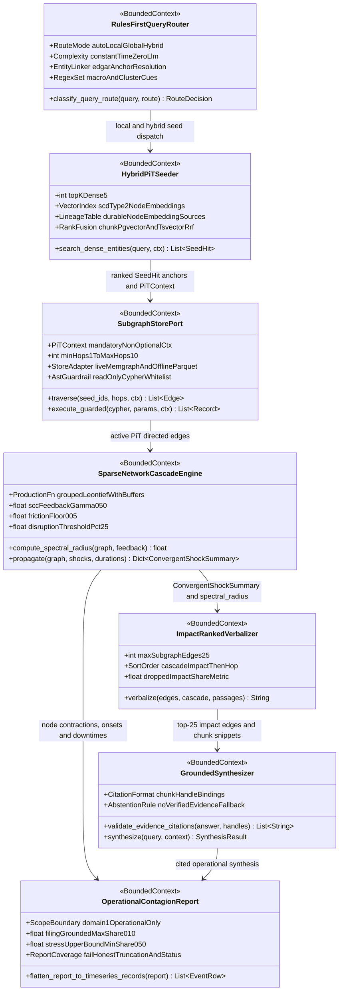
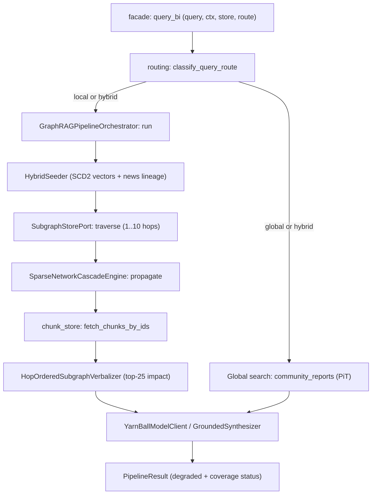
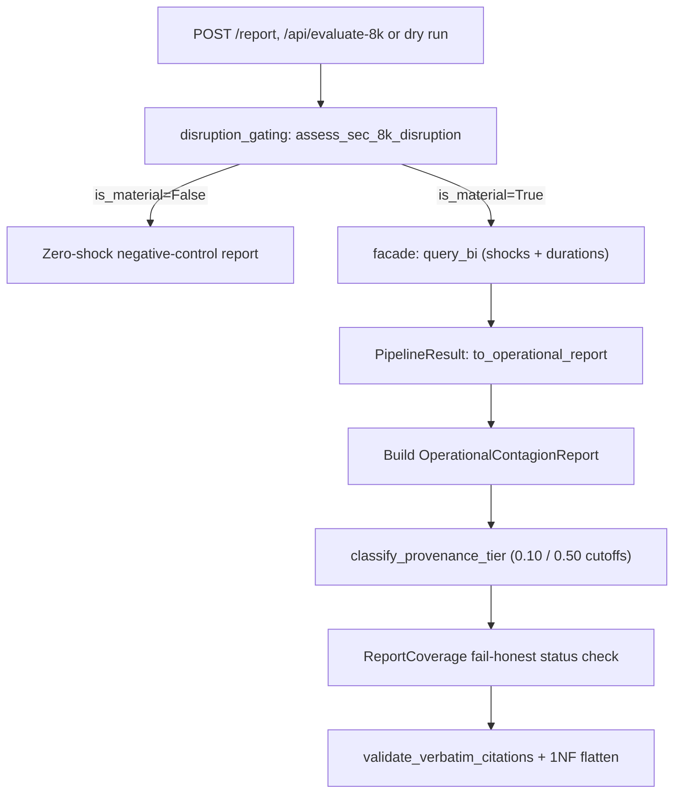
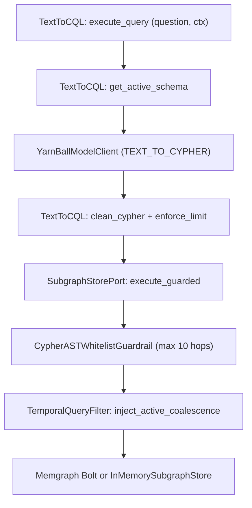

# Chapter 3:<br>Hybrid GraphRAG Retrieval, Network Contagion Algebra & Provenance-Graded Reporting

> **Series Navigation**: [Part 0 (System Atlas)](00-system-atlas.md) | [Part 1 (PiT Universe & Ingestion)](01-pit-universe-and-ingestion.md) | [Part 2 (Ontology, Linkage & Ledger)](02-ontology-linkage-and-ledger.md) | **Part 3 (Retrieval, Contagion & Reporting)** | [Part 4 (Curation & Model Foundry)](04-curation-and-model-foundry.md)

Once regulatory disclosures are segmented into bitemporal chunks (Chapter 1) and committed to the PostgreSQL assertion ledger, ephemeral Memgraph projection, and Leiden community hierarchy (Chapter 2), YarnBall's analytical read plane answers operational risk queries: *Given a facility fire, ransomware halt, or contract termination at supplier $A$ on session $t_0$, which multi-tier S&P 500 customers face unbuffered production downtime, when does inventory cover run out, and how much of that estimate rests on filing-disclosed figures versus conservative fallback bounds?*

This chapter documents YarnBall's production-network contagion algebra, single-entry Point-in-Time retrieval facade, citation-grounded synthesis, and Domain-1 reporting/workbench surfaces (`contagion/`, `retrieval/`, `synthesis/`, `explorer/`, and dry-run/workbench CLIs), governed by [ADR-00043](../decisions/ADR-00043-ch3-retrieval-contagion-and-reporting---.md). **Part A** derives the Grouped-Leontief cascade recurrence, bitemporal Cypher rewriting, hybrid seeding/routing, and epistemic coverage invariants. **Part B** provides the module inventory, three AST-verified call graphs, and complete FastAPI/Pydantic contracts.

---

## Part A: Domain & Theoretical Technical Report

### A.1 Topic-Level Conceptual Architecture

At the conceptual level, Chapter 3 funnels every analytical query and Form 8-K shock assessment through a single bitemporal gateway (`query_bi`), combining deterministic network economics with chunk-cited synthesis.



**Figure 3.1:** *Chapter 3 topic-level domain architecture connecting zero-LLM routing, hybrid PiT seeding, `SubgraphStorePort`, Grouped-Leontief contagion, impact-ranked verbalization, and Domain-1 reporting.*

---

### A.2 Production-Network Economics & Grouped-Leontief Cascade Algebra

#### Why Linear Network Centrality Mismodels Supply Chains
Random-walk and eigenvector centralities treat incoming links as uniform convex combinations: if firm $v$ buys $95\%$ of its commodity packaging from healthy vendor $u_1$ and $100\%$ of its custom ASICs from halted foundry $u_2$, simple weight averaging predicts a moderate $\approx 50\%$ slowdown. In physical manufacturing, missing a sole-source complementary input halts assembly completely ($100\%$ bottleneck), whereas losing one of two interchangeable memory suppliers in the same input group cuts capacity only by that supplier's procurement share.

[`SparseNetworkCascadeEngine`](../../contagion/cascade.py) ([ADR-00006](../decisions/ADR-00006-phase-7-sparse-network-cascade-engine---.md), [ADR-00007](../decisions/ADR-00007-cascade-engine-adversarial-verification-.md)) formalizes a **Grouped-Leontief production function** grounded in Inoue & Todo (2019), Simchi-Levi et al. (2015), Acemoglu et al. (2012), and Bardoscia et al. (2017):

1. **Capacity Feasibility Constraint**:
   Incoming directed edges $(u \to v)$ targeting customer $v$ are partitioned by interchangeable `input_group` $k \in \mathcal{K}(v)$, each carrying procurement share $a_{uv} \in [0, 1]$ and inventory safety-stock cover $B_{uv} \ge 0$ (calendar days). `CascadeGraph.validate_group_shares` enforces $\sum_{u \in \text{In}_k(v)} a_{uv} \le 1 + 10^{-6}$ for every $(v, k)$.
2. **Tarjan SCC Feedback Identification & Spectral Stability**:
   Real industrial networks contain cyclic cross-licensing and reciprocal chemical/wafer supply loops. `compute_sccs` executes Tarjan's $O(V + E)$ algorithm, and `identify_feedback_edges` classifies edge $(u \to v, k)$ as a **cyclic feedback edge** ($(u, v, k) \in \mathcal{F}$) iff $u$ and $v$ belong to the same non-trivial Strongly Connected Component (or self-loop) and $\text{dist}(v) \le \text{dist}(u)$ in BFS hop distance from initial shock seeds. Feedback edges are attenuated by intermediate input share $\gamma = 0.50$:

   $$a_{uv}^{\text{eff}} = \begin{cases} \gamma\, a_{uv}, & (u, v, k) \in \mathcal{F} \\ a_{uv}, & (u, v, k) \notin \mathcal{F} \end{cases} \tag{3.1}$$

   and `compute_spectral_radius` reports $\rho(W_{\text{eff}}) = \max_i |\lambda_i(W_{\text{eff}})|$ as an explicit loop-amplification diagnostic.
3. **Grouped-Leontief Fixed-Point Recurrence**:
   Given normalized initial capacity shocks $h_v^{(0)} \in [0, 1]$ and upstream disruption durations $d_u \ge 0$, round $r \in \{1, \dots, R\}$ (`max_iterations = 5`, convergence `tolerance = 1e-9`) updates nodes in topological BFS hop order:

   $$h_v^{(r)} = \max\!\left(h_v^{(0)},\; \max_{k \in \mathcal{K}(v)} \min\!\left(1,\; \sum_{u \in \text{In}_k(v)} \mathbf{1}\!\left[B_{uv} = 0 \,\lor\, h_u^{(r-1)} d_u > B_{uv}\right] a_{uv}^{\text{eff}}\, h_u^{(r-1)}\right)\right) \tag{3.2}$$

   where $\text{In}_k(v)$ denotes the upstream suppliers $u$ feeding input group $k \in \mathcal{K}(v)$ into node $v$, and $\mathbf{1}[\cdot] \in \{0, 1\}$ is the indicator function ($1$ when the condition holds, $0$ otherwise) activating edge $(u \to v)$ only when buffer cover $B_{uv} = 0$ or lost upstream capacity-days satisfy $h_u^{(r-1)} d_u > B_{uv}$ (otherwise inventory cover $B_{uv} > 0$ absorbs the shock completely).
4. **Simchi-Levi Time-to-Survive (TTS) Onset & Unbuffered Downtime**:
   Across all active unabsorbed incoming edges ($h_u d_u > B_{uv}$), given upstream node $u$'s onset time $t_u$ ($t_u = 0$ for initial shock seeds), converged impairment $h_u$, and duration $d_u$, shock arrival time $t_{uv}$, unbuffered edge downtime $d_{uv}$, and node disruption window $[t_v^{\text{onset}}, t_v^{\text{onset}} + d_v^{\text{net}}]$ resolve in hop order:

   $$\begin{aligned} t_{uv} &= t_u + \frac{B_{uv}}{h_u}, & d_{uv} &= \max\!\left(0,\; d_u - \frac{B_{uv}}{h_u}\right), \\[4pt] t_v^{\text{onset}} &= \min_{(u,v) \text{ active}} t_{uv}, & d_v^{\text{net}} &= \max_{(u,v) \text{ active}}(t_{uv} + d_{uv}) - t_v^{\text{onset}} \end{aligned} \tag{3.3}$$

5. **Active-Buffer Friction Floor & Institutional Verdicts**:
   When a non-seed customer $v$ experiences incoming upstream disruption that is **fully absorbed** by safety stock ($h_u d_u \le B_{uv}$, yielding $d_v^{\text{net}} = 0$), expediting and buffer drawdown costs are flagged via `is_friction_floor = True` (`friction_floor = 0.05`) and assigned verdict `TOLERATED_BUFFERED`. Unbuffered peaks $\ge 25.0\%$ (`disruption_threshold_pct = 25.0`) emit `DISRUPTIVE_SHOCK`, $(0\%, 25\%)$ emit `CONTAINED_MINIMAL_CONTAGION`, and $0\%$ emit `NEUTRAL_UNAFFECTED`. All 10 canonical topologies (chains, diamonds, dual-source splits, butterflies) and 8 adversarial pathologies (resonant cycles, zero-buffer singularities, horizon cutoffs) are verified in [`ADR-00007`](../decisions/ADR-00007-cascade-engine-adversarial-verification-.md).

#### 3-Tier Cascade Parameter Provenance ([ADR-00026](../decisions/ADR-00026-cascade-parameter-extraction-provenance-.md))
SEC filings rarely disclose exact inventory buffer days for every vendor. [`resolve_edge_cascade_parameters`](../../contagion/parameters.py) stamps every edge with explicit `ParameterProvenance`:
1. `EXTRACTED_QUANTITATIVE`: explicit percentage revenue/procurement share (`% of revenue/purchases`) or explicit buffer days/weeks/months parsed from filing prose.
2. `EXTRACTED_QUALITATIVE_SOLE_SOURCE`: statutory `SOLE_SOURCE_DEPENDENT_ON` or lexical `sole-source` / `only qualified supplier` cues (`share = 1.0`).
3. `DEFAULT_CONSERVATIVE_BOUND`: unquantified structural links assigned worst-case stress bounds (`share = 1.0`, `buffer_days = 0.0`) and tracked separately so downstream reports never confuse stress bounds with measured numbers.

---

### A.3 Point-in-Time Read Facade, Store Isomorphism & Cypher AST Guardrails

To eliminate split-brain retrieval paths and accidental point-in-time bypasses, [ADR-00033](../decisions/ADR-00033-bitemporal-pit-contract-for-read-paths--.md) and [ADR-00034](../decisions/ADR-00034-single-bi-read-facade-and-pipeline-merge.md) enforce three structural invariants across the read plane:

1. **Single-Entry `query_bi` Facade ([`retrieval/facade.py`](../../retrieval/facade.py))**:
   Outside `retrieval/facade.py` and `retrieval/pipeline.py`, no module in `retrieval/`, `synthesis/`, `explorer/`, or `tools/` executes Memgraph read Cypher directly (enforced by AST architecture tests). Every read call requires a non-optional `ctx: PiTContext`.
2. **Live / Offline `SubgraphStorePort` Isomorphism ([ADR-00015](../decisions/ADR-00015-dynamic-in-memory-offline-subgraph-store.md), [ADR-00034](../decisions/ADR-00034-single-bi-read-facade-and-pipeline-merge.md))**:
   Both `MemgraphSubgraphStore` (live Bolt Cypher) and `InMemorySubgraphStore` (offline Parquet / fixture graph in [`retrieval/offline_store.py`](../../retrieval/offline_store.py)) implement `SubgraphStorePort` (`traverse` and `execute_guarded`) with identical `_edge_sort_key` normalization `(hop, source, target, rel_type, input_group)`.
3. **Bitemporal Cypher Rewriting & Read-Only AST Guardrails**:
   - [`CypherASTWhitelistGuardrail`](../../retrieval/guardrails/schema_guardrail.py) parses candidate Cypher statements to block mutating keywords (`CREATE`, `MERGE`, `DELETE`, `DETACH`, `SET`, `REMOVE`, `DROP`), procedures, off-schema labels/predicates, and out-of-range variable-length hops (`MIN_TRAVERSAL_HOPS = 1`, `MAX_TRAVERSAL_HOPS = 10`).
   - [`TemporalQueryFilter`](../../retrieval/temporal.py) rewrites both single-hop `[r:TYPE]` and multi-hop `[r*1..H]` patterns (`ALL(_rel IN r WHERE ...)`). In `historical` mode, it enforces half-open validity `r.valid_from <= $as_of_date AND (r.valid_to IS NULL OR r.valid_to > $as_of_date)` without consulting mutable current-state `r.status`, and excludes `is_temporal_unanchored` edges unless `ctx.include_unanchored = True`.

---

### A.4 Hybrid Seeding, Rules-First Routing & Impact-Ranked Verbalization

#### Deterministic Zero-LLM Query Routing ([ADR-00037](../decisions/ADR-00037-pit-community-layer-and-impact-ranking--.md))
Using a 7B generative model to classify query intent adds hundreds of milliseconds of latency and risks format errors. [`classify_query_route`](../../retrieval/routing.py) resolves `route = "auto"` deterministically in $O(1)$ using offline-safe `EdgarEntityLinker` anchor resolution and `_MACRO_CLUSTER_CUE_RE`:
- **Entity anchor(s) only** $\rightarrow$ `"local"` (multi-hop ego traversal + cascade engine).
- **Macro/sector/cluster cues only** $\rightarrow$ `"global"` (cosine + lexical map-reduce over precomputed `community_reports` with `as_of <= ctx.as_of`).
- **Both entity anchor(s) and macro cues** $\rightarrow$ `"hybrid"` (`local` cascade subgraph enriched with matching PiT community summaries).

#### Multi-Channel Seeding & Reciprocal Rank Fusion
[`HybridSeeder`](../../retrieval/hybrid.py) combines SCD Type 2 `node_embeddings` cosine search (`1 - (embedding <=> query_vec)`), dense news passage hits joined through durable `node_embedding_sources` (immune to Memgraph's 90-day `:News` TTL eviction), and guarded `TextToCQL`. Supporting filing chunks in `document_chunks` are ranked via **Reciprocal Rank Fusion (RRF)** (`search_chunks_hybrid_rrf` in [`knowledge_graph/chunk_store.py`](../../knowledge_graph/chunk_store.py), smoothing constant $k_{\text{RRF}} = 60$) over `pgvector` HNSW rank $r_{\text{vec}}(c)$ and PostgreSQL `tsvector` GIN rank $r_{\text{fts}}(c)$:

$$\text{RRF}(c) = \frac{1}{k_{\text{RRF}} + r_{\text{vec}}(c)} + \frac{1}{k_{\text{RRF}} + r_{\text{fts}}(c)} \tag{3.4}$$

#### Impact-Ranked Subgraph Pruning (`MAX_SUBGRAPH_EDGES = 25`)
To fit 7B context windows cleanly without arbitrary alphabetical truncation, [`HopOrderedSubgraphVerbalizer`](../../retrieval/pipeline.py) ranks retrieved edges $e = (u \to v) \in E_{\text{all}}$ descending by cascade impairment impact $w_{\text{impact}}(e) = \max(h_u, h_v) \cdot a_{uv}$ before hop distance, retains the top `MAX_SUBGRAPH_EDGES = 25` edges with resolved verbatim chunk passages, and computes exact tail loss over the pruned set $E_{\text{dropped}} \subseteq E_{\text{all}}$:

$$\text{dropped\_impact\_share} = \frac{\sum_{e \in E_{\text{dropped}}} w_{\text{impact}}(e)}{\sum_{e \in E_{\text{all}}} w_{\text{impact}}(e)} \in [0, 1] \tag{3.5}$$

---

### A.5 Provenance-Graded Reporting, Grounded Synthesis & Workbench Audit

[`OperationalContagionReport`](../../retrieval/reporting.py) ([ADR-00011](../decisions/ADR-00011-operational-contagion-report-schema-----.md), [ADR-00013](../decisions/ADR-00013-contagion-event-time-series-join-schema-.md), [ADR-00037](../decisions/ADR-00037-pit-community-layer-and-impact-ranking--.md)) packages cascade metrics and cited synthesis under strict epistemic invariants:

1. **Provenance Tier Grading (`classify_provenance_tier`)**:
   Measures the fraction $\theta_{\text{def}}$ (`default_param_impact_share`) of cumulative downstream impairment attributable to edges carrying `DEFAULT_CONSERVATIVE_BOUND` parameters (`DEFAULT_FILING_GROUNDED_MAX_SHARE = 0.10`, `DEFAULT_STRESS_UPPER_BOUND_MIN_SHARE = 0.50`):
   - `FILING_GROUNDED`: $\theta_{\text{def}} \le 0.10$
   - `MIXED_PROVENANCE`: $0.10 < \theta_{\text{def}} < 0.50$
   - `STRESS_UPPER_BOUND`: $\theta_{\text{def}} \ge 0.50$
2. **Fail-Honest Pydantic Validators (`ReportCoverage`)**:
   - **No silent truncation**: `edges_total > edges_shown` automatically forces `coverage.truncated = True`.
   - **No false healthy status**: `model_mode == DEGRADED_UNREACHABLE` forbids `coverage.data_status == "ok"` (raising `ValueError` if explicitly forced to `"ok"`).
3. **Verbatim Citation Enforcement & 1NF Time-Series Export**:
   [`GroundedSynthesizer`](../../synthesis/synthesizer.py) binds every edge to `[E<n> <- <chunk_id>]` handles and abstains with `NO_VERIFIED_EVIDENCE_MESSAGE` when evidence is empty; `validate_verbatim_citations` flags uncited claims, and `flatten_report_to_timeseries_records` emits 1NF `ContagionTimeSeriesEventRecord` rows for offline event-study joins ([ADR-00013](../decisions/ADR-00013-contagion-event-time-series-join-schema-.md), [ADR-00038](../decisions/ADR-00038-event-study-backtest-and-signal-decay---.md)).

---

### A.6 Chapter 3 Theory-to-Code Crosswalk Table

Every `<package>.<module>:<symbol>` anchor below is AST-verified by [`tests/docs/test_docs_integrity.py`](../../tests/docs/test_docs_integrity.py).

**Table 3.1:** *Chapter 3 Theory-to-Code Crosswalk (Contagion Algebra, Read Facade, Cypher Guardrails, Routing, Reporting, and Workbench).*

| Concept / Mathematical Invariant | Code Anchor (`module:symbol`) | Provenance | Verification Suite |
| :--- | :--- | :--- | :--- |
| Leontief input-group share feasibility $\sum a_{uv} \le 1$ | `contagion.cascade:CascadeGraph.validate_group_shares` | [ADR-00006](../decisions/ADR-00006-phase-7-sparse-network-cascade-engine---.md) | [`test_cascade_models.py`](../../tests/contagion/test_cascade_models.py) |
| Tarjan $O(V+E)$ SCC decomposition & feedback edge set | `contagion.cascade:CascadeGraph.identify_feedback_edges` | [ADR-00006](../decisions/ADR-00006-phase-7-sparse-network-cascade-engine---.md), [ADR-00007](../decisions/ADR-00007-cascade-engine-adversarial-verification-.md) | [`test_cascade_pathologies.py`](../../tests/contagion/test_cascade_pathologies.py) |
| Effective damped adjacency spectral radius $\rho(W_{\text{eff}})$ | `contagion.cascade:SparseNetworkCascadeEngine.compute_spectral_radius` | [ADR-00006](../decisions/ADR-00006-phase-7-sparse-network-cascade-engine---.md) | [`test_cascade_canonical_topologies.py`](../../tests/contagion/test_cascade_canonical_topologies.py) |
| Grouped-Leontief fixed-point & TTS propagation | `contagion.cascade:SparseNetworkCascadeEngine.propagate` | [ADR-00006](../decisions/ADR-00006-phase-7-sparse-network-cascade-engine---.md), [ADR-00007](../decisions/ADR-00007-cascade-engine-adversarial-verification-.md) | [`test_cascade_engine.py`](../../tests/contagion/test_cascade_engine.py) |
| 3-tier cascade edge parameter provenance | `contagion.parameters:resolve_edge_cascade_parameters` | [ADR-00026](../decisions/ADR-00026-cascade-parameter-extraction-provenance-.md) | [`test_cascade_parameter_provenance_adr00026.py`](../../tests/contagion/test_cascade_parameter_provenance_adr00026.py) |
| Single-entry Point-in-Time BI read facade | `retrieval.facade:query_bi` | [ADR-00034](../decisions/ADR-00034-single-bi-read-facade-and-pipeline-merge.md) | [`test_adr00034_facade_invariants.py`](../../tests/retrieval/test_adr00034_facade_invariants.py) |
| Live Bolt implementation of `SubgraphStorePort` | `retrieval.facade:MemgraphSubgraphStore.traverse` | [ADR-00034](../decisions/ADR-00034-single-bi-read-facade-and-pipeline-merge.md) | [`test_adr00034_facade_invariants.py`](../../tests/retrieval/test_adr00034_facade_invariants.py) |
| Offline Parquet/fixture `SubgraphStorePort` parity | `retrieval.offline_store:InMemorySubgraphStore` | [ADR-00015](../decisions/ADR-00015-dynamic-in-memory-offline-subgraph-store.md), [ADR-00034](../decisions/ADR-00034-single-bi-read-facade-and-pipeline-merge.md) | [`test_offline_subgraph_store.py`](../../tests/retrieval/test_offline_subgraph_store.py) |
| Bitemporal `[r*1..H]` Cypher predicate injector | `retrieval.temporal:TemporalQueryFilter` | [ADR-00033](../decisions/ADR-00033-bitemporal-pit-contract-for-read-paths--.md) | [`test_temporal_filter.py`](../../tests/retrieval/test_temporal_filter.py) |
| Read-only Cypher AST & schema whitelist guardrail | `retrieval.guardrails.schema_guardrail:CypherASTWhitelistGuardrail.validate` | Pre-ADR Foundation | [`test_schema_guardrail.py`](../../tests/retrieval/test_schema_guardrail.py) |
| Deterministic zero-LLM `local`/`global`/`hybrid` router | `retrieval.routing:classify_query_route` | [ADR-00037](../decisions/ADR-00037-pit-community-layer-and-impact-ranking--.md) | [`test_adr00037_communities_ranking_coverage.py`](../../tests/retrieval/test_adr00037_communities_ranking_coverage.py) |
| SCD2 `pgvector` + durable-lineage hybrid seeder | `retrieval.hybrid:HybridSeeder` | [ADR-00021](../decisions/ADR-00021-contextual-node-embeddings-and-pgvector-.md), [ADR-00034](../decisions/ADR-00034-single-bi-read-facade-and-pipeline-merge.md) | [`test_hybrid_retriever.py`](../../tests/retrieval/test_hybrid_retriever.py) |
| Guarded NL-to-Cypher translator & executor | `retrieval.text_to_cql:TextToCQL.execute_query` | Pre-ADR + [ADR-00002](../decisions/ADR-00002-sit-flow-3-nl-to-cypher-rag-e2e-harness-.md) | [`test_text_to_cql.py`](../../tests/retrieval/test_text_to_cql.py) |
| Impact-ranked verbalizer (`MAX_SUBGRAPH_EDGES = 25`) | `retrieval.pipeline:HopOrderedSubgraphVerbalizer.verbalize` | [ADR-00035](../decisions/ADR-00035-text-unit-chunk-layer-and-evidence-links.md), [ADR-00037](../decisions/ADR-00037-pit-community-layer-and-impact-ranking--.md) | [`test_pipeline.py`](../../tests/retrieval/test_pipeline.py) |
| Provenance-tier classifier (`0.10` / `0.50` bounds) | `retrieval.reporting:classify_provenance_tier` | [ADR-00037](../decisions/ADR-00037-pit-community-layer-and-impact-ranking--.md) | [`test_adr00037_communities_ranking_coverage.py`](../../tests/retrieval/test_adr00037_communities_ranking_coverage.py) |
| Fail-honest Domain-1 contagion report & 1NF flattener | `retrieval.reporting:flatten_report_to_timeseries_records` | [ADR-00011](../decisions/ADR-00011-operational-contagion-report-schema-----.md), [ADR-00013](../decisions/ADR-00013-contagion-event-time-series-join-schema-.md) | [`test_operational_contagion_reporting.py`](../../tests/retrieval/test_operational_contagion_reporting.py) |
| `[E<n> <- chunk_id]` grounded citation synthesizer | `synthesis.synthesizer:GroundedSynthesizer.validate_evidence_citations` | Pre-ADR + [ADR-00035](../decisions/ADR-00035-text-unit-chunk-layer-and-evidence-links.md) | [`test_eval_harness.py`](../../tests/synthesis/test_eval_harness.py) |
| Local read-only FastAPI Workbench backend | `explorer.workbench_api:create_workbench_app` | [ADR-00017](../decisions/ADR-00017-local-fastapi-kg-contagion-workbench-app.md)–[ADR-00019](../decisions/ADR-00019-pit-kg-explorer-and-cohort-browser-views.md) | [`test_workbench_api.py`](../../tests/explorer/test_workbench_api.py) |

---

## Part B: Software Architecture, Call Graphs & Entry Points

### B.1 Subsystem Module Inventory

**Table 3.2:** *Chapter 3 Subsystem Module Inventory Across `contagion/`, `retrieval/`, `synthesis/`, and `explorer/`.*

| Module Path | Key Classes & Functions | Role in Chapter 3 Pipeline |
| :--- | :--- | :--- |
| [`contagion/cascade.py`](../../contagion/cascade.py) | `CascadeNode`, `CascadeEdge`, `CascadeGraph`, `ConvergentShockSummary`, `SparseNetworkCascadeEngine` | Pure-math Grouped-Leontief cascade solver, Tarjan SCC feedback damping & TTS timing. |
| [`contagion/parameters.py`](../../contagion/parameters.py) | `ParameterProvenance`, `extract_cascade_parameters_from_text`, `resolve_edge_cascade_parameters` | Clause-level extraction of `share` and `buffer_days` with 3-tier provenance tagging. |
| [`retrieval/facade.py`](../../retrieval/facade.py) | `SubgraphStorePort`, `MemgraphSubgraphStore`, `query_subgraph_ego`, `query_bi` | Single mandatory Point-in-Time BI read gateway across live and offline stores. |
| [`retrieval/offline_store.py`](../../retrieval/offline_store.py) | `CypherSubgraphQuery`, `InMemorySubgraphStore`, `parse_cypher_subgraph_query` | DB-free Parquet/JSONL implementation of `SubgraphStorePort` with read-only Cypher subset parser. |
| [`retrieval/routing.py`](../../retrieval/routing.py) | `RouteMode`, `ResolvedRoute`, `classify_query_route` | Deterministic zero-LLM router classifying BI queries into `local`, `global`, or `hybrid`. |
| [`retrieval/hybrid.py`](../../retrieval/hybrid.py) | `SeedHit`, `HybridSeeder` | SCD Type 2 `node_embeddings`, durable news-lineage, and guarded-CQL seed candidate engine. |
| [`retrieval/guardrails/schema_guardrail.py`](../../retrieval/guardrails/schema_guardrail.py) | `SchemaSpecification`, `CypherASTWhitelistGuardrail` | Read-only Cypher AST validator enforcing allowed labels, predicates, hop bounds & `LIMIT`. |
| [`retrieval/text_to_cql.py`](../../retrieval/text_to_cql.py) | `TextToCQL`, `GuardrailViolationError` | Schema-prompted NL-to-OpenCypher generator wrapped in AST whitelist & temporal filters. |
| [`retrieval/enricher.py`](../../retrieval/enricher.py) | `enrich_node`, `enrich_nodes` | Attaches CIK, sector, and metadata descriptors onto retrieved graph node dictionaries. |
| [`retrieval/pipeline.py`](../../retrieval/pipeline.py) | `AnalystQuery`, `PipelineResult`, `HopOrderedSubgraphVerbalizer`, `GraphRAGPipelineOrchestrator` | Coordinates seeding, traversal, cascade propagation, top-25 impact verbalization & LLM reasoning. |
| [`retrieval/reporting.py`](../../retrieval/reporting.py) | `ReportCoverage`, `OperationalContagionReport`, `ContagionTimeSeriesEventRecord`, `build_operational_contagion_report`, `flatten_report_to_timeseries_records` | Domain-1 report builder, provenance-tier grader, ASCII formatter, citation validator & 1NF exporter. |
| [`retrieval/service.py`](../../retrieval/service.py) | `SearchRequest`, `ReportRequest`, `health`, `ready`, `search`, `report` | Production FastAPI microservice exposing `/health`, `/ready`, `/search`, and `/report`. |
| [`synthesis/synthesizer.py`](../../synthesis/synthesizer.py), [`engine.py`](../../synthesis/engine.py), [`eval_harness.py`](../../synthesis/eval_harness.py) | `GroundedSynthesizer`, `FinancialAnalysisEngine`, `EvaluationHarness` | `[E<n> <- chunk_id]` citation-enforced narrative generator and RAG faithfulness harness. |
| [`explorer/workbench_api.py`](../../explorer/workbench_api.py) & `explorer/static/` | `create_workbench_app`, `index.html`, `app.js`, `styles.css` | Local read-only FastAPI backend & vanilla JS SPA for Form 8-K audit, PiT KG ego & cohort views. |
| [`tools/dry_run_sec_8k_contagion.py`](../../tools/dry_run_sec_8k_contagion.py) & [`tools/serve_explorer.py`](../../tools/serve_explorer.py) | `run_sec_8k_dry_run`, `export_report_to_jsonl` | Offline computational reading dry-run harness ([ADR-00009](../decisions/ADR-00009-sec-8k-computational-reading-dry-run----.md)) and Workbench launcher CLI. |

---

### B.2 AST-Verified Execution Call Graphs

#### Pipeline 1: Unified `query_bi` Execution Across `local`, `global`, and `hybrid` Routes



**Figure 3.2:** *Execution call graph for unified `query_bi` dispatch across `local`, `global`, and `hybrid` BI routes.*

#### Pipeline 2: SEC Form 8-K Disruption Evaluation, Provenance Grading & 1NF Export



**Figure 3.3:** *Execution call graph for SEC Form 8-K disruption evaluation, provenance-tier grading, fail-honest coverage checks, and 1NF time-series export.*

#### Pipeline 3: Guarded NL-to-OpenCypher Execution Path



**Figure 3.4:** *Execution call graph for guarded natural-language-to-OpenCypher translation, AST whitelisting, and bitemporal filter injection.*

---

### B.3 Service Routes, CLI Commands & Report Schema Contracts

#### CLI & Service Launch Commands

```bash
# 1. Start the production BI Retrieval microservice on port 8000
.venv/bin/uvicorn retrieval.service:app --host 0.0.0.0 --port 8000

# 2. Execute an offline-isolated Form 8-K contagion dry run and export 1NF JSONL rows
.venv/bin/python -m tools.dry_run_sec_8k_contagion \
    --filing tests/fixtures/filings/aapl_8k_disruption.json \
    --use-mock \
    --output-jsonl data/exports/aapl_contagion_1nf.jsonl

# 3. Launch the local interactive FastAPI KG & Form 8-K Audit Workbench
.venv/bin/python -m tools.serve_explorer --host 127.0.0.1 --port 8050
```

#### Key Hyperparameters & Epistemic Thresholds

**Table 3.3:** *Chapter 3 Cascade Hyperparameters, Traversal Bounds, and Epistemic Provenance Thresholds.*

| Constant / Parameter | Location | Value | Architectural Guarantee |
| :--- | :--- | :---: | :--- |
| `gamma` | `contagion/cascade.py` | `0.50` | Intermediate input attenuation factor applied strictly to Tarjan SCC feedback edges. |
| `friction_floor` | `contagion/cascade.py` | `0.05` | Minimum capacity impairment (`5%`) assigned when safety stock absorbs an incoming upstream halt (`TOLERATED_BUFFERED`). |
| `max_iterations` / `tolerance` | `contagion/cascade.py` | `5` / `1e-9` | Fixed-point propagation horizon and $L_\infty$ early-stopping threshold. |
| `disruption_threshold_pct` | `contagion/cascade.py` | `25.0` | Contraction cutoff separating `DISRUPTIVE_SHOCK` ($\ge 25\%$) from `CONTAINED_MINIMAL_CONTAGION`. |
| `MIN_TRAVERSAL_HOPS` .. `MAX_TRAVERSAL_HOPS` | `retrieval/temporal.py` | `1` .. `10` | Hard traversal depth bounds enforced on every `SubgraphStorePort` and FastAPI call. |
| `MAX_SUBGRAPH_EDGES` | `retrieval/pipeline.py` | `25` | Maximum impact-ranked edges verbalized into the LLM prompt (`dropped_impact_share` logged). |
| `DEFAULT_FILING_GROUNDED_MAX_SHARE` | `retrieval/reporting.py` | `0.10` | Maximum fallback-parameter impact share eligible for `FILING_GROUNDED` tier. |
| `DEFAULT_STRESS_UPPER_BOUND_MIN_SHARE` | `retrieval/reporting.py` | `0.50` | Fallback-parameter impact threshold triggering `STRESS_UPPER_BOUND` tier. |
