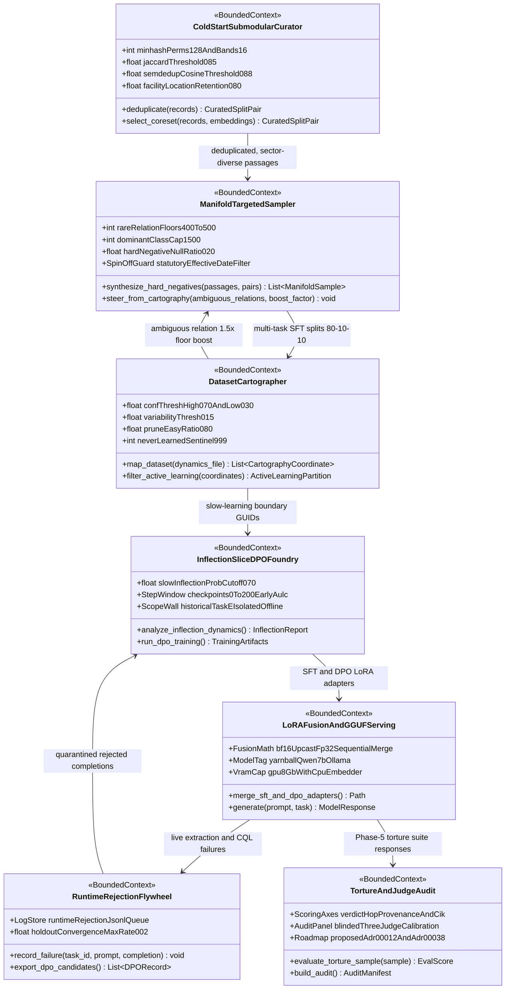
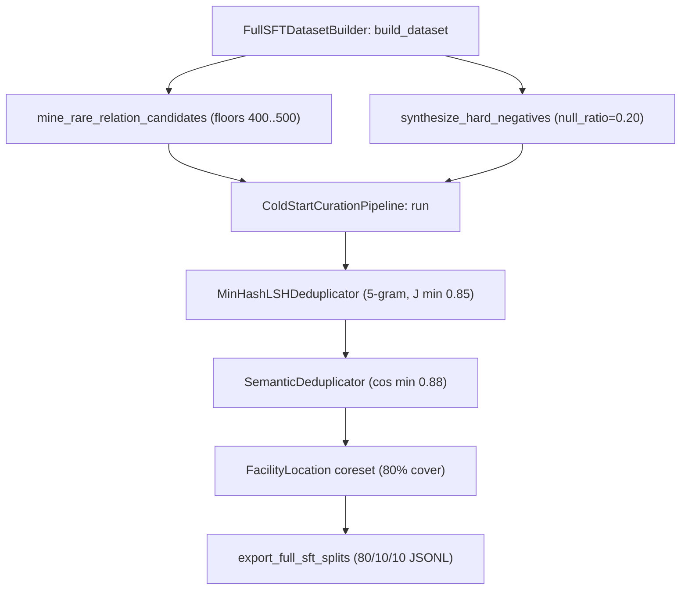
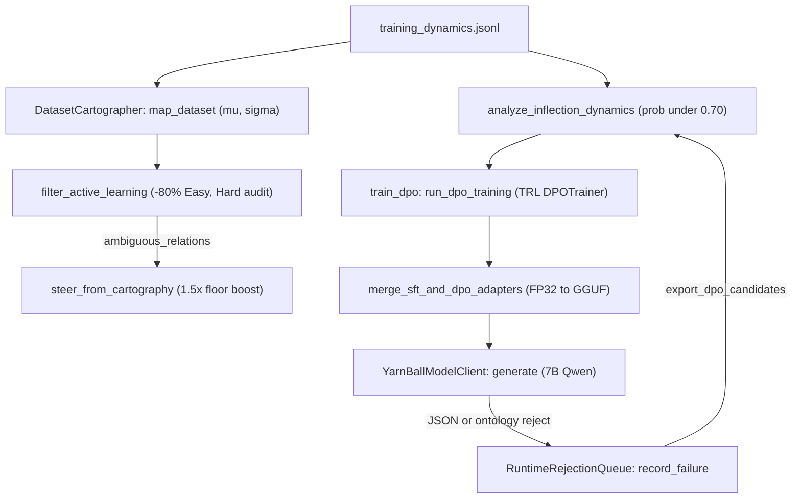
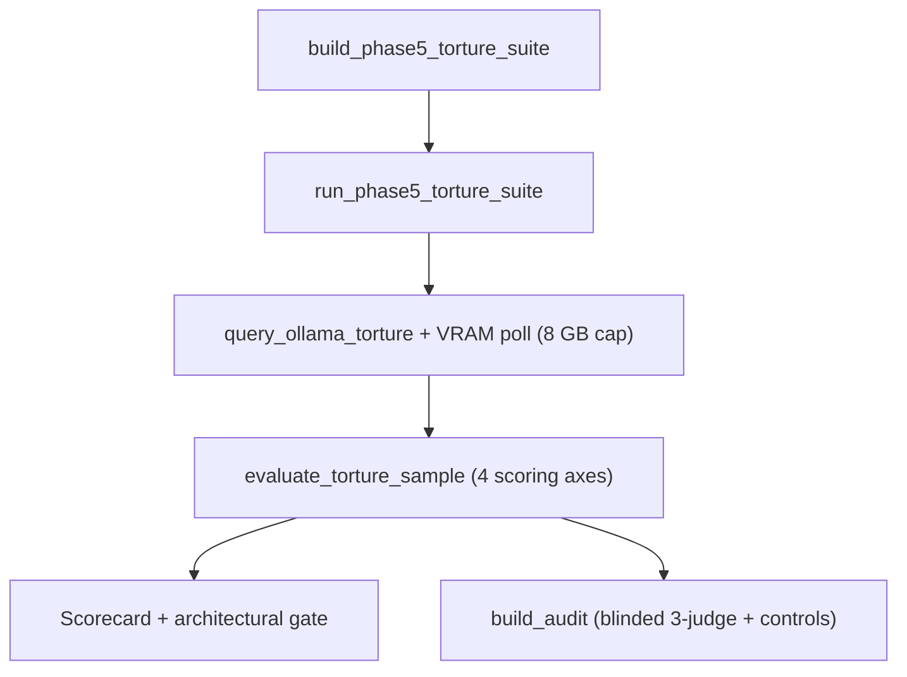

# Chapter 4:<br>Submodular Curation, Dataset Cartography & Task-Selective Model Alignment

> **Series Navigation**: [Part 0 (System Atlas)](00-system-atlas.md) | [Part 1 (PiT Universe & Ingestion)](01-pit-universe-and-ingestion.md) | [Part 2 (Ontology, Linkage & Ledger)](02-ontology-linkage-and-ledger.md) | [Part 3 (Retrieval, Contagion & Reporting)](03-retrieval-contagion-and-reporting.md) | **Part 4 (Curation & Model Foundry)**

A Financial GraphRAG platform is only as reliable as the domain-aligned language model powering its structured triple extraction (`EXTRACT_SEC_GRAPH`), OpenCypher generation (`TEXT_TO_CYPHER`), multi-hop `<think>` contagion reasoning (`CONTAGION_REASONING`), and cluster summarization (`COMMUNITY_REPORT`). Training a compact 7B model on raw SEC filings and syndicated news wires fails for predictable statistical reasons: repetitive legal boilerplate dominates gradient updates, common `SUPPLIES_TO` mentions drown out rare tail-risk predicates (`SOLE_SOURCE_DEPENDENT_ON`, `DEFAULTED_ON`), co-mentioned S&P 500 companies trigger false-positive edges, and multi-task prompts suffer cross-task syntax bleed.

This chapter documents YarnBall's cold-start optimization, economic manifold sampling, Dataset Cartography active learning, inflection-lag Direct Preference Optimization (DPO), adapter fusion, 8 GB VRAM serving, and multi-judge evaluation stack (`curation/` and `sft_pipeline/`), governed by [ADR-00044](../decisions/ADR-00044-ch4-curation-cartography-model-foundry--.md). Because the ADR log began at [ADR-00001](../decisions/ADR-00001-sit-flow-2-event-shock-contagion-harness.md), most of `curation/` and `sft_pipeline/` represent foundational pre-ADR algorithms documented directly from source code here alongside post-`ADR-00001` runtime quarantine and model-serving contracts.

---

## Part A: Domain & Theoretical Technical Report

### A.1 Topic-Level Conceptual Architecture

At the conceptual level, Chapter 4 forms a closed-loop alignment flywheel connecting raw historical disclosures and runtime quarantine logs to the fine-tuned `yarnball-qwen:7b` serving client.



**Figure 4.1:** *Chapter 4 topic-level domain architecture modeling YarnBall's closed-loop submodular curation, Dataset Cartography, inflection-lag DPO, FP32 LoRA fusion, runtime quarantine flywheel, and Phase-5 evaluation.*

---

### A.2 Cold-Start Deduplication & Submodular Core-Set Selection

Corporate filings and financial news feeds exhibit extreme Zipfian redundancy: identical risk-factor paragraphs repeat across 10-Q quarters, and syndicated press releases appear verbatim across dozens of wire outlets. [`ColdStartCurationPipeline`](../../curation/cold_start/pipeline.py) executes a three-stage geometric reduction before supervised fine-tuning:

1. **Stage 1: Syntactic Near-Duplicate Removal (`MinHashLSHDeduplicator` in [`minhash_lsh.py`](../../curation/cold_start/minhash_lsh.py))**:
   Following Broder (1997) and Lee et al. (2022), documents are tokenized into lowercase word `shingle_size = 5` n-grams hashed to 32-bit integers. Across `num_perm = 128` universal linear hash permutations modulo the Mersenne prime $M = 2^{31} - 1$:

   $$\text{sig}_i(D) = \min_{s \in \mathcal{S}_5(D)} \big((a_i s + b_i) \bmod (2^{31} - 1)\big), \qquad i \in \{1, \dots, 128\} \tag{4.1}$$

   where $\text{sig}_i(D)$ is the $i$-th MinHash signature coordinate for document $D$, $\mathcal{S}_5(D)$ is the set of 32-bit hashed 5-gram word shingles in $D$, and $(a_i, b_i)$ are deterministic seeded universal hash coefficients ($a_i \ne 0$). Signatures are partitioned into `num_bands = 16` bands of $r = 8$ rows each, inducing the Locality-Sensitive Hashing (LSH) candidate collision probability $P_{\text{cand}}(J) = 1 - (1 - J^8)^{16}$ (steepest inflection at $J \approx (1/16)^{1/8} \approx 0.707$) before exact signature verification prunes pairs exceeding `jaccard_threshold = 0.85`.
2. **Stage 2: Dense Semantic Deduplication (`SemanticDeduplicator` in [`semdedup.py`](../../curation/cold_start/semdedup.py))**:
   Paraphrased governance boilerplate escapes lexical shingling. Adapting SemDeDup (Abbas et al., 2023), unit-normalized embeddings $\hat{v}_i = v_i / \|v_i\|_2$ are clustered via Union-Find over edges satisfying $\langle \hat{v}_i, \hat{v}_j \rangle \ge 0.88$ (`cosine_threshold = 0.88`). Each cluster $C$ collapses to its single centroid-nearest exemplar $i^* = \arg\max_{i \in C} \langle \hat{v}_i, \hat{\mu}_C \rangle$.
3. **Stage 3: Submodular Facility Location Core-Set Selection (`FacilityLocationCoresetSelector` in [`coreset.py`](../../curation/cold_start/coreset.py))**:
   Uniform random downsampling under-represents smaller GICS sectors (such as Utilities, Materials, and Real Estate). Over the candidate corpus $V$ ($|V| = N$) with non-negative cosine similarity $w_{ij} = \max(0, \langle \hat{v}_i, \hat{v}_j \rangle)$ and cardinality budget $K = \lfloor 0.80\, N \rfloor$ (`retention_fraction = 0.80`), the selector chooses a core-set $S \subseteq V$ ($|S| \le K$) maximizing the monotone submodular Facility Location objective $F(S)$ via greedy marginal gain $\Delta(c \mid S)$ for each candidate $c \in V \setminus S$ (Mirzasoleiman et al., 2020; Wei et al., 2015):

   $$F(S) = \sum_{i \in V} \max_{j \in S}\, w_{ij}, \qquad \Delta(c \mid S) = \sum_{i \in V} \max\!\big(0,\; w_{ic} - \alpha_i\big) \tag{4.2}$$

   where $\alpha_i = \max_{j \in S} w_{ij}$ tracks the running coverage envelope. By Nemhauser-Wolsey-Fisher submodularity, greedy maximization guarantees $F(S_{\text{greedy}}) \ge (1 - 1/e)\, F(S^*)$.

---

### A.3 Economic Manifold Sampling & Hard-Negative Boundary Mining

In uncurated SEC prose, generic `SUPPLIES_TO` and `COMPETES_WITH` mentions outnumber acute solvency or sole-source chokepoint edges by more than $20:1$. [`ManifoldTargetedSampler`](../../sft_pipeline/sampler.py) reshapes training distributions onto the low-dimensional **economic risk manifold $\mathcal{M}^*$**:

- **Information-theoretic class floors and caps**: enforces `RARE_RELATION_FLOORS` (`400` minimum instances each for `SOLE_SOURCE_DEPENDENT_ON`, `LICENSES_FROM`, `LICENSES_TO`, `DEFAULTED_ON`, `EXPOSED_TO_RISK`; `500` for `ACQUIRED_BY`) via targeted regex pre-mining (`RARE_RELATION_TRIGGERS`), while capping dominant classes at `DOMINANT_CLASS_CAP = 1500`.
- **Boundary-proximity hard negatives (`null_sample_ratio = 0.20`)**: `synthesize_hard_negatives` selects market-commentary passages co-mentioning two or more S&P 500 issuers that share **zero** active edge in the Knowledge Graph, training the extractor to emit `(none)` rather than hallucinating edges from mere co-occurrence.
- **Statutory corporate spin-off separation**: grounds post-separation entities (`GE Aerospace` vs. `GE Vernova`, `RTX` vs. `Carrier Global`, `Abbott` vs. `AbbVie`) against Form 10 / Form 8-K effective separation dates so pre-spin subsidiary contracts do not bleed onto post-spin sister companies.

---

### A.4 Dataset Cartography, Learning Dynamics & Closed-Loop Steering

Static pre-training heuristics cannot anticipate which syntactic patterns a 7B model genuinely finds ambiguous. [`DatasetCartographer`](../../curation/active_learning/cartographer.py) adapts Swayamdipta et al. (2020) and Toneva et al. (2019) to compute mean confidence $\hat{\mu}_i$ and variability $\hat{\sigma}_i$ from autoregressive sequence probabilities $p_{\theta^{(e)}}(y_i^* \mid x_i)$ of gold target $y_i^*$ given prompt $x_i$ logged across training checkpoints $\theta^{(e)}$, $e \in \{1, \dots, E\}$:

$$\hat{\mu}_i = \frac{1}{E} \sum_{e=1}^E p_{\theta^{(e)}}(y_i^* \mid x_i), \qquad \hat{\sigma}_i = \sqrt{\frac{1}{E} \sum_{e=1}^E \Big(p_{\theta^{(e)}}(y_i^* \mid x_i) - \hat{\mu}_i\Big)^2} \tag{4.3}$$

Alongside $(\hat{\mu}_i, \hat{\sigma}_i)$, `compute_forgetfulness` counts learned-to-unlearned transitions $\sum_{e=1}^{E-1} \mathbf{1}\!\left[\text{correct}_i^{(e)} = 1 \land \text{correct}_i^{(e+1)} = 0\right]$, assigning sentinel `999` to instances never predicted correctly across all epochs. `filter_active_learning` partitions the corpus across three geometry regions (`var_thresh = 0.15`, `conf_thresh_high = 0.70`, `conf_thresh_low = 0.30`):
1. **Ambiguous ($\hat{\sigma}_i \ge 0.15$)**: `100%` retained; decision-boundary instances that drive out-of-distribution generalization.
2. **Easy-to-Learn ($\hat{\sigma}_i < 0.15 \land \hat{\mu}_i \ge 0.70$)**: `80%` pruned (`prune_easy_ratio = 0.80`), preventing overfitting to repetitive templates while preserving `20%` anchor centroids.
3. **Hard-to-Learn ($\hat{\sigma}_i < 0.15 \land \hat{\mu}_i < 0.70$)**: `100%` quarantined for human/automated CIK and label noise audit.

High-ambiguity predicates feed back into `ManifoldTargetedSampler.steer_from_cartography(ambiguous_relations, boost_factor = 1.5)`, dynamically raising rare-class sampling floors by $1.5\times$ on subsequent data-generation passes.

---

### A.5 Multi-Task SFT, Inflection-Lag DPO, Adapter Fusion & 8 GB VRAM Serving

#### Multi-Task SFT & Historical Task E Scope Isolation
[`FullSFTDatasetBuilder`](../../sft_pipeline/builder.py) and [`SFTDatasetExporter`](../../sft_pipeline/exporter.py) compile point-in-time grounded instances partitioned into zero-leakage 80/10/10 splits across structured extraction (Tasks A & B), Text-to-Cypher (Task C), and `<think>`-prefixed contagion reasoning (Task D).

> **Domain-1 Scope Isolation Note**: The historical SFT/DPO builders (`builder.py`, `exporter.py`, `dpo_builder.py`) also retain offline code paths for **Task E (`PORTFOLIO_RECOMMENDATION`)** constructed prior to [ADR-00010](../decisions/ADR-00010-directional-basket-peer-cluster-mapping-.md). Under [ADR-00010](../decisions/ADR-00010-directional-basket-peer-cluster-mapping-.md) (`REJECTED` for runtime) and [ADR-00034](../decisions/ADR-00034-single-bi-read-facade-and-pipeline-merge.md), Task E is strictly quarantined to offline model-alignment research and is **never** exposed or invoked by any Domain-1 runtime service (`query_bi`, `retrieval/service.py`, `OperationalContagionReport`, or `explorer/`).

#### Empirical Inflection-Lag DPO (`InflectionSliceDPOBuilder` in [`dpo_builder.py`](../../sft_pipeline/dpo_builder.py))
Rather than constructing random preference pairs, `analyze_inflection_dynamics` inspects validation trajectories at early gradient steps $s \in \{0, 25, 50, 100, 200\}$, computing early Area Under the Learning Curve $\text{AULC}_{\text{early}}(i) = \frac{1}{5}\sum_{s} p^{(s)}_i$ and isolating **slow-inflection cohorts** (`seq_prob < 0.70` at Step 50 and Step 100). Paired `(prompt, chosen, rejected)` preference records target four observed autoregressive failure modes for TRL `DPOTrainer` ([`train_dpo.py`](../../sft_pipeline/train_dpo.py)):
1. Eliminating first-token OpenCypher mode-bleed (`MATCH ...`) when Task-D contagion prompts contain multi-edge subgraph verbalizations,
2. Enforcing parent S&P 500 CIK rollup over `Exhibit 21` subsidiary CIKs (`0001001082` vs. `0001001811`),
3. Calibrating borderline Form 8-K volatility $z$-scores ($|z| \in [1.85, 2.05]$), and
4. Penalizing unindexed Cartesian Cypher scans.

#### Sequential FP32 LoRA Fusion, GGUF Export & Single-Client Serving
[`sft_pipeline/phase4_export_and_serve.py`](../../sft_pipeline/phase4_export_and_serve.py) upcasts BF16 base weights $W_0$ to exact FP32, merges sequential SFT and DPO Low-Rank Adaptation (LoRA) tensors without intermediate quantization loss:

$$W_{\text{merged}} = W_0 + \frac{\alpha_{\text{SFT}}}{r_{\text{SFT}}} B_{\text{SFT}} A_{\text{SFT}} + \frac{\alpha_{\text{DPO}}}{r_{\text{DPO}}} B_{\text{DPO}} A_{\text{DPO}} \tag{4.4}$$

where $(\alpha_{\text{SFT}}, r_{\text{SFT}}, A_{\text{SFT}}, B_{\text{SFT}})$ and $(\alpha_{\text{DPO}}, r_{\text{DPO}}, A_{\text{DPO}}, B_{\text{DPO}})$ denote the LoRA scaling factor, adapter rank, and low-rank projection matrices for the SFT and DPO stages, respectively, producing merged FP32 weights $W_{\text{merged}}$ before serializing GGUF weights served locally by Ollama (`yarnball-qwen:7b`). [`YarnBallModelClient`](../../sft_pipeline/serving/model_client.py) ([ADR-00030](../decisions/ADR-00030-purge-non-ft-qwen-runtime-dependencies--.md)) provides the sole runtime inference interface across the repository, demultiplexing `<think>...</think>` reasoning traces (`demux_cot`), truncating degenerate n-gram loops (`detect_and_truncate_runaway`), and logging schema/transport failures into [`RuntimeRejectionQueue`](../../sft_pipeline/rejection_queue.py) ([ADR-00029](../decisions/ADR-00029-structured-llm-extraction-and-quarantine.md), [ADR-00031](../decisions/ADR-00031-iterative-predicate-convergence-protocol.md)).

---

### A.6 Adversarial Torture Suite, Multi-Judge Audit & Forward Roadmap

#### Phase-5 Torture Suite & Multi-Judge Calibration (`sft_pipeline/evaluation/`)
[`phase5_torture_evaluators.py`](../../sft_pipeline/evaluation/phase5_torture_evaluators.py) and [`phase5_torture_runner.py`](../../sft_pipeline/evaluation/phase5_torture_runner.py) stress-test the served model under live 8 GB GPU VRAM polling (`poll_gpu_vram_mib`) across four deterministic scoring axes:
1. `evaluate_verdict_and_polarity` (shock vs. buffered vs. negative-control accuracy),
2. `evaluate_causal_hop_trace` (multi-hop topological path fidelity without distractor vendor bleed),
3. `evaluate_epistemic_provenance` (distinguishing explicit filing facts from implied bounds), and
4. `evaluate_schema_and_cik_integrity` (zero off-ontology predicates or subsidiary CIK leaks).

[`phase5_judge_audit.py`](../../sft_pipeline/evaluation/phase5_judge_audit.py) constructs blinded multi-judge audit batches with seeded positive/negative control items to measure inter-annotator agreement across independent judge panels.

#### Forward Architecture Roadmap (`PROPOSED` Only — Not Active Runtime)
Two `PROPOSED` Architecture Decision Records specify the next evolutionary stage of the foundry and empirical calibration layer:
- **[ADR-00012](../decisions/ADR-00012-qwen-model-upgrade-and-fine-tuning-plan-.md) (`PROPOSED` — Qwen3.5-9B Linear-Attention & Task-Selective SFT + GRPO)**: plans an upgrade from `yarnball-qwen:7b` to hybrid Gated DeltaNet `Qwen3.5-9B` with task-selective Reinforcement Learning from Verifiable Rewards (GRPO) grounded directly in cascade and ontology verifiers.
- **[ADR-00038](../decisions/ADR-00038-event-study-backtest-and-signal-decay---.md) (`PROPOSED` — Deferred First-Instance Event-Study Backtest & Signal-Decay Calibration)**: specifies an offline `Open(t_0) -> Close(t_0 + h)` abnormal-return harness (paired with `PROPOSED` [ADR-00039](../decisions/ADR-00039-sp500-pit-stock-split-corporate-actions-.md) split adjustments) to calibrate `MEMGRAPH_EVENT_TTL_DAYS` and cascade buffer priors against realized post-event equity drift.

---

### A.7 Chapter 4 Theory-to-Code Crosswalk Table

Every `<package>.<module>:<symbol>` anchor below is AST-verified by [`tests/docs/test_docs_integrity.py`](../../tests/docs/test_docs_integrity.py).

**Table 4.1:** *Chapter 4 Theory-to-Code Crosswalk (Cold-Start Curation, Cartography, Manifold Sampling, SFT/DPO Foundry, Serving, and Evaluation).*

| Concept / Mathematical Invariant | Code Anchor (`module:symbol`) | Provenance | Verification Suite |
| :--- | :--- | :--- | :--- |
| 5-gram $128$-perm MinHash LSH ($\ge 0.85$ Jaccard) | `curation.cold_start.minhash_lsh:MinHashLSHDeduplicator.deduplicate` | Pre-ADR Foundation | [`test_cold_start.py`](../../tests/curation/test_cold_start.py) |
| Unit-sphere SemDeDup centroid clustering ($\cos \ge 0.88$) | `curation.cold_start.semdedup:SemanticDeduplicator.deduplicate_with_embeddings` | Pre-ADR Foundation | [`test_cold_start.py`](../../tests/curation/test_cold_start.py) |
| Greedy $(1 - 1/e)$ Facility Location coreset ($0.80$) | `curation.cold_start.coreset:FacilityLocationCoresetSelector.select_coreset` | Pre-ADR Foundation | [`test_cold_start.py`](../../tests/curation/test_cold_start.py) |
| 3-stage cold-start curation orchestrator | `curation.cold_start.pipeline:ColdStartCurationPipeline.run` | Pre-ADR Foundation | [`test_cold_start.py`](../../tests/curation/test_cold_start.py) |
| Swayamdipta $(\hat{\mu}_i, \hat{\sigma}_i)$ Data Map coordinates | `curation.active_learning.cartographer:DatasetCartographer.map_dataset` | Pre-ADR Foundation | [`test_cartographer.py`](../../tests/curation/test_cartographer.py) |
| Toneva forgetfulness counter (`999` never-learned) | `curation.active_learning.cartographer:DatasetCartographer.compute_forgetfulness` | Pre-ADR Foundation | [`test_cartographer.py`](../../tests/curation/test_cartographer.py) |
| Ambiguous / Easy (`80%` prune) / Hard active partition | `curation.active_learning.cartographer:DatasetCartographer.filter_active_learning` | Pre-ADR Foundation | [`test_cartographer.py`](../../tests/curation/test_cartographer.py) |
| Rare-relation floors (`400`–`500`) & hard-negative sampler | `sft_pipeline.sampler:ManifoldTargetedSampler.synthesize_hard_negatives` | Pre-ADR Foundation | [`test_manifold_sampler.py`](../../tests/sft_pipeline/test_manifold_sampler.py) |
| Active-learning $1.5\times$ floor boost hook | `sft_pipeline.sampler:ManifoldTargetedSampler.steer_from_cartography` | Pre-ADR Foundation | [`test_manifold_sampler.py`](../../tests/sft_pipeline/test_manifold_sampler.py) |
| 5-axis taxonomy teacher annotator | `sft_pipeline.annotator:FinancialTaxonomyAnnotator` | Pre-ADR Foundation | [`test_taxonomy_annotator.py`](../../tests/sft_pipeline/test_taxonomy_annotator.py) |
| Point-in-time multi-task SFT dataset builder | `sft_pipeline.builder:FullSFTDatasetBuilder.build_dataset` | Pre-ADR + [ADR-00004](../decisions/ADR-00004-sit-flow-5-model-foundry-alignment-smoke.md) | [`test_pipeline.py`](../../tests/sft_pipeline/test_pipeline.py) |
| Leak-free 80/10/10 split formatter & exporter | `sft_pipeline.exporter:SFTDatasetExporter.export_full_sft_splits` | Pre-ADR Foundation | [`test_export_sft_dataset.py`](../../tests/sft_pipeline/test_export_sft_dataset.py) |
| Step-50/100 inflection-lag (`< 0.70`) DPO builder | `sft_pipeline.dpo_builder:InflectionSliceDPOBuilder.analyze_inflection_dynamics` | Pre-ADR Foundation | [`test_dpo_builder.py`](../../tests/sft_pipeline/test_dpo_builder.py) |
| Sequential FP32 SFT+DPO LoRA shard merger & GGUF export | `sft_pipeline.phase4_export_and_serve:merge_sft_and_dpo_adapters` | Pre-ADR Foundation | [`test_phase4_export.py`](../../tests/sft_pipeline/test_phase4_export.py) |
| Unified fine-tuned model client (`demux_cot` & runaway guard) | `sft_pipeline.serving.model_client:YarnBallModelClient.generate` | [ADR-00030](../decisions/ADR-00030-purge-non-ft-qwen-runtime-dependencies--.md) | [`test_model_client.py`](../../tests/sft_pipeline/test_model_client.py) |
| Runtime quarantine queue & DPO candidate exporter | `sft_pipeline.rejection_queue:RuntimeRejectionQueue.evaluate_predicate_convergence` | [ADR-00029](../decisions/ADR-00029-structured-llm-extraction-and-quarantine.md), [ADR-00031](../decisions/ADR-00031-iterative-predicate-convergence-protocol.md) | [`test_rejection_queue.py`](../../tests/sft_pipeline/test_rejection_queue.py) |
| 4-axis Phase-5 adversarial torture evaluator | `sft_pipeline.evaluation.phase5_torture_evaluators:evaluate_torture_sample` | Pre-ADR + [ADR-00004](../decisions/ADR-00004-sit-flow-5-model-foundry-alignment-smoke.md) | [`test_model_foundry_smoke_flow.py`](../../tests/integration/pipelines/test_model_foundry_smoke_flow.py) |

---

## Part B: Software Architecture, Call Graphs & Entry Points

### B.1 Subsystem Module Inventory

**Table 4.2:** *Chapter 4 Subsystem Module Inventory Across `curation/` and `sft_pipeline/`.*

| Module Path | Key Classes & Functions | Role in Chapter 4 Pipeline |
| :--- | :--- | :--- |
| [`curation/contracts.py`](../../curation/contracts.py) | `CartographyRegion`, `CartographyCoordinate`, `ActiveLearningPartition` | Typed dataclasses shared across cold-start curation, Dataset Cartography & SFT builders. |
| [`curation/cold_start/minhash_lsh.py`](../../curation/cold_start/minhash_lsh.py) | `MinHashLSHDeduplicator` | 5-gram shingling, 128-permutation universal hashing & 16-band LSH deduplication (`>= 0.85`). |
| [`curation/cold_start/semdedup.py`](../../curation/cold_start/semdedup.py) | `SemanticDeduplicator` | Unit-sphere cosine similarity clustering (`>= 0.88`) retaining centroid exemplars. |
| [`curation/cold_start/coreset.py`](../../curation/cold_start/coreset.py) | `FacilityLocationCoresetSelector` | Greedy monotone submodular Facility Location core-set optimizer (`retention_fraction = 0.80`). |
| [`curation/cold_start/pipeline.py`](../../curation/cold_start/pipeline.py) | `ColdStartCurationPipeline` | Chains MinHash LSH $\rightarrow$ SemDeDup $\rightarrow$ Facility Location and deterministic split partitioning. |
| [`curation/active_learning/cartographer.py`](../../curation/active_learning/cartographer.py) & [`visualizer.py`](../../curation/active_learning/visualizer.py) | `DatasetCartographer`, `DataMapVisualizer` | Computes $(\hat{\mu}_i, \hat{\sigma}_i)$, forgetfulness, 3-region active filtering & Data Map plots. |
| [`sft_pipeline/sampler.py`](../../sft_pipeline/sampler.py) & [`annotator.py`](../../sft_pipeline/annotator.py) | `ManifoldSample`, `ManifoldTargetedSampler`, `FinancialTaxonomyAnnotator` | Rare-predicate regex mining, co-occurrence hard negatives, GICS balancing & 5-axis annotation. |
| [`sft_pipeline/builder.py`](../../sft_pipeline/builder.py) & [`exporter.py`](../../sft_pipeline/exporter.py) | `FullSFTDatasetBuilder`, `SFTRecord`, `SFTDatasetExporter` | Multi-task SFT synthesis, spin-off/distractor augmentation & ChatML 80/10/10 JSONL export. |
| [`sft_pipeline/dpo_builder.py`](../../sft_pipeline/dpo_builder.py) & [`train_dpo.py`](../../sft_pipeline/train_dpo.py) | `DPORecord`, `InflectionSliceDPOBuilder`, `run_dpo_training` | Step-50/100 inflection-lag harvesting, 4-bucket preference construction & TRL DPO trainer. |
| [`sft_pipeline/phase4_export_and_serve.py`](../../sft_pipeline/phase4_export_and_serve.py) | `fuse_safetensors_shard`, `merge_sft_and_dpo_adapters`, `hf_tensor_name_to_gguf` | BF16 $\leftrightarrow$ FP32 sequential LoRA adapter fusion and GGUF quantization/Modelfile export. |
| [`sft_pipeline/serving/model_client.py`](../../sft_pipeline/serving/model_client.py) | `ModelResponse`, `YarnBallModelClient`, `check_ollama_models_ready` | Unified Ollama/vLLM inference client with `<think>` demux, runaway truncation & health probes. |
| [`sft_pipeline/rejection_queue.py`](../../sft_pipeline/rejection_queue.py) | `ErrorStage`, `RejectionRecord`, `RuntimeRejectionQueue` | Runtime failure quarantine log, predicate convergence telemetry & DPO candidate exporter. |
| `sft_pipeline/evaluation/` (`phase5_*.py`) | `build_phase5_torture_suite`, `evaluate_torture_sample`, `run_phase5_torture_suite`, `build_audit` | 4-axis adversarial torture benchmark, 8 GB VRAM telemetry & 3-judge calibration audit. |
| [`sft_pipeline/hf_sync.py`](../../sft_pipeline/hf_sync.py), [`monitor.py`](../../sft_pipeline/monitor.py), [`vast_dpo_orchestrator.py`](../../sft_pipeline/vast_dpo_orchestrator.py), [`generate_dashboard.py`](../../sft_pipeline/generate_dashboard.py), [`generate_cartography_plot.py`](../../sft_pipeline/generate_cartography_plot.py) | `upload_to_huggingface`, `get_live_telemetry`, `deploy_and_start_dpo` | Remote GPU training orchestration, telemetry dashboards & Hugging Face dataset card sync. |
| [`tools/dry_run_aapl_pipeline.py`](../../tools/dry_run_aapl_pipeline.py) | `run_dry_run` | End-to-end AAPL cold-start curation and dual-split SFT verification script. |

---

### B.2 AST-Verified Execution Call Graphs

#### Pipeline 1: Cold-Start Submodular Curation, Manifold Sampling & SFT Split Export



**Figure 4.2:** *Execution call graph for cold-start MinHash LSH, SemDeDup, Facility Location core-set selection, and leak-free 80/10/10 SFT split export.*

#### Pipeline 2: Cartography Dynamics, Inflection-Lag DPO, FP32 LoRA Fusion & Runtime Flywheel



**Figure 4.3:** *Execution call graph for Dataset Cartography steering, Step-50/100 inflection-lag DPO, FP32 LoRA-to-GGUF fusion, and runtime quarantine feedback.*

#### Pipeline 3: Phase-5 Adversarial Torture Benchmark & Multi-Judge Audit



**Figure 4.4:** *Execution call graph for the Phase-5 adversarial torture benchmark under an 8 GB VRAM cap and blinded 3-judge calibration audit.*

---

### B.3 CLI Commands & Foundry Artifact Contracts

#### CLI Invocations

```bash
# 1. Run end-to-end AAPL manifold curation & SFT export dry run
.venv/bin/python -m tools.dry_run_aapl_pipeline

# 2. Construct multi-task SFT splits and harvest Step-50/100 inflection-lag DPO pairs
.venv/bin/python -m sft_pipeline.builder
.venv/bin/python -m sft_pipeline.dpo_builder

# 3. Inspect runtime rejection quarantine telemetry and predicate convergence
.venv/bin/python -m sft_pipeline.rejection_queue --summary

# 4. Run Phase-5 adversarial torture evaluation against local Ollama
.venv/bin/python -m sft_pipeline.evaluation.phase5_torture_runner
```

#### Core Foundry JSONL & Coordinate Schemas

**Table 4.3:** *Core Foundry JSONL and Cartography Coordinate Record Schemas.*

| Artifact / Record | Producer | Key Fields |
| :--- | :--- | :--- |
| `SFTRecord` (`data/sft/*.jsonl`) | `SFTDatasetExporter` | `sample_id`, `messages` (ChatML `system`/`user`/`assistant` with `<think>` on reasoning tasks), `metadata` (`task_type`, `ticker`, `cik`, `as_of_date`, `provenance`). |
| `training_dynamics.jsonl` | SFT Callback / Probe | `guid` (`sample_id`), `epoch` / `step`, `seq_prob` ($\in [0, 1]$), `is_correct` (`bool`). |
| `CartographyCoordinate` | `DatasetCartographer` | `guid`, `confidence` ($\hat{\mu}_i$), `variability` ($\hat{\sigma}_i$), `correctness`, `forgetfulness` (`999` = never learned), `region` (`ambiguous`, `easy_to_learn`, `hard_to_learn`). |
| `DPORecord` (`data/dpo/*.jsonl`) | `InflectionSliceDPOBuilder` & `RuntimeRejectionQueue` | `sample_id`, `prompt`, `chosen`, `rejected`, `metadata` (`bucket`, `prob_step_50`, `early_aulc`), `schema_version`. |
| `RejectionRecord` (`data/rejections/*.jsonl`) | `RuntimeRejectionQueue` | `sample_id`, `task_id`, `error_stage` (`ErrorStage`), `error_message`, `prompt`, `completion`, `metadata`, `timestamp`. |
